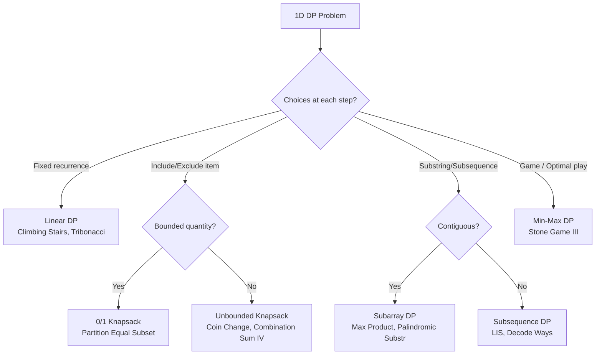

# 1D Dynamic Programming

## Core Intuition
Break a problem into overlapping subproblems. Each state depends on a fixed number of previous states. Ask: "What is the minimum info I need to compute dp[i]?"

- **Linear DP**: dp[i] depends on dp[i-1], dp[i-2], etc.
- **Knapsack**: dp[i] = best result using first i items with capacity constraint
- **Subsequence**: dp[i] = best result ending at index i
- **Palindrome**: expand from center or dp[i][j] collapsed to 1D

## Decision Flowchart

## Problems

### Climbing Stairs — LC 70 | Easy
- **Learn**: Base case setup; dp[i] = dp[i-1] + dp[i-2]
- **Mistake**: Off-by-one on base cases (dp[1]=1, dp[2]=2)
- **Complexity**: O(n) time, O(1) space (two variables)
- **Edge**: n=1 → return 1

---

### Min Cost Climbing Stairs — LC 746 | Easy
- **Learn**: Can start at index 0 or 1; dp[i] = cost[i] + min(dp[i-1], dp[i-2])
- **Mistake**: Forgetting the "free" start; answer is min(dp[n-1], dp[n-2])
- **Complexity**: O(n) time, O(1) space
- **Edge**: Array of length 2

---

### N-th Tribonacci — LC 1137 | Easy
- **Learn**: Three-variable rolling window instead of array
- **Mistake**: Wrong base cases (T0=0, T1=1, T2=1)
- **Complexity**: O(n) time, O(1) space
- **Edge**: n=0 → 0

---

### House Robber — LC 198 | Medium
- **Learn**: dp[i] = max(dp[i-1], dp[i-2] + nums[i]); skip adjacent
- **Mistake**: Using array when two variables suffice
- **Complexity**: O(n) time, O(1) space
- **Edge**: Single house, two houses

---

### House Robber II — LC 213 | Medium
- **Learn**: Circular → run House Robber twice: [0..n-2] and [1..n-1], take max
- **Mistake**: Forgetting that first and last are adjacent
- **Complexity**: O(n) time, O(1) space
- **Edge**: n=1 → return nums[0]

---

### Longest Palindromic Substring — LC 5 | Medium
- **Learn**: Expand-around-center; check odd and even length centers
- **Mistake**: Using O(n²) space DP when O(1) space expand works
- **Complexity**: O(n²) time, O(1) space
- **Edge**: All same characters, single character

---

### Palindromic Substrings — LC 647 | Medium
- **Learn**: Count expansions; each successful expansion = +1
- **Mistake**: Counting only odd-length palindromes
- **Complexity**: O(n²) time, O(1) space
- **Edge**: Empty string → 0

---

### Decode Ways — LC 91 | Medium
- **Learn**: dp[i] = ways to decode s[0..i-1]; check single digit and two-digit validity
- **Mistake**: '0' alone is invalid; "06" is invalid as two-digit
- **Complexity**: O(n) time, O(1) space
- **Edge**: Leading zero, "10", "20", "30"

---

### Coin Change — LC 322 | Medium
- **Learn**: Unbounded knapsack; dp[i] = min coins to make amount i
- **Mistake**: Initializing dp with 0 instead of infinity; forgetting dp[0]=0
- **Complexity**: O(n·amount) time, O(amount) space
- **Edge**: No solution → return -1; amount=0 → 0

---

### Maximum Product Subarray — LC 152 | Medium
- **Learn**: Track both max and min (negative × negative = positive)
- **Mistake**: Only tracking max; missing the min flip on negative numbers
- **Complexity**: O(n) time, O(1) space
- **Edge**: All negatives, single element, zeros reset the product

---

### Word Break — LC 139 | Medium
- **Learn**: dp[i] = can s[0..i-1] be segmented; check all valid word endings
- **Mistake**: Not using a set for O(1) word lookup
- **Complexity**: O(n²·m) time where m = avg word length, O(n) space
- **Edge**: Empty string → true; word longer than s

---

### Longest Increasing Subsequence — LC 300 | Medium
- **Learn**: O(n log n) with patience sorting / binary search on `tails` array
- **Mistake**: Using O(n²) DP when O(n log n) is expected
- **Complexity**: O(n log n) time, O(n) space
- **Edge**: All same elements → LIS = 1; strictly increasing

---

### Partition Equal Subset Sum — LC 416 | Medium
- **Learn**: 0/1 knapsack; can we reach sum/2? Iterate capacity backwards
- **Mistake**: Iterating capacity forward (allows reuse of same item)
- **Complexity**: O(n·sum) time, O(sum) space
- **Edge**: Odd total sum → false immediately; single element

---

### Combination Sum IV — LC 377 | Medium
- **Learn**: Unbounded knapsack counting ordered arrangements (permutations, not combinations)
- **Mistake**: Confusing with Coin Change II (unordered); loop order matters
- **Complexity**: O(n·target) time, O(target) space
- **Edge**: target=0 → 1 (empty combination)

---

### Perfect Squares — LC 279 | Medium
- **Learn**: Unbounded knapsack; dp[i] = min squares summing to i
- **Mistake**: Not precomputing squares; recomputing sqrt each time
- **Complexity**: O(n·√n) time, O(n) space
- **Edge**: n=1 → 1; perfect square input → 1

---

### Integer Break — LC 343 | Medium
- **Learn**: dp[i] = max product splitting i; or math: use 3s greedily
- **Mistake**: Not considering keeping a factor as-is (not splitting further)
- **Complexity**: O(n) time, O(n) space (DP) or O(1) (math)
- **Edge**: n=2 → 1, n=3 → 2

---

### Stone Game III — LC 1406 | Hard
- **Learn**: dp[i] = max score difference (current - opponent) from index i onward; pick 1, 2, or 3 stones
- **Mistake**: Storing absolute scores instead of score difference
- **Complexity**: O(n) time, O(1) space (rolling 3 vars)
- **Edge**: Single stone, all negative values

---

## General Edge Cases
- Empty input / n=0
- Single element arrays
- All elements equal
- Negative numbers (product DP)
- Overflow for large sums (use long if needed)
- Target = 0 (usually base case = 1 or true)
