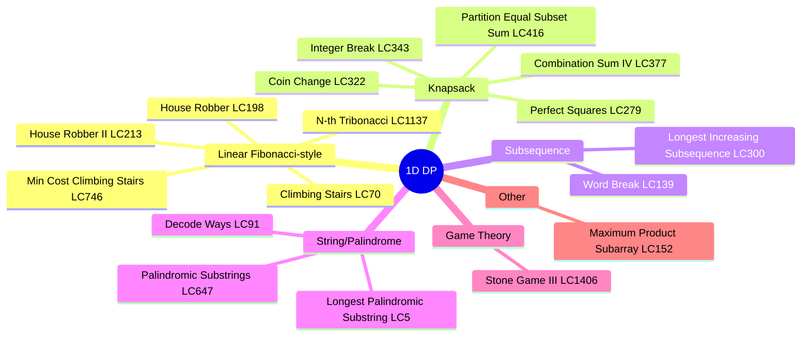
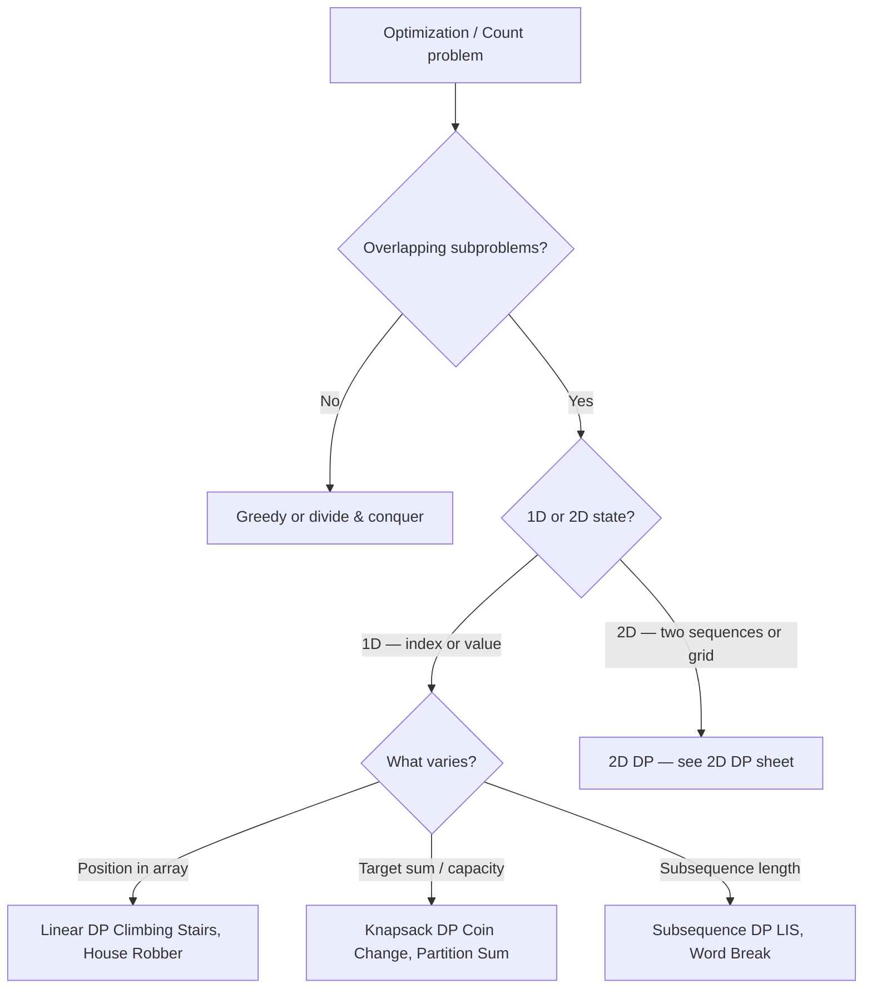
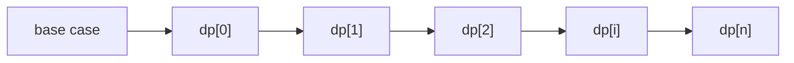
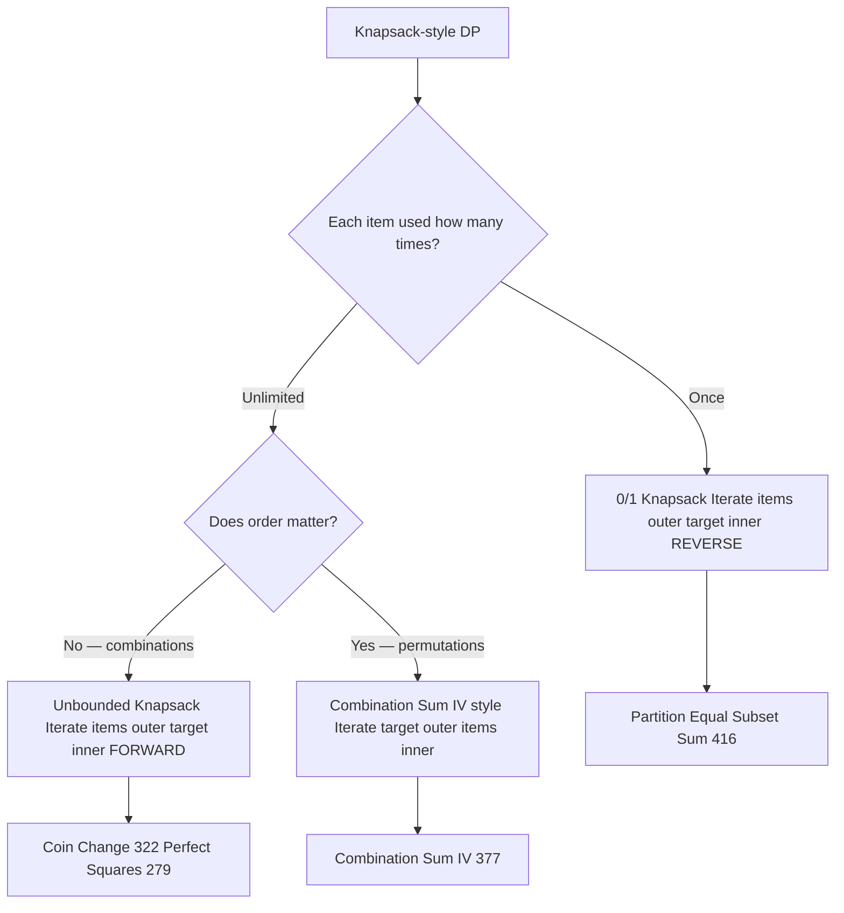
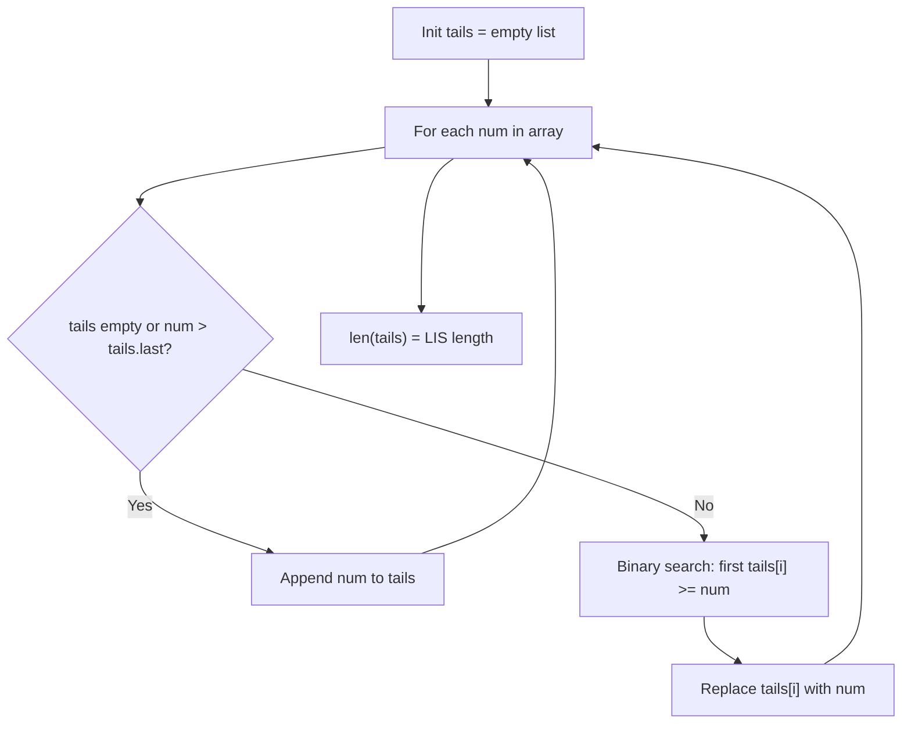

# 1D Dynamic Programming



## Problem List

| # | Problem | LC # | Difficulty | Key Technique |
|---|---------|------|------------|---------------|
| 1 | Climbing Stairs | 70 | Easy | Linear DP (Fibonacci) |
| 2 | Min Cost Climbing Stairs | 746 | Easy | Linear DP |
| 3 | N-th Tribonacci | 1137 | Easy | Linear DP (3 vars) |
| 4 | House Robber | 198 | Medium | Linear DP (skip adjacent) |
| 5 | House Robber II | 213 | Medium | Linear DP (circular, 2 passes) |
| 6 | Longest Palindromic Substring | 5 | Medium | Expand around center |
| 7 | Palindromic Substrings | 647 | Medium | Expand around center |
| 8 | Decode Ways | 91 | Medium | Linear DP (conditional transitions) |
| 9 | Coin Change | 322 | Medium | Unbounded knapsack |
| 10 | Maximum Product Subarray | 152 | Medium | Track min & max |
| 11 | Word Break | 139 | Medium | DP + set lookup |
| 12 | Longest Increasing Subsequence | 300 | Medium | DP / Binary search |
| 13 | Partition Equal Subset Sum | 416 | Medium | 0/1 Knapsack |
| 14 | Combination Sum IV | 377 | Medium | Unbounded knapsack (order matters) |
| 15 | Perfect Squares | 279 | Medium | Unbounded knapsack |
| 16 | Integer Break | 343 | Medium | DP / Math |
| 17 | Stone Game III | 1406 | Hard | Game theory DP |

---

## Patterns & Diagrams

### 1. DP Problem Identification Decision Tree



### 2. State Transition — 1D Linear



### 3. Space Optimization — Array vs 2 Variables

```mermaid
flowchart TD
    A[dp array needed?] --> B{"dp[i] depends on how many prior states?"}
    B -->|Only dp[i-1]| C["1 variable: prev = cur"]
    B -->|"dp[i-1] and dp[i-2]"| D["2 variables: prev2, prev1"]
    B -->|"dp[i-1]...dp[i-k], small k"| E["Rolling array size k"]
    B -->|dp[j] for all j < i| F["Keep full array O(n) space"]

    C --> G["O(1) space"]
    D --> G
    E --> H["O(k) space"]
    F --> I["O(n) space"]
```

### 4. Knapsack Variant Decision Tree



### 5. LIS — Binary Search Approach



---

## Complexity Summary

| Problem | Time | Space | Pattern |
|---------|------|-------|---------|
| climbing_stairs | O(n) | O(1) | Linear DP (Fibonacci) |
| min_cost_climbing_stairs | O(n) | O(1) | Linear DP |
| n_th_tribonacci_number | O(n) | O(1) | Linear DP (3 vars) |
| house_robber | O(n) | O(1) | Linear DP (skip adjacent) |
| house_robber_ii | O(n) | O(1) | Linear DP (circular, 2 passes) |
| longest_palindromic_substring | O(n²) | O(1) | Expand around center |
| palindromic_substrings | O(n²) | O(1) | Expand around center |
| decode_ways | O(n) | O(1) | Linear DP (conditional transitions) |
| coin_change | O(n·target) | O(target) | Unbounded knapsack |
| maximum_product_subarray | O(n) | O(1) | Track min & max |
| word_break | O(n²) | O(n) | DP + set lookup |
| longest_increasing_subsequence | O(n log n) | O(n) | DP / Binary search |
| partition_equal_subset_sum | O(n·target) | O(target) | 0/1 Knapsack |
| combination_sum_iv | O(n·target) | O(target) | Unbounded knapsack (order matters) |
| perfect_squares | O(n·√n) | O(n) | Unbounded knapsack |
| integer_break | O(n²) | O(n) | DP / Math |
| stone_game_iii | O(n) | O(1) | Game theory DP |

---

## Study Order

1. **Fibonacci family** — 70, 746, 1137 (base linear DP)
2. **Skip-adjacent** — 198, 213 (House Robber pattern)
3. **Conditional transitions** — 91 (Decode Ways)
4. **Unbounded knapsack** — 322, 279 (Coin Change)
5. **0/1 knapsack** — 416 (Partition Sum)
6. **Order-matters knapsack** — 377 (Combination Sum IV)
7. **Subsequence DP** — 300, 139 (LIS, Word Break)
8. **Palindrome DP** — 5, 647 (expand around center)
9. **Product DP** — 152 (track min & max)
10. **Game theory** — 1406 (Stone Game III)
