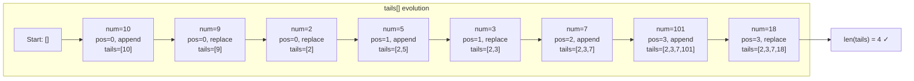

# LC 300: Longest Increasing Subsequence — Patience Sorting Proof

## Problem Statement

Given an integer array `nums`, return the length of the longest strictly increasing subsequence.

**Example:** `nums = [10,9,2,5,3,7,101,18]` → Output: `4` (e.g., `[2,3,7,101]`)

---

## Approach 1: O(n²) DP

### Recurrence

```
dp[i] = length of LIS ending at index i
dp[i] = 1 + max(dp[j] for j < i if nums[j] < nums[i])
```

Base case: `dp[i] = 1` (every element is an LIS of length 1 by itself).

Answer: `max(dp)`

### Why it works

`dp[i]` considers every valid predecessor `j` (where `nums[j] < nums[i]`) and extends the best LIS ending there. Since we process left to right, all `dp[j]` for `j < i` are already computed.

```python
def lengthOfLIS_n2(nums: list[int]) -> int:
    dp = [1] * len(nums)
    for i in range(1, len(nums)):
        for j in range(i):
            if nums[j] < nums[i]:
                dp[i] = max(dp[i], dp[j] + 1)
    return max(dp)
```

**Time:** O(n²) | **Space:** O(n)

---

## Approach 2: O(n log n) — Patience Sorting

### The `tails` Array

Maintain `tails[]` where:

> `tails[i]` = the **smallest possible tail element** of all increasing subsequences of length `i+1` seen so far.

**Invariant:** `tails` is always strictly sorted in increasing order.

### Algorithm

For each `num` in `nums`:
1. Binary search (`bisect_left`) for `num` in `tails` → position `pos`
2. If `pos == len(tails)`: `num` extends the longest subsequence → **append**
3. Else: `tails[pos] = num` → **replace** (found a smaller tail for length `pos+1`)

Answer: `len(tails)`

```python
from bisect import bisect_left

def lengthOfLIS(nums: list[int]) -> int:
    tails = []
    for num in nums:
        pos = bisect_left(tails, num)
        if pos == len(tails):
            tails.append(num)
        else:
            tails[pos] = num
    return len(tails)
```

---

## Proof of Correctness

### Invariant Proof: `tails` is always sorted

**Base case:** Empty `tails` is trivially sorted.

**Inductive step:** Assume `tails` is sorted before processing `num`.
- If we append: `num > tails[-1]` (since `bisect_left` returned `len(tails)`), so sorted order is maintained.
- If we replace at `pos`: `tails[pos-1] < num < tails[pos]` (by binary search property), so replacing `tails[pos]` with `num` preserves sorted order. ∎

### Why Replacing Never Invalidates Existing Subsequences

**Claim:** Setting `tails[pos] = num` (where `num < tails[pos]`) does not destroy any valid subsequence.

**Proof:**
- `tails[pos]` was the smallest tail of some subsequence `S` of length `pos+1`.
- `num` is strictly smaller than `tails[pos]`, so `num` is an equally valid (in fact, **better**) tail for a subsequence of length `pos+1`.
- The subsequence `S` still exists — we haven't removed it. We've only recorded that there's now a **smaller** tail available for length `pos+1`.
- A smaller tail is strictly better: it leaves more room for future elements to extend the subsequence. ∎

### Why `len(tails)` = Length of LIS

**Claim:** At all times, `len(tails)` equals the length of the longest increasing subsequence seen so far.

**Proof by induction on elements processed:**
- After 0 elements: `len(tails) = 0` = LIS length. ✓
- Assume true after `k` elements. Process element `num`:
  - Case 1: `num > tails[-1]` → `num` extends the current LIS → append → `len(tails)` increases by 1 = new LIS length. ✓
  - Case 2: `num` replaces `tails[pos]` → LIS length doesn't change (we found a better tail, not a longer sequence) → `len(tails)` unchanged = LIS length. ✓ ∎

### ⚠️ Important: `tails` is NOT the actual LIS

`tails` is a **virtual** structure. After processing `[10,9,2,5,3,7,101,18]`, `tails = [2,3,7,18]` — this happens to be a valid LIS, but in general it may not be. To reconstruct the actual LIS, you need to track predecessors separately.

---

## Mermaid Diagram: `tails` Evolution for `[10,9,2,5,3,7,101,18]`



### Trace Table

| num | bisect_left pos | action | tails |
|-----|----------------|--------|-------|
| 10 | 0 (empty) | append | [10] |
| 9 | 0 | replace tails[0] | [9] |
| 2 | 0 | replace tails[0] | [2] |
| 5 | 1 | append | [2, 5] |
| 3 | 1 | replace tails[1] | [2, 3] |
| 7 | 2 | append | [2, 3, 7] |
| 101 | 3 | append | [2, 3, 7, 101] |
| 18 | 3 | replace tails[3] | [2, 3, 7, 18] |

**LIS length = 4**

---

## Complexity

| | O(n²) DP | O(n log n) Patience Sort |
|---|---|---|
| **Time** | O(n²) | O(n log n) — binary search per element |
| **Space** | O(n) | O(n) — tails array |

The O(n log n) bound is tight: `bisect_left` is O(log n) and we call it n times.
