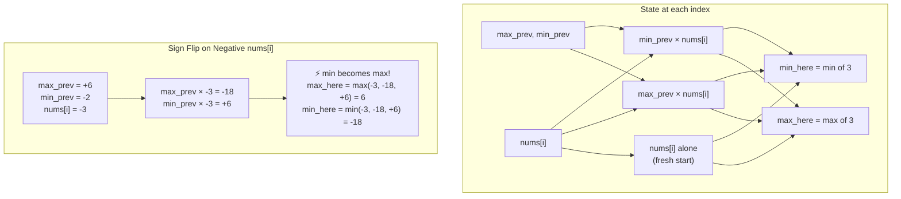

# LC 152: Maximum Product Subarray — Why Track Both Min and Max

## Problem Statement

Given an integer array `nums`, find the contiguous subarray with the largest product and return that product.

**Examples:**
- `nums = [2,3,-2,4]` → Output: `6` (subarray `[2,3]`)
- `nums = [-2,0,-1]` → Output: `0`

---

## Why Kadane's Algorithm (Sum Version) Doesn't Directly Apply

Kadane's for maximum sum works because:
> A negative running sum is always worse than starting fresh.

For products, this breaks down:

> A **negative** running product might become the **maximum** if multiplied by another negative number.

Example: `[-3, -2]` → product = `6`. If we reset at `-3` (it's negative), we'd miss this.

The sign of a product can **flip** with every negative number encountered. We need to track both extremes.

---

## Key Insight: Track Both Min and Max

At each position `i`, the maximum product ending at `i` is one of exactly three candidates:

1. `nums[i]` alone — start a fresh subarray (previous products are harmful)
2. `max_prev * nums[i]` — extend the previous maximum (positive × positive, or negative × negative)
3. `min_prev * nums[i]` — the previous minimum flipped sign (negative × negative = positive)

```
max_here = max(nums[i], max_prev * nums[i], min_prev * nums[i])
min_here = min(nums[i], max_prev * nums[i], min_prev * nums[i])
```

---

## Proof of Completeness

**Claim:** The maximum product of any subarray ending at index `i` is exactly `max(nums[i], max_prev * nums[i], min_prev * nums[i])`.

**Proof:**

Any subarray ending at `i` either:
- **Starts at `i`:** product = `nums[i]` → covered by case 1.
- **Extends a subarray ending at `i-1`:** product = `(product of subarray ending at i-1) * nums[i]`

For the second case, we need the best possible "product of subarray ending at `i-1`". That product is either:
- As large as possible → `max_prev` (to maximize when `nums[i] > 0`, or minimize magnitude when `nums[i] < 0`)
- As small as possible → `min_prev` (to maximize when `nums[i] < 0`, since negative × negative = positive)

**No other value** from subarrays ending at `i-1` can beat both `max_prev` and `min_prev` for the purpose of maximizing the product at `i`:
- If `nums[i] > 0`: we want the largest previous product → `max_prev * nums[i]`
- If `nums[i] < 0`: we want the most negative previous product → `min_prev * nums[i]`
- If `nums[i] = 0`: all extensions give 0, same as starting fresh

Therefore, checking all three candidates is both **necessary and sufficient**. ∎

---

## Mermaid Diagram: Negatives Flip Min ↔ Max



---

## Step-by-Step Walkthrough

### Example 1: `nums = [2, 3, -2, 4]`

| i | nums[i] | max_prev | min_prev | candidates | max_here | min_here | global_max |
|---|---------|----------|----------|------------|----------|----------|------------|
| 0 | 2 | — | — | {2} | 2 | 2 | 2 |
| 1 | 3 | 2 | 2 | {3, 6, 6} | 6 | 3 | 6 |
| 2 | -2 | 6 | 3 | {-2, -12, -6} | -2 | -12 | **6** |
| 3 | 4 | -2 | -12 | {4, -8, -48} | 4 | -48 | **6** |

**Answer: 6** (subarray `[2,3]`)

### Example 2: `nums = [-2, 0, -1]`

| i | nums[i] | max_prev | min_prev | candidates | max_here | min_here | global_max |
|---|---------|----------|----------|------------|----------|----------|------------|
| 0 | -2 | — | — | {-2} | -2 | -2 | -2 |
| 1 | 0 | -2 | -2 | {0, 0, 0} | 0 | 0 | **0** |
| 2 | -1 | 0 | 0 | {-1, 0, 0} | 0 | -1 | **0** |

**Answer: 0** (the zero resets everything; `-2 * -1 = 2` is not contiguous)

---

## Implementation

```python
def maxProduct(nums: list[int]) -> int:
    max_here = min_here = global_max = nums[0]

    for num in nums[1:]:
        # Must compute both before updating (use previous values)
        candidates = (num, max_here * num, min_here * num)
        max_here = max(candidates)
        min_here = min(candidates)
        global_max = max(global_max, max_here)

    return global_max
```

---

## Complexity

| | Value | Justification |
|---|---|---|
| **Time** | O(n) | Single pass, O(1) work per element |
| **Space** | O(1) | Only track max_here, min_here, global_max |

This is optimal — we must examine every element at least once (lower bound Ω(n)).
