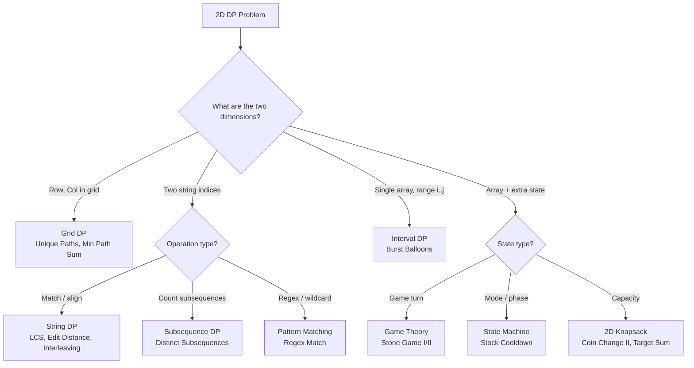

# 2D Dynamic Programming

## Core Intuition
State requires two dimensions — typically two indices into strings/arrays, or row+col in a grid. The recurrence fills a table, often diagonally (interval DP) or row-by-row (grid/string DP).

- **Grid DP**: Move right/down; dp[r][c] from dp[r-1][c] and dp[r][c-1]
- **String matching**: dp[i][j] compares s1[i] with s2[j]
- **Interval DP**: dp[i][j] = optimal over subarray [i..j]; fill by increasing length
- **Game theory**: dp[i][j] = score advantage for current player over [i..j]
- **State machine**: Extra dimension encodes a mode (holding stock, cooldown, etc.)

## Decision Flowchart

## Problems

### Unique Paths — LC 62 | Medium
- **Learn**: dp[r][c] = dp[r-1][c] + dp[r][c-1]; optimize to 1D row
- **Mistake**: Allocating full 2D grid when 1D suffices
- **Complexity**: O(m·n) time, O(n) space
- **Edge**: 1×1 grid → 1; single row/column → 1

---

### Unique Paths II — LC 63 | Medium
- **Learn**: Same as 62 but set dp[r][c]=0 on obstacles
- **Mistake**: Not zeroing out the starting cell if it's an obstacle
- **Complexity**: O(m·n) time, O(n) space
- **Edge**: Obstacle at start or end → 0

---

### Minimum Path Sum — LC 64 | Medium
- **Learn**: dp[r][c] = grid[r][c] + min(dp[r-1][c], dp[r][c-1])
- **Mistake**: Forgetting to initialize first row and column correctly
- **Complexity**: O(m·n) time, O(n) space
- **Edge**: 1×1 grid → grid[0][0]

---

### Longest Common Subsequence — LC 1143 | Medium
- **Learn**: dp[i][j] = LCS of s1[0..i-1] and s2[0..j-1]; match → +1, else max of skip either
- **Mistake**: Confusing LCS (subsequence) with LCS (substring — contiguous)
- **Complexity**: O(m·n) time, O(m·n) or O(n) space
- **Edge**: One empty string → 0; identical strings → length

---

### Last Stone Weight II — LC 1049 | Medium
- **Learn**: Partition into two groups minimizing |S1-S2|; equivalent to 0/1 knapsack targeting sum/2
- **Mistake**: Not recognizing the partition reformulation
- **Complexity**: O(n·sum) time, O(sum) space
- **Edge**: Single stone → that stone's weight

---

### Best Time to Buy/Sell Stock with Cooldown — LC 309 | Medium
- **Learn**: States: holding, sold (cooldown), idle; transition between states
- **Mistake**: Missing the cooldown day between sell and next buy
- **Complexity**: O(n) time, O(1) space
- **Edge**: Single price → 0 profit

---

### Coin Change II — LC 518 | Medium
- **Learn**: Unbounded knapsack counting combinations (unordered); iterate coins in outer loop
- **Mistake**: Swapping loop order → counts permutations instead
- **Complexity**: O(n·amount) time, O(amount) space
- **Edge**: amount=0 → 1; no valid combination → 0

---

### Target Sum — LC 494 | Medium
- **Learn**: Assign + or - to each number; equivalent to subset sum with target (total+target)/2
- **Mistake**: Not checking (total+target) is even and non-negative before DP
- **Complexity**: O(n·sum) time, O(sum) space
- **Edge**: target > total → 0 ways; negative target handled by symmetry

---

### Interleaving String — LC 97 | Medium
- **Learn**: dp[i][j] = can s1[0..i-1] and s2[0..j-1] interleave to form s3[0..i+j-1]
- **Mistake**: Not checking len(s1)+len(s2)==len(s3) upfront
- **Complexity**: O(m·n) time, O(n) space
- **Edge**: Empty s1 or s2 → check if other equals s3

---

### Stone Game — LC 877 | Medium
- **Learn**: dp[i][j] = score advantage for current player over piles[i..j]
- **Mistake**: Storing absolute scores; store difference (current - opponent)
- **Complexity**: O(n²) time, O(n²) space
- **Edge**: Alice always wins (math proof); DP still good to know

---

### Stone Game II — LC 1140 | Medium
- **Learn**: dp[i][m] = max stones current player can get from index i with M=m; update M = max(M, X)
- **Mistake**: Not updating M correctly; forgetting suffix sums
- **Complexity**: O(n²) time, O(n²) space
- **Edge**: Single pile → take it all

---

### Longest Increasing Path in Matrix — LC 329 | Hard
- **Learn**: DFS + memoization; dp[r][c] = longest path starting at (r,c)
- **Mistake**: Treating as standard DP (no cycles possible since strictly increasing)
- **Complexity**: O(m·n) time, O(m·n) space
- **Edge**: 1×1 matrix → 1; all same values → 1

---

### Distinct Subsequences — LC 115 | Hard
- **Learn**: dp[i][j] = ways to form t[0..j-1] from s[0..i-1]; match → dp[i-1][j-1]+dp[i-1][j], else dp[i-1][j]
- **Mistake**: Confusing direction of recurrence; forgetting to carry forward non-match count
- **Complexity**: O(m·n) time, O(n) space
- **Edge**: Empty t → 1; t longer than s → 0

---

### Edit Distance — LC 72 | Medium
- **Learn**: dp[i][j] = min ops to convert word1[0..i-1] to word2[0..j-1]; insert/delete/replace
- **Mistake**: Off-by-one in base cases (dp[i][0]=i, dp[0][j]=j)
- **Complexity**: O(m·n) time, O(n) space
- **Edge**: One empty string → length of other; identical strings → 0

---

### Burst Balloons — LC 312 | Hard
- **Learn**: Interval DP; dp[i][j] = max coins bursting all balloons between i and j; think "last balloon to burst"
- **Mistake**: Thinking "first to burst" (creates dependency); "last to burst" is clean
- **Complexity**: O(n³) time, O(n²) space
- **Edge**: Single balloon; add sentinel 1s at boundaries

---

### Regular Expression Matching — LC 10 | Hard
- **Learn**: dp[i][j] = does s[0..i-1] match p[0..j-1]; '*' means 0 or more of preceding char
- **Mistake**: Handling '*' — it can match zero occurrences (dp[i][j-2]) or one more (dp[i-1][j])
- **Complexity**: O(m·n) time, O(m·n) space
- **Edge**: Empty pattern matches only empty string; ".*" matches everything

---

## General Edge Cases
- Empty strings (base cases dp[0][j] and dp[i][0])
- Single row/column grids
- Strings of length 1
- Overflow when counting paths (use modulo if required)
- Parity checks before DP (Target Sum, Last Stone II)
