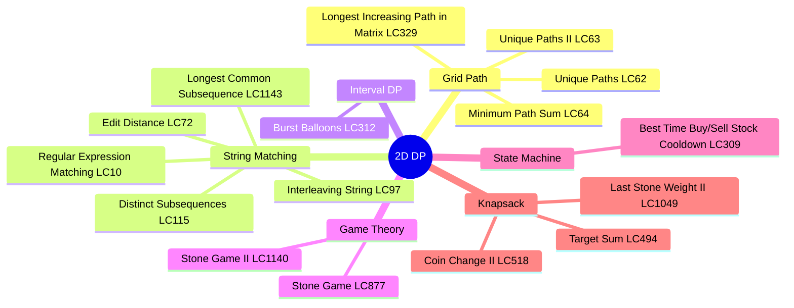
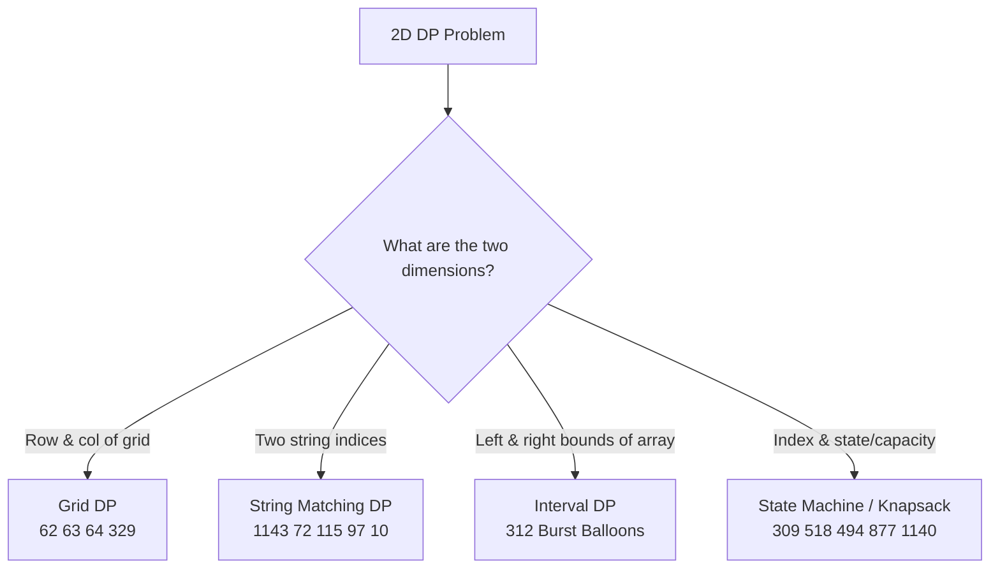
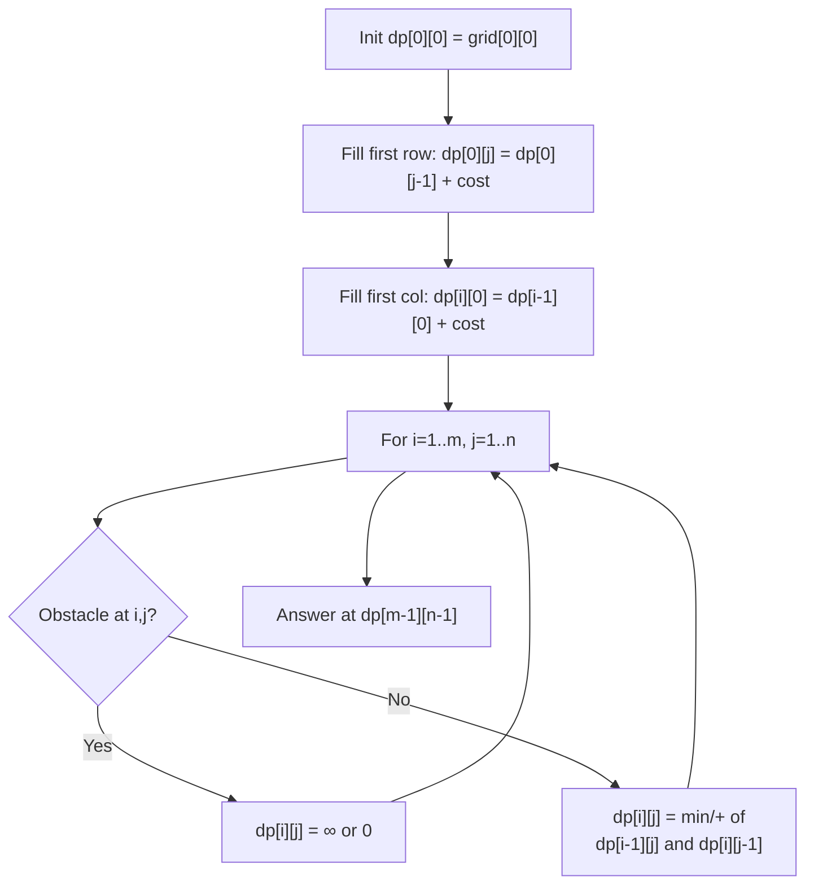
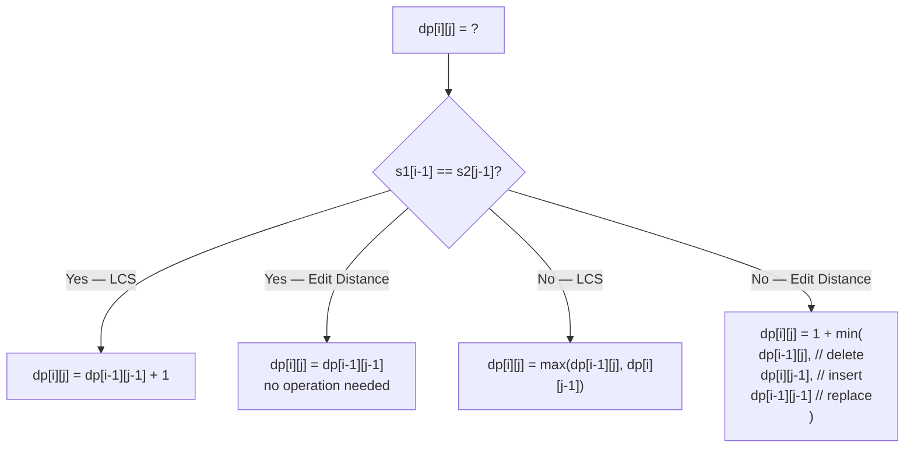
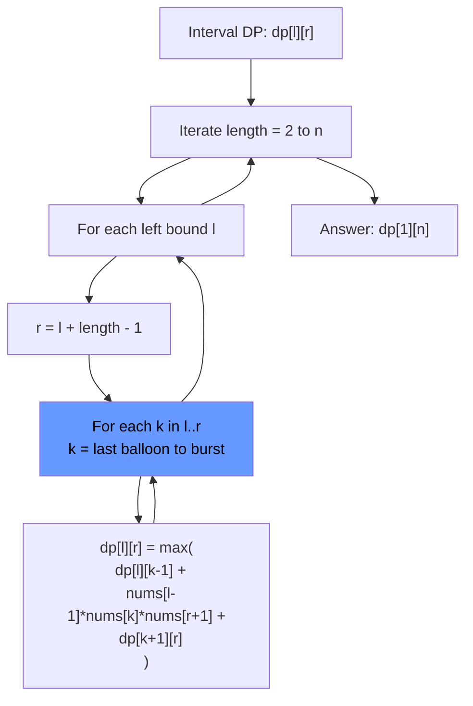
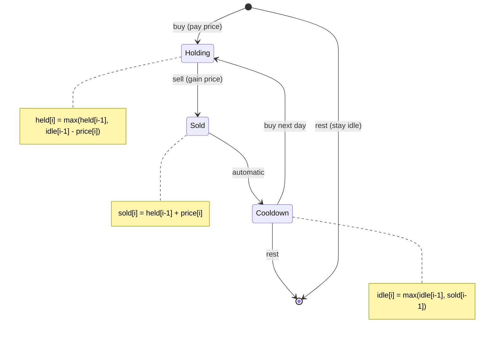

# 2D Dynamic Programming

## Problem List

| # | Problem | LC # | Difficulty | Key Technique |
|---|---------|------|------------|---------------|
| 1 | Unique Paths | 62 | Medium | Grid DP |
| 2 | Unique Paths II | 63 | Medium | Grid DP with obstacles |
| 3 | Minimum Path Sum | 64 | Medium | Grid DP |
| 4 | Longest Common Subsequence | 1143 | Medium | String matching DP |
| 5 | Last Stone Weight II | 1049 | Medium | 0/1 Knapsack |
| 6 | Best Time Buy/Sell Stock Cooldown | 309 | Medium | State machine DP |
| 7 | Coin Change II | 518 | Medium | Unbounded knapsack (2D→1D) |
| 8 | Target Sum | 494 | Medium | 0/1 Knapsack |
| 9 | Interleaving String | 97 | Medium | 2D string DP |
| 10 | Stone Game | 877 | Medium | Game theory DP |
| 11 | Stone Game II | 1140 | Medium | Game theory DP |
| 12 | Longest Increasing Path in Matrix | 329 | Hard | DFS + memoization on grid |
| 13 | Distinct Subsequences | 115 | Hard | String matching DP |
| 14 | Edit Distance | 72 | Medium | String matching DP |
| 15 | Burst Balloons | 312 | Hard | Interval DP |
| 16 | Regular Expression Matching | 10 | Hard | String matching DP |

---

## Patterns & Diagrams

### 1. 2D DP Categories

### 2. Grid DP State Transition

### 3. String Matching DP — LCS / Edit Distance Cell Logic

### 4. Interval DP Pattern — Burst Balloons

### 5. State Machine DP — Buy/Sell with Cooldown

---

## Complexity Summary

| Problem | Time | Space | Pattern |
|---------|------|-------|---------|
| unique_paths | O(m×n) | O(n) | Grid DP |
| unique_paths_ii | O(m×n) | O(n) | Grid DP with obstacles |
| minimum_path_sum | O(m×n) | O(n) | Grid DP |
| longest_common_subsequence | O(m×n) | O(n) | String matching DP |
| last_stone_weight_ii | O(n·sum) | O(sum) | 0/1 Knapsack |
| best_time_to_buy_and_sell_stock_with_cooldown | O(n) | O(1) | State machine DP |
| coin_change_ii | O(n·amount) | O(amount) | Unbounded knapsack |
| target_sum | O(n·sum) | O(sum) | 0/1 Knapsack |
| interleaving_string | O(m×n) | O(n) | 2D string DP |
| stone_game | O(n) | O(1) | Game theory DP |
| stone_game_ii | O(n²) | O(n²) | Game theory DP |
| longest_increasing_path_in_a_matrix | O(m×n) | O(m×n) | DFS + memoization |
| distinct_subsequences | O(m×n) | O(n) | String matching DP |
| edit_distance | O(m×n) | O(n) | String matching DP |
| burst_balloons | O(n³) | O(n²) | Interval DP |
| regular_expression_matching | O(m×n) | O(n) | String matching DP |

---

## Study Order

1. **Grid DP basics** — 62, 63, 64 (path counting / min cost)
2. **String matching** — 1143 (LCS), 72 (Edit Distance)
3. **String matching hard** — 115 (Distinct Subseq), 97 (Interleaving), 10 (Regex)
4. **Knapsack in 2D** — 518 (Coin Change II), 494 (Target Sum), 1049 (Last Stone)
5. **State machine** — 309 (Stock Cooldown)
6. **Game theory** — 877, 1140 (Stone Game I & II)
7. **Grid DFS + memo** — 329 (Longest Increasing Path)
8. **Interval DP** — 312 (Burst Balloons — hardest)
