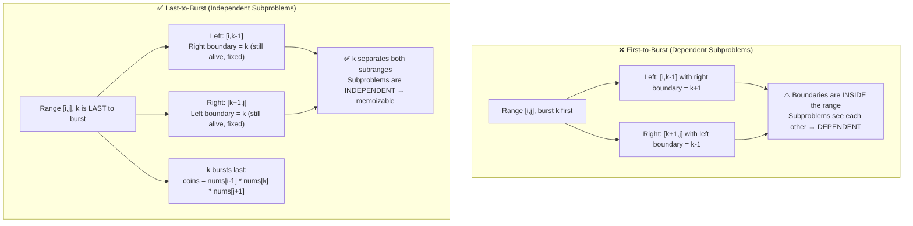

# LC 312: Burst Balloons — Interval DP "Last to Burst" Insight

## Problem Statement

Given `n` balloons indexed `0` to `n-1`. Each balloon has a number `nums[i]`. Bursting balloon `i` earns `nums[i-1] * nums[i] * nums[i+1]` coins (neighbors at time of burst). Burst all balloons to maximize coins.

Boundary condition: treat `nums[-1] = nums[n] = 1`.

**Example:** `nums = [3,1,5,8]` → Output: `167`

---

## Why "First to Burst" Fails

The natural instinct is to try every balloon as the **first** to burst in a range. This fails because:

> When balloon `k` bursts first in `[i,j]`, its neighbors become `i-1` and `j+1` — but those are **outside** the range. The remaining subproblems `[i..k-1]` and `[k+1..j]` now share a **changed boundary** (they see each other as neighbors), making them **dependent**.

```
First-to-burst attempt for [i, j]:
  Burst k first → coins = nums[i-1] * nums[k] * nums[j+1]  ✗ WRONG
  Now [i..k-1] has right boundary = k+1 (which is inside [i,j])
  And [k+1..j] has left boundary = k-1 (which is inside [i,j])
  → Subproblems are NOT independent → can't memoize separately
```

---

## The Key Insight: Think "Last to Burst"

**If `k` is the LAST balloon to burst in range `[i,j]`:**

- When `k` finally bursts, ALL other balloons in `[i,j]` are already gone
- Its only neighbors are `nums[i-1]` (left outer boundary) and `nums[j+1]` (right outer boundary)
- Subrange `[i..k-1]` was solved with `k` as its **right boundary** (k is still alive during that phase)
- Subrange `[k+1..j]` was solved with `k` as its **left boundary** (k is still alive during that phase)
- → Both subproblems are **completely independent**

### Recurrence

```
dp[i][j] = max over k in [i,j] of:
    dp[i][k-1] + nums[i-1]*nums[k]*nums[j+1] + dp[k+1][j]
```

Where `nums` is padded: `nums = [1] + original + [1]`

---

## Proof of Independence

**Claim:** When `k` is last to burst in `[i,j]`, subproblems `[i,k-1]` and `[k+1,j]` are independent.

**Proof:**
1. During the solving of `[i,k-1]`, balloon `k` is still present (it's last to burst in `[i,j]`).
   - So every balloon in `[i,k-1]` sees `k` as its right outer boundary → fixed, known value.
2. During the solving of `[k+1,j]`, balloon `k` is still present.
   - So every balloon in `[k+1,j]` sees `k` as its left outer boundary → fixed, known value.
3. No balloon in `[i,k-1]` ever interacts with any balloon in `[k+1,j]` because `k` separates them throughout.
4. Therefore `dp[i][k-1]` and `dp[k+1][j]` can be computed independently. ∎

---

## Mermaid Diagram: First-to-Burst vs Last-to-Burst



---

## Step-by-Step Walkthrough: `nums = [3,1,5,8]`

Padded: `nums = [1, 3, 1, 5, 8, 1]` (indices 0..5, balloons at 1..4)

We compute `dp[i][j]` for all subranges, bottom-up by length.

### Length 1 subranges

| dp[i][j] | k | Coins |
|----------|---|-------|
| dp[1][1] | 1 | nums[0]*nums[1]*nums[2] = 1*3*1 = **3** |
| dp[2][2] | 2 | nums[1]*nums[2]*nums[3] = 3*1*5 = **15** |
| dp[3][3] | 3 | nums[2]*nums[3]*nums[4] = 1*5*8 = **40** |
| dp[4][4] | 4 | nums[3]*nums[4]*nums[5] = 5*8*1 = **40** |

### Length 2 subranges

**dp[1][2]:** try k=1 and k=2
- k=1: dp[1][0] + nums[0]*nums[1]*nums[3] + dp[2][2] = 0 + 1*3*5 + 15 = **30**
- k=2: dp[1][1] + nums[0]*nums[2]*nums[3] + dp[3][2] = 3 + 1*1*5 + 0 = **8**
- dp[1][2] = **30**

**dp[2][3]:** try k=2 and k=3
- k=2: dp[2][1] + nums[1]*nums[2]*nums[4] + dp[3][3] = 0 + 3*1*8 + 40 = **64**
- k=3: dp[2][2] + nums[1]*nums[3]*nums[4] + dp[4][3] = 15 + 3*5*8 + 0 = **135**
- dp[2][3] = **135**

**dp[3][4]:** try k=3 and k=4
- k=3: dp[3][2] + nums[2]*nums[3]*nums[5] + dp[4][4] = 0 + 1*5*1 + 40 = **45**
- k=4: dp[3][3] + nums[2]*nums[4]*nums[5] + dp[5][4] = 40 + 1*8*1 + 0 = **48**
- dp[3][4] = **48**

### Length 3 subranges

**dp[1][3]:** try k=1,2,3
- k=1: 0 + 1*3*8 + dp[2][3] = 24 + 135 = **159**
- k=2: dp[1][1] + 1*1*8 + dp[3][3] = 3 + 8 + 40 = **51**
- k=3: dp[1][2] + 1*5*8 + 0 = 30 + 40 = **70**
- dp[1][3] = **159**

**dp[2][4]:** try k=2,3,4
- k=2: 0 + 3*1*1 + dp[3][4] = 3 + 48 = **51**
- k=3: dp[2][2] + 3*5*1 + dp[4][4] = 15 + 15 + 40 = **70**
- k=4: dp[2][3] + 3*8*1 + 0 = 135 + 24 = **159**
- dp[2][4] = **159**

### Full range dp[1][4]

try k=1,2,3,4:
- k=1: 0 + 1*3*1 + dp[2][4] = 3 + 159 = **162**
- k=2: dp[1][1] + 1*1*1 + dp[3][4] = 3 + 1 + 48 = **52**
- k=3: dp[1][2] + 1*5*1 + dp[4][4] = 30 + 5 + 40 = **75**
- k=4: dp[1][3] + 1*8*1 + 0 = 159 + 8 = **167** ✓

**Answer: 167**

---

## Implementation

```python
def maxCoins(nums: list[int]) -> int:
    nums = [1] + nums + [1]
    n = len(nums)
    dp = [[0] * n for _ in range(n)]

    for length in range(1, n - 1):          # subrange length
        for i in range(1, n - length):       # start of subrange
            j = i + length - 1              # end of subrange
            for k in range(i, j + 1):       # k is last to burst
                coins = nums[i-1] * nums[k] * nums[j+1]
                dp[i][j] = max(dp[i][j], dp[i][k-1] + coins + dp[k+1][j])

    return dp[1][n-2]
```

---

## Complexity

| | Value | Justification |
|---|---|---|
| **Time** | O(n³) | O(n²) subranges × O(n) choices for k |
| **Space** | O(n²) | dp table |

The O(n³) is tight — every triple (i, k, j) with i ≤ k ≤ j is visited exactly once.
