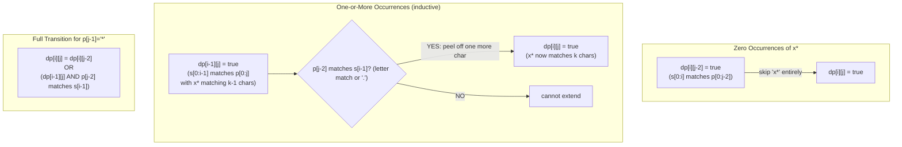

# LC 10: Regular Expression Matching — DP Transitions for `*`

## Problem Statement

Given string `s` and pattern `p` (with `.` matching any single character and `*` matching zero or more of the preceding element), return `true` if `p` matches `s` entirely.

**Example:** `s = "aab"`, `p = "c*a*b"` → `true`
(`c*` matches 0 c's, `a*` matches 2 a's, `b` matches `b`)

---

## DP State Definition

```
dp[i][j] = true if s[0:i] matches p[0:j]
```

- `dp[0][0] = true` (empty string matches empty pattern)
- `dp[i][0] = false` for `i > 0` (non-empty string can't match empty pattern)
- `dp[0][j]`: only `true` if `p[0:j]` can match empty string (e.g., `a*`, `a*b*`, ...)

---

## Transitions

### Case 1: `p[j-1]` is a letter or `.`

```
dp[i][j] = dp[i-1][j-1]  AND  (p[j-1] == s[i-1]  OR  p[j-1] == '.')
```

Simple: the last characters must match, and the rest must match.

### Case 2: `p[j-1] == '*'` — The Hard Case

`*` means "zero or more of `p[j-2]`". Two sub-cases:

**Zero occurrences** (skip the `x*` pair entirely):
```
dp[i][j] |= dp[i][j-2]
```

**One or more occurrences** (use `*` to match `s[i-1]`):
```
dp[i][j] |= dp[i-1][j]   IF  (p[j-2] == s[i-1]  OR  p[j-2] == '.')
```

---

## The Critical Question: Why `dp[i-1][j]` and Not `dp[i-1][j-2]`?

This is the most confusing part. Let's be precise.

### What `dp[i-1][j-2]` would mean:
> `s[0:i-1]` matches `p[0:j-2]` — the `x*` pattern matched exactly **one** character.

This only handles the "exactly one occurrence" case.

### What `dp[i-1][j]` means:
> `s[0:i-1]` matches `p[0:j]` — the `x*` pattern is **still active** and has already matched some characters.

By referencing `dp[i-1][j]` (same `j`!), we're saying: "the pattern `p[0:j]` (which ends in `x*`) already matched `s[0:i-1]`, and now we're adding one more `s[i-1]` that also matches `x`."

This single transition handles **all** counts (1, 2, 3, ...) through **induction**:
- `dp[i-1][j]` encodes "matched 0, 1, 2, ..., or k-1 characters with `x*`"
- Adding one more character gives "matched 1, 2, 3, ..., or k characters"

---

## Proof by Induction: `*` Matching k Characters

**Claim:** `dp[i][j]` is `true` when `x*` matches exactly `k` characters iff `dp[i-k][j-2]` is `true` and `s[i-k:i]` are all `x`.

**Proof:**

Base case (k=0): `dp[i][j] = dp[i][j-2]` — zero occurrences, skip `x*`. ✓

Inductive step: Assume `dp[i-1][j]` correctly encodes "x* matched k-1 characters from `s[0:i-1]`".

Now for `dp[i][j]` with `x*` matching k characters:
- We need `s[i-1]` to match `x` (i.e., `p[j-2] == s[i-1]` or `p[j-2] == '.'`)
- And `s[0:i-1]` to match `p[0:j]` with `x*` matching k-1 characters → that's `dp[i-1][j]`

So `dp[i][j] = dp[i-1][j]` when `s[i-1]` matches `p[j-2]`. ✓

By induction, `dp[i-1][j]` propagates through all k steps, encoding all counts from 0 to k. ∎

---

## Mermaid Diagram: DP Transitions for `*`



---

## Step-by-Step Walkthrough: `s = "aab"`, `p = "c*a*b"`

Grid: rows = s indices (0..3), cols = p indices (0..5)

```
     ""  c   *   a   *   b
""  [ T   F   T   F   T   F ]
a   [ F   F   F   T   T   F ]
a   [ F   F   F   F   T   F ]
b   [ F   F   F   F   F   T ]
```

Key cells explained:

- `dp[0][2]`: `p[1]='*'`, zero occurrences → `dp[0][0] = T` ✓
- `dp[0][4]`: `p[3]='*'`, zero occurrences → `dp[0][2] = T` ✓
- `dp[1][3]`: `p[2]='a'`, matches `s[0]='a'` → `dp[0][2] = T` ✓
- `dp[1][4]`: `p[3]='*'`, zero occ → `dp[1][2]=F`; one+ occ: `dp[0][4]=T` AND `p[2]='a'` matches `s[0]='a'` → **T** ✓
- `dp[2][4]`: `p[3]='*'`, zero occ → `dp[2][2]=F`; one+ occ: `dp[1][4]=T` AND `p[2]='a'` matches `s[1]='a'` → **T** ✓
- `dp[3][5]`: `p[4]='b'`, matches `s[2]='b'` → `dp[2][4]=T` → **T** ✓

**Answer: `dp[3][5] = true`** ✓

---

## Implementation

```python
def isMatch(s: str, p: str) -> bool:
    m, n = len(s), len(p)
    dp = [[False] * (n + 1) for _ in range(m + 1)]
    dp[0][0] = True

    # Handle patterns like a*, a*b*, a*b*c* matching empty string
    for j in range(2, n + 1):
        if p[j-1] == '*':
            dp[0][j] = dp[0][j-2]

    for i in range(1, m + 1):
        for j in range(1, n + 1):
            if p[j-1] == '*':
                # Zero occurrences
                dp[i][j] = dp[i][j-2]
                # One or more occurrences
                if p[j-2] == s[i-1] or p[j-2] == '.':
                    dp[i][j] = dp[i][j] or dp[i-1][j]
            elif p[j-1] == s[i-1] or p[j-1] == '.':
                dp[i][j] = dp[i-1][j-1]

    return dp[m][n]
```

---

## Complexity

| | Value | Justification |
|---|---|---|
| **Time** | O(m × n) | Fill every cell of the dp table once |
| **Space** | O(m × n) | dp table; reducible to O(n) with rolling array |

Where `m = len(s)`, `n = len(p)`.
