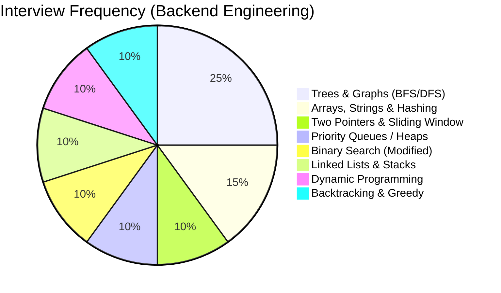
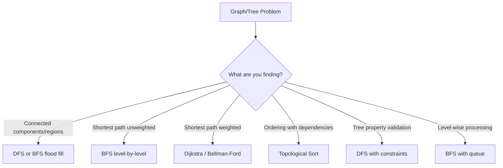
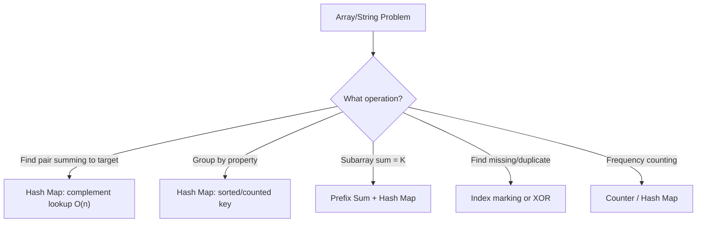
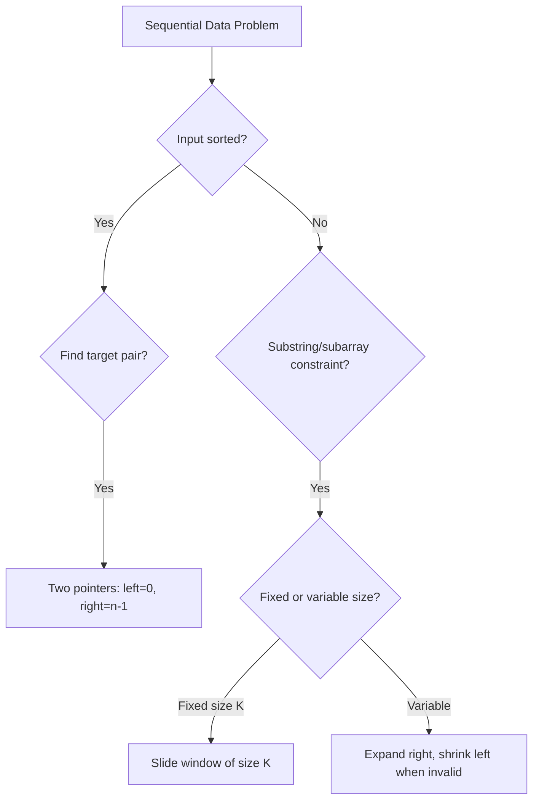
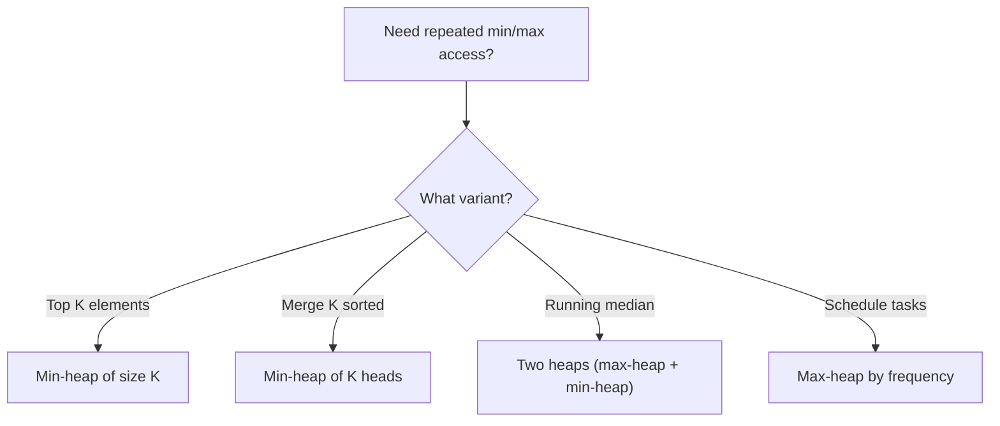
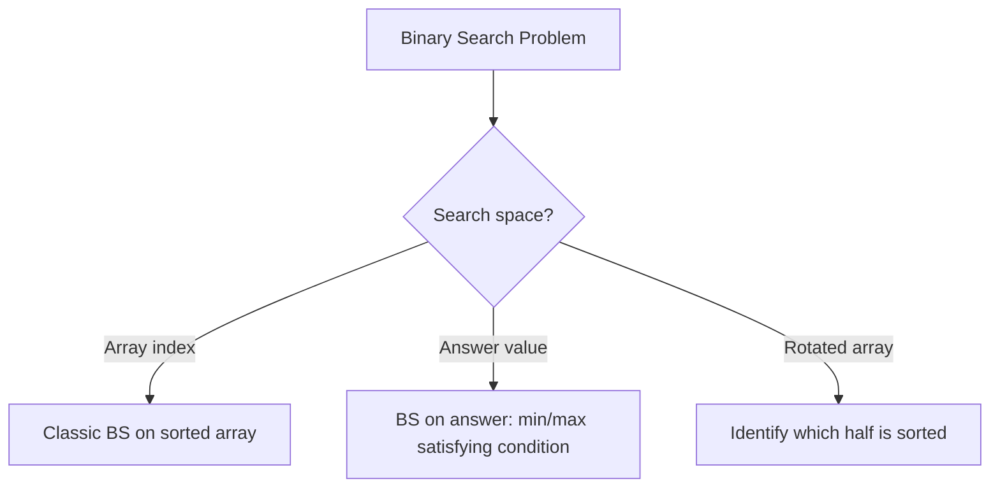
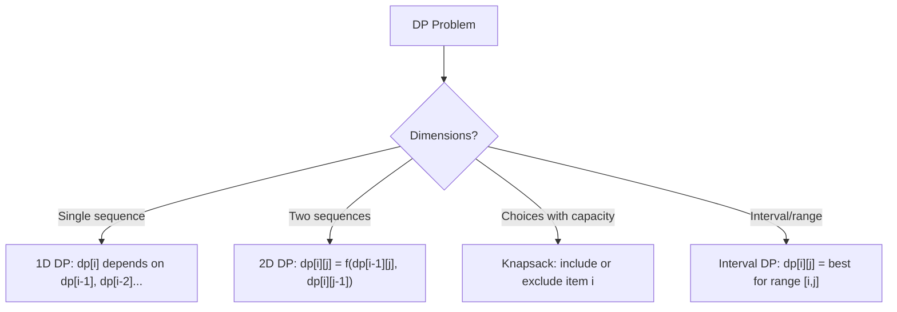
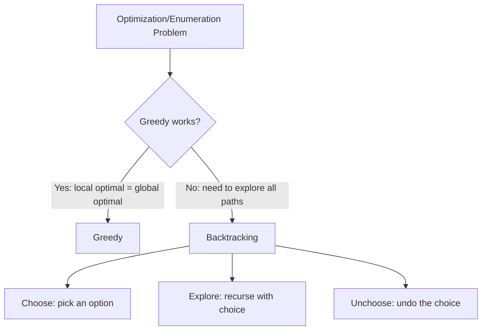

# AlgoAtlas — Frequency-Based Learning Roadmap

> Structured for **learning**, not just listing. Each pattern has: core intuition, when to recognize it, Mermaid diagrams, and problem-by-problem notes.

---

## 📊 Interview Frequency Map



---

## 🧠 How to Use This Roadmap

1. **Study in phase order** — Phase 1 covers 50% of interview questions
2. **Read the pattern notes** — `[pattern]/README.md` for diagrams, `NOTES.md` for per-problem tips
3. **Solve problems** — each lives in `[pattern]/code/[problem_name]/solution.py`
4. **Check proofs** — extraordinary problems have `README.md` in their folder
5. **Reference algorithms** — `algorithms/` has clean implementations of all classic algorithms
6. **Python tricks** — `utilities/README.md` for bisect, heapq, collections cheat sheet

---

## ▶️ Running & Testing

- **Requirements:** Python 3.10+ — solutions use only the standard library (no third-party runtime deps).
- **Run one solution:** `python3 <pattern>/code/<problem>/solution.py` — most files carry `assert`-based self-tests in their `if __name__ == "__main__":` block and print `All tests passed.` on success.
- **Run the whole suite:** install the dev tooling and invoke pytest from the repo root:

```bash
python3 -m venv .venv && source .venv/bin/activate
pip install -r requirements-dev.txt
pytest            # discovers and executes every solution.py
```

CI runs the same suite on Python 3.10–3.13 via GitHub Actions (`.github/workflows/tests.yml`).

---

# Phase 1: The Core 50%

---

## 🌳 Trees & Graphs — ~25% of all questions

### Pattern Notes

**Core Insight:** Most tree/graph problems reduce to "visit nodes in some order and track state."

**Recognition Signals:**
- Grid with connected components → BFS/DFS
- Dependencies between tasks → Topological Sort
- Shortest path → BFS (unweighted) or Dijkstra (weighted)
- Hierarchical data → Tree traversal



**Template — BFS on Grid:**
```python
def bfs(grid, start_r, start_c):
    queue = deque([(start_r, start_c)])
    visited = {(start_r, start_c)}
    while queue:
        r, c = queue.popleft()
        for dr, dc in [(0,1),(0,-1),(1,0),(-1,0)]:
            nr, nc = r+dr, c+dc
            if 0<=nr<rows and 0<=nc<cols and (nr,nc) not in visited:
                visited.add((nr, nc))
                queue.append((nr, nc))
```

### Problem Priority (by frequency)

| Pri | Problem | LC # | Key Learning |
|-----|---------|------|-------------|
| 🔴 | Number of Islands | 200 | BFS/DFS flood fill on grid |
| 🔴 | Course Schedule | 207 | Cycle detection = topological sort |
| 🔴 | Level Order Traversal | 102 | BFS template with level grouping |
| 🔴 | Validate BST | 98 | DFS with (min, max) range |
| 🔴 | Clone Graph | 133 | DFS/BFS + hash map old→new |
| 🟠 | Rotting Oranges | 994 | Multi-source BFS |
| 🟠 | Course Schedule II | 210 | Topological sort returning order |
| 🟠 | LCA of BST | 235 | Exploit BST split point |
| 🟠 | Right Side View | 199 | BFS: last node at each level |
| 🟠 | Word Ladder | 127 | BFS on implicit graph |
| 🟠 | Network Delay Time | 743 | Dijkstra's algorithm |
| 🟡 | Pacific Atlantic | 417 | Reverse BFS from both oceans |
| 🟡 | Serialize/Deserialize Tree | 297 | BFS or preorder DFS |
| 🟡 | Max Path Sum | 124 | DFS returning max single-branch |
| 🟡 | Alien Dictionary | 269 | Build graph + topo sort |

📁 **Folders:** `trees/` (46 problems), `graphs/` (28 problems), `advanced_graphs/` (20 problems)

---

## #️⃣ Arrays, Strings & Hashing — ~15% of all questions

### Pattern Notes

**Core Insight:** "Can I trade space for time?" — Almost always yes, using a hash map.



**Key Insight — Prefix Sum:**
```
subarray_sum(i, j) = prefix[j+1] - prefix[i]
If prefix[j] - K exists in seen → there's a subarray summing to K
```

### Problem Priority (by frequency)

| Pri | Problem | LC # | Key Learning |
|-----|---------|------|-------------|
| 🔴 | Two Sum | 1 | Hash map complement lookup |
| 🔴 | Group Anagrams | 49 | Key design: sorted string or char count |
| 🔴 | Longest Consecutive Sequence | 128 | Hash set + only start from beginnings |
| 🔴 | Subarray Sum Equals K | 560 | Prefix sum + hash map |
| 🟠 | Product Except Self | 238 | Left pass × right pass |
| 🟠 | Top K Frequent | 347 | Bucket sort by frequency = O(n) |
| 🟠 | Valid Sudoku | 36 | Three hash sets: row, col, box |
| 🟡 | First Missing Positive | 41 | Index marking |

📁 **Folders:** `arrays_and_hashing/` (22 problems), `strings/` (18 problems)

---

## 👆 Two Pointers & Sliding Window — ~10% of all questions

### Pattern Notes

**Core Insight:** Avoid nested loops by maintaining a "window" or "two boundaries."



**Template — Variable Sliding Window:**
```python
left = 0
window = {}
for right in range(len(s)):
    window[s[right]] = window.get(s[right], 0) + 1
    while window_is_invalid():
        window[s[left]] -= 1
        left += 1
    result = max(result, right - left + 1)
```

### Problem Priority (by frequency)

| Pri | Problem | LC # | Key Learning |
|-----|---------|------|-------------|
| 🔴 | 3Sum | 15 | Sort + fix one, two-pointer on rest |
| 🔴 | Min Window Substring | 76 | Expand until valid, shrink until invalid |
| 🔴 | Longest Substr No Repeat | 3 | Window with hash set |
| 🟠 | Container Most Water | 11 | Move shorter side |
| 🟠 | Trapping Rain Water | 42 | Two pointers tracking left/right max |
| 🟠 | Sliding Window Maximum | 239 | Monotonic deque |

📁 **Folders:** `two_pointers/` (13 problems), `sliding_window/` (18 problems)

---

# Phase 2: The Infrastructure Set (~30%)

---

## ⏫ Priority Queues / Heaps — ~10% of all questions



| Pri | Problem | LC # | Key Learning |
|-----|---------|------|-------------|
| 🔴 | Merge K Sorted Lists | 23 | Min-heap of K list heads |
| 🔴 | Find Median from Stream | 295 | Two heaps: lower half + upper half |
| 🟠 | Task Scheduler | 621 | Max-heap + cooldown queue |
| 🟠 | Kth Largest in Array | 215 | Min-heap of size K or quickselect |

📁 **Folder:** `heap/` (12 problems)

---

## 🔍 Binary Search — ~10% of all questions



**Template — Binary Search on Answer:**
```python
def binary_search_on_answer(lo, hi):
    while lo < hi:
        mid = (lo + hi) // 2
        if is_feasible(mid):
            hi = mid
        else:
            lo = mid + 1
    return lo
```

| Pri | Problem | LC # | Key Learning |
|-----|---------|------|-------------|
| 🔴 | Search in Rotated Sorted Array | 33 | Identify sorted half |
| 🔴 | Koko Eating Bananas | 875 | BS on answer space |
| 🔴 | Median of Two Sorted Arrays | 4 | BS on partition point |

📁 **Folder:** `binary_search/` (14 problems)

---

## 🔗 Linked Lists & Stacks — ~10% of all questions

| Pri | Problem | LC # | Key Learning |
|-----|---------|------|-------------|
| 🔴 | Reverse Linked List | 206 | Fundamental pointer manipulation |
| 🔴 | LRU Cache | 146 | DLL + HashMap = O(1) get/put |
| 🔴 | Daily Temperatures | 739 | Monotonic decreasing stack |
| 🟠 | Reverse Nodes in K-Group | 25 | Count K, reverse, connect |
| 🟠 | Largest Rectangle Histogram | 84 | Monotonic stack boundaries |

📁 **Folders:** `linked_list/` (14 problems), `stack/` (14 problems)

---

# Phase 3: The Differentiators (~20%)

---

## 📐 Dynamic Programming — ~10% of all questions



**Framework:**
1. **Define state:** What does `dp[i]` represent?
2. **Recurrence:** How does `dp[i]` relate to previous states?
3. **Base case:** What's `dp[0]`?
4. **Order:** Fill left→right? bottom→up?
5. **Optimize space:** Can you use O(1)?

| Pri | Problem | LC # | Key Learning |
|-----|---------|------|-------------|
| 🔴 | Coin Change | 322 | Unbounded knapsack |
| 🔴 | LCS | 1143 | 2D DP: match → diagonal+1 |
| 🔴 | LIS | 300 | O(n²) DP or O(n log n) patience sort |
| 🟠 | House Robber | 198 | `dp[i] = max(dp[i-1], dp[i-2]+nums[i])` |
| 🟠 | Edit Distance | 72 | 3 operations → min of 3 subproblems |
| 🟡 | Burst Balloons | 312 | "Last to burst" interval DP |

📁 **Folders:** `1d_dp/` (17 problems), `2d_dp/` (16 problems)

---

## 🔄 Backtracking & Greedy — ~10% of all questions



| Pri | Problem | LC # | Key Learning |
|-----|---------|------|-------------|
| 🔴 | Word Search | 79 | Grid backtracking with visited marking |
| 🔴 | Merge Intervals | 56 | Sort by start, merge overlapping |
| 🔴 | Combination Sum | 39 | Backtrack with reuse |
| 🟠 | N-Queens | 51 | Row-by-row, track cols/diagonals |
| 🟠 | Jump Game | 55 | Greedy: track farthest reachable |

📁 **Folders:** `backtracking/` (22 problems), `greedy/` (14 problems), `intervals/` (7 problems)

---

## 📅 8-Week Study Plan

```mermaid
gantt
    title Frequency-Optimized Study Plan
    dateFormat X
    axisFormat Week %s

    section Phase 1 (50%)
    Trees & Graphs P0       :a1, 1, 2
    Trees & Graphs P1+P2    :a2, 2, 3
    Arrays/Hashing          :a3, 3, 4
    Two Pointers + Window   :a4, 4, 5

    section Phase 2 (30%)
    Heaps + Binary Search   :b1, 5, 6
    Linked Lists + Stacks   :b2, 6, 7

    section Phase 3 (20%)
    Dynamic Programming     :c1, 7, 8
    Backtracking + Greedy   :c2, 8, 9
```



---

## 🗂️ Directory Structure

```
dsa/
├── README.md                          ← YOU ARE HERE
├── utilities/README.md                ← Python DSA cheat sheet
├── algorithms/                        ← Reference implementations (25 files)
│   ├── sorting/                       (merge, quick, heap, counting, bucket)
│   ├── searching/                     (binary search, quickselect)
│   ├── graphs/                        (BFS, DFS, Dijkstra, Bellman-Ford, topo sort, union-find, MST)
│   ├── trees/                         (traversals, BST ops, segment tree, trie)
│   ├── strings/                       (KMP, Rabin-Karp, Manacher)
│   └── dp/                            (knapsack, LCS, LIS, interval DP)
│
├── [pattern]/                         ← 20 pattern folders
│   ├── README.md                      ← Mindmap + flow diagrams + complexity table + study order
│   ├── NOTES.md                       ← Per-problem learning notes
│   └── code/
│       └── [problem_name]/            ← One folder per problem
│           ├── solution.py            ← Multi-approach stubs with inline comments
│           └── README.md              ← Problem statement + approaches + key insight + edge cases
```

| Pattern | Problems | README | NOTES |
|---------|----------|--------|-------|
| arrays_and_hashing | 22 | ✅ | ✅ |
| two_pointers | 13 | ✅ | ✅ |
| sliding_window | 18 | ✅ | ✅ |
| stack | 14 | ✅ | ✅ |
| binary_search | 14 | ✅ | ✅ |
| linked_list | 14 | ✅ | ✅ |
| trees | 46 | ✅ | ✅ |
| heap | 12 | ✅ | ✅ |
| backtracking | 22 | ✅ | ✅ |
| tries | 4 | ✅ | ✅ |
| graphs | 28 | ✅ | ✅ |
| advanced_graphs | 20 | ✅ | ✅ |
| 1d_dp | 17 | ✅ | ✅ |
| 2d_dp | 16 | ✅ | ✅ |
| greedy | 14 | ✅ | ✅ |
| intervals | 7 | ✅ | ✅ |
| math_and_geometry | 13 | ✅ | ✅ |
| bit_manipulation | 10 | ✅ | ✅ |
| recursion | 20 | ✅ | ✅ |
| strings | 18 | ✅ | ✅ |

**Total: 343 problems | 343 problem READMEs | 20 pattern folders | 25 algorithm references**

---

## Priority Legend

- 🔴 **P0** — Asked in 70%+ of loops. Solve these first.
- 🟠 **P1** — Asked in 40-70%. Strong differentiator.
- 🟡 **P2** — Asked in 20-40%. Nice-to-have for FAANG.
