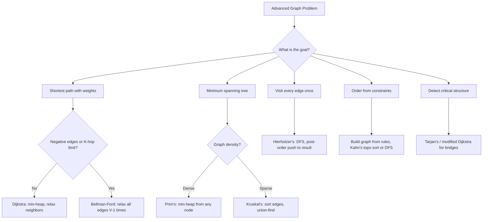

# Advanced Graphs — Pattern Notes

## Core Intuition
Advanced graph problems go beyond plain BFS/DFS. The key is recognizing **which algorithm fits the constraint**:
- Need shortest path with weights → Dijkstra (non-negative) or Bellman-Ford (negative edges / K-hops)
- Need minimum spanning tree → Prim's (dense) or Kruskal's (sparse, union-find)
- Need to traverse every edge exactly once → Euler path (Hierholzer's)
- Need topological order from implicit constraints → build graph from rules, then topo sort

---

## Decision Diagram

---

## Per-Problem Notes

| # | Problem | LC | Difficulty | What to Learn | Common Mistakes | Time / Space |
|---|---------|-----|------------|---------------|-----------------|--------------|
| 1 | Min Effort Path | 1631 | Medium | Dijkstra on grid; cost = max effort so far on path; min-heap by effort | Using BFS (unweighted); not updating effort correctly as max | O(mn log mn) / O(mn) |
| 2 | Network Delay Time | 743 | Medium | Classic Dijkstra from source k; answer = max dist in dist array; -1 if any unreachable | 1-indexed nodes — adjust array size; not checking all nodes reached | O((V+E) log V) / O(V+E) |
| 3 | Reconstruct Itinerary | 332 | Medium | Euler path: sort adjacency lists lexicographically; Hierholzer's DFS; post-order build result | Not sorting neighbors; reversing result at end | O(E log E) / O(E) |
| 4 | Min Cost Connect Points | 1584 | Medium | MST with Prim's or Kruskal's; edge weight = Manhattan distance | Building all O(n²) edges explicitly for Kruskal's (fine here); Prim's avoids this | O(n² log n) / O(n²) |
| 5 | Swim in Rising Water | 778 | Medium | Dijkstra where cost to reach cell = max(current_cost, grid[r][c]); or binary search + BFS | Using plain BFS (ignores water levels); not taking max with current cost | O(n² log n) / O(n²) |
| 6 | Alien Dictionary | 269 | Hard | Build graph from adjacent word pairs (first differing char); topo sort; cycle → invalid | Not detecting cycles (return ""); comparing words where prefix is longer (invalid input) | O(C) where C = total chars / O(1) (26 chars) |
| 7 | Cheapest Flights K Stops | 787 | Medium | Bellman-Ford for exactly K+1 hops; copy dist array each iteration to prevent chaining in same round | Using Dijkstra (can't limit hops easily); updating dist in-place within a round | O(K·E) / O(V) |
| 8 | Critical Connections | 1489 | Hard | Tarjan's bridge-finding algorithm; track discovery time and low values; bridge when `low[v] > disc[u]` | Confusing bridge condition with articulation point condition | O(V+E) / O(V+E) |
| 9 | Build Matrix (2392) | 2392 | Hard | Two topo sorts: row constraints graph + col constraints graph; detect cycles in both | Not checking both graphs for cycles independently | O(k² + k) / O(k²) |
| 10 | GCD Traversal | 2709 | Hard | Build graph: connect nodes sharing a common factor > 1; use factor-based grouping (sieve-like); check connectivity | Building O(n²) edges naively — TLE; must group by prime factors | O(n√M) / O(n+M) |

---

## Edge Cases to Watch
- Dijkstra: node unreachable → dist remains infinity; check before returning answer
- Bellman-Ford: negative cycle detection (extra relaxation round still changes dist)
- Euler path: graph must have 0 or 2 nodes with odd degree; start from odd-degree node if 2 exist
- Alien Dictionary: word A is prefix of word B but appears after it → return `""`
- Prim's/Kruskal's on disconnected graph → MST impossible, return -1
- Cheapest Flights: `src == dst` → cost is 0
- Critical Connections: parallel edges (multiple edges between same pair) — handle carefully in Tarjan's
- GCD Traversal: `n=1` → always traversable (trivially connected)
