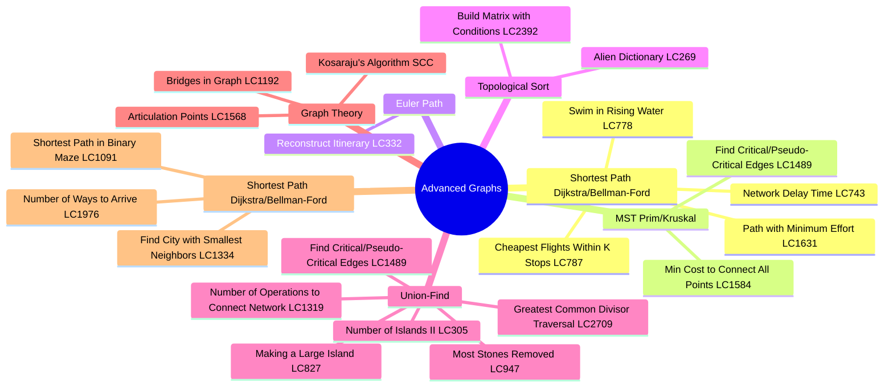
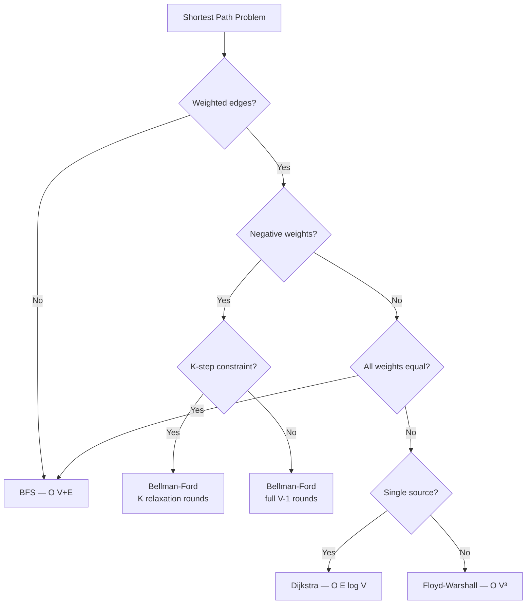
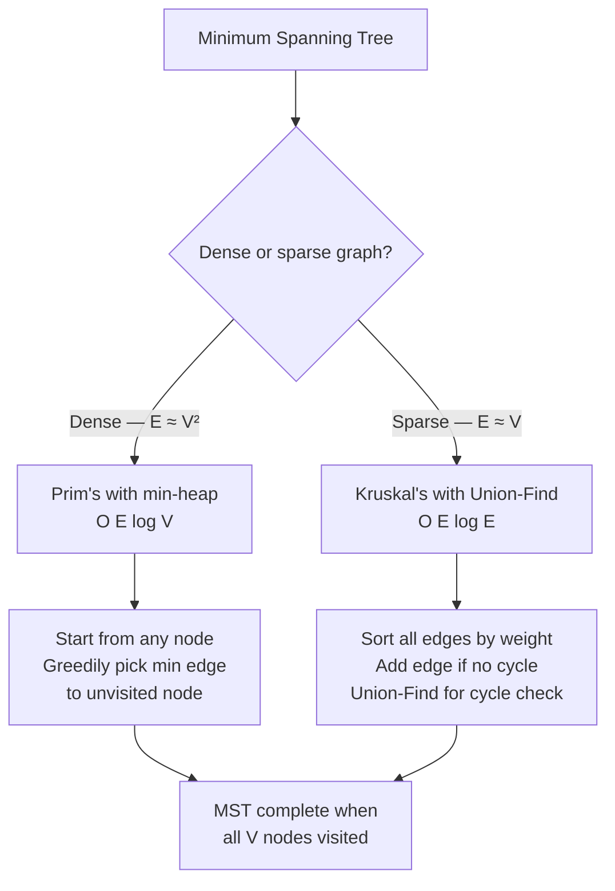
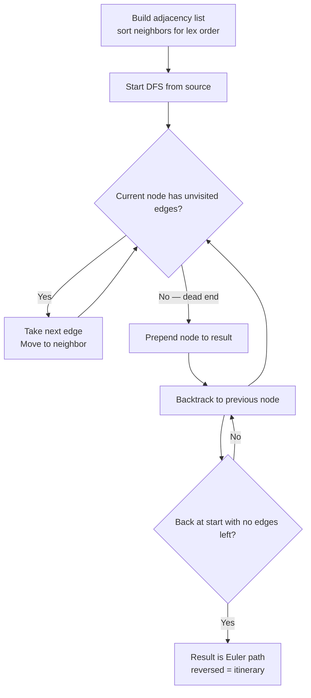

# Advanced Graphs



## Problem List

| # | Problem | LC # | Difficulty | Key Technique |
|---|---------|------|------------|---------------|
| 1 | Path with Minimum Effort | 1631 | Medium | Dijkstra / Binary search |
| 2 | Network Delay Time | 743 | Medium | Dijkstra |
| 3 | Reconstruct Itinerary | 332 | Hard | Hierholzer's (Euler path) |
| 4 | Min Cost to Connect All Points | 1584 | Medium | Prim's / Kruskal's MST |
| 5 | Swim in Rising Water | 778 | Hard | Dijkstra / Binary search |
| 6 | Alien Dictionary | 269 | Hard | Topological sort |
| 7 | Cheapest Flights Within K Stops | 787 | Medium | Bellman-Ford (K relaxations) |
| 8 | Find Critical/Pseudo-Critical Edges | 1489 | Hard | Kruskal's + bridge finding |
| 9 | Build Matrix with Conditions | 2392 | Hard | Topological sort (2 passes) |
| 10 | Greatest Common Divisor Traversal | 2709 | Hard | Union-Find on prime factors |
| 11 | Shortest Path in Binary Maze | 1091 | Medium | BFS |
| 12 | Number of Ways to Arrive at Destination | 1976 | Medium | Dijkstra + count paths |
| 13 | Find City with Smallest Number of Neighbors | 1334 | Medium | Floyd-Warshall / Dijkstra |
| 14 | Number of Operations to Connect Network | 1319 | Medium | Union-Find |
| 15 | Most Stones Removed with Same Row/Column | 947 | Medium | Union-Find |
| 16 | Number of Islands II | 305 | Hard | Online Union-Find |
| 17 | Making a Large Island | 827 | Hard | Union-Find + BFS |
| 18 | Bridges in Graph | 1192 | Hard | Tarjan's DFS |
| 19 | Articulation Points | 1568 | Hard | Tarjan's DFS |
| 20 | Kosaraju's Algorithm (SCC) | — | Hard | Two-pass DFS |

---

## Patterns & Diagrams

### 1. Shortest Path Algorithm Decision Tree



### 2. MST Algorithm Decision



### 3. Dijkstra's Algorithm Flow

```mermaid
flowchart TD
    A["Init dist[src]=0, All others=∞, Min-heap: src,0"] --> B{"Heap empty?"}
    B -->|No| C[Pop u, d with min dist]
    C --> D{"d > dist[u]?"}
    D -->|Yes — stale| B
    D -->|No| E[For each neighbor v, w]
    E --> F{"dist[u]+w < dist[v]?"}
    F -->|Yes| G[dist[v] = dist[u]+w<br>Push v, dist[v] to heap]
    F -->|No| H[Skip]
    G --> B
    H --> B
    B -->|Empty| I[dist[] = shortest paths]
```

### 4. Bellman-Ford with K Stops

```mermaid
flowchart TD
    A["Init dist[src]=0, All others=∞"] --> B[For round = 1 to K+1]
    B --> C[Copy dist as prev_dist<br>to avoid using same-round updates]
    C --> D[For each edge u→v, w]
    D --> E{"prev_dist[u] + w < dist[v]?"}
    E -->|Yes| F[dist[v] = prev_dist[u] + w]
    E -->|No| G[Skip]
    F --> D
    G --> D
    D --> B
    B --> H["dist[dst] = answer or ∞ if unreachable"]

    style C fill:#f90,color:#000
```

### 5. Euler Path — Hierholzer's Algorithm



---

## Complexity Summary

| Problem | Time | Space | Pattern |
|---------|------|-------|---------|
| path_with_minimum_effort | O(m·n·log(m·n)) | O(m·n) | Dijkstra / Binary search |
| network_delay_time | O(E log V) | O(V+E) | Dijkstra |
| reconstruct_itinerary | O(E log E) | O(E) | Hierholzer's (Euler path) |
| min_cost_to_connect_all_points | O(V² log V) | O(V) | Prim's / Kruskal's MST |
| swim_in_rising_water | O(n² log n) | O(n²) | Dijkstra / Binary search |
| alien_dictionary | O(V+E) | O(V+E) | Topological sort |
| cheapest_flights_within_k_stops | O(K·E) | O(V) | Bellman-Ford (K relaxations) |
| find_critical_and_pseudo_critical_edges | O(E² · α(V)) | O(V) | Kruskal's + bridge finding |
| build_a_matrix_with_conditions | O(k²) | O(k²) | Topological sort (2 passes) |
| greatest_common_divisor_traversal | O(n·√M) | O(n+P) | Union-Find on prime factors |
| shortest_path_in_binary_maze | O(n²) | O(n²) | BFS |
| number_of_ways_to_arrive | O(E log V) | O(V+E) | Dijkstra + count paths |
| find_city_with_smallest_neighbors | O(V³) | O(V²) | Floyd-Warshall / Dijkstra |
| number_of_operations_to_connect_network | O(E·α(V)) | O(V) | Union-Find |
| most_stones_removed | O(n·α(n)) | O(n) | Union-Find |
| number_of_islands_ii | O(k·α(m·n)) | O(m·n) | Online Union-Find |
| making_a_large_island | O(n²) | O(n²) | Union-Find + BFS |
| bridges_in_graph | O(V+E) | O(V+E) | Tarjan's DFS |
| articulation_points | O(V+E) | O(V+E) | Tarjan's DFS |
| kosarajus_algorithm | O(V+E) | O(V+E) | Two-pass DFS (SCC) |

---

## Study Order

1. **Dijkstra foundation** — 743 (Network Delay Time)
2. **Dijkstra variants** — 1631, 778 (min-max path cost)
3. **MST** — 1584 (Prim's or Kruskal's)
4. **Bellman-Ford** — 787 (K stops constraint)
5. **Topological sort** — 269, 2392 (alien dict, matrix conditions)
6. **Euler path** — 332 (Hierholzer's)
7. **Hard combinatorics** — 1489, 2709 (critical edges, GCD traversal)
