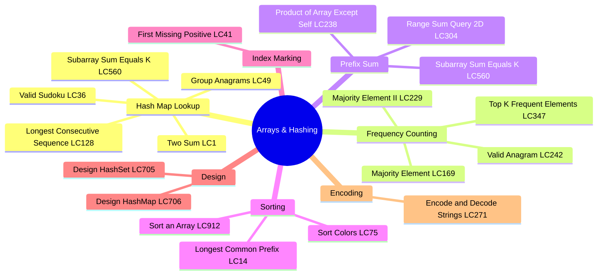
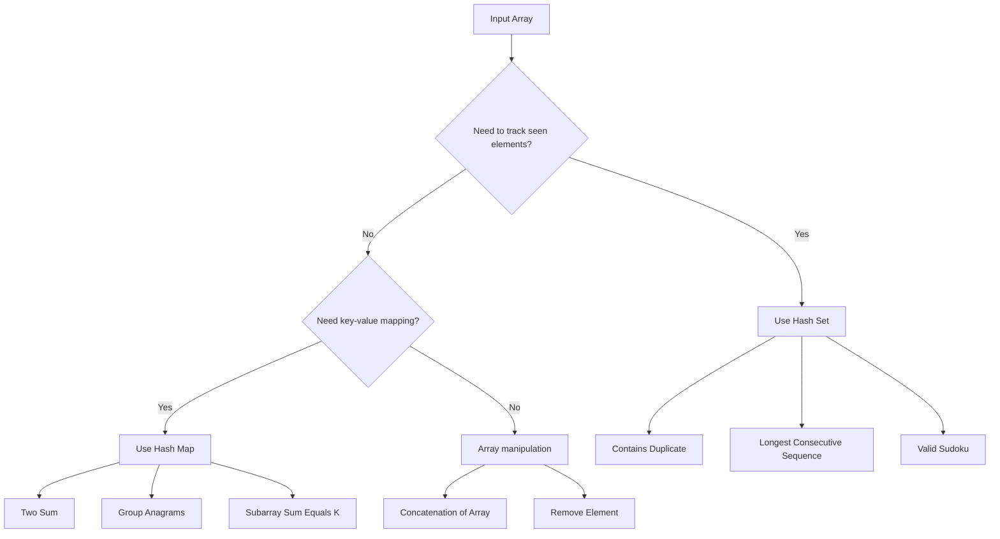
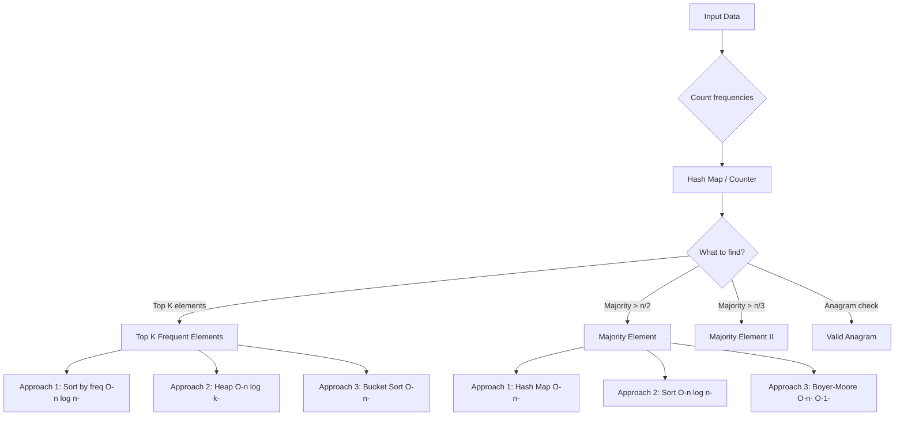
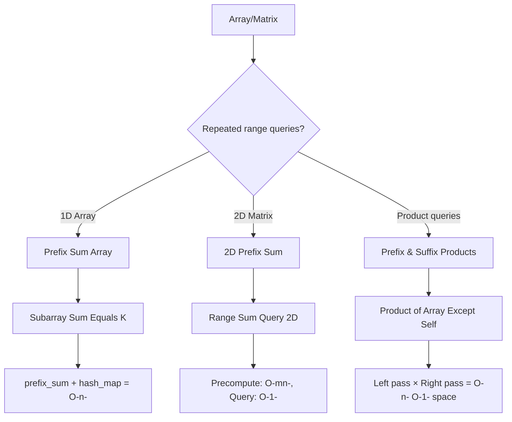
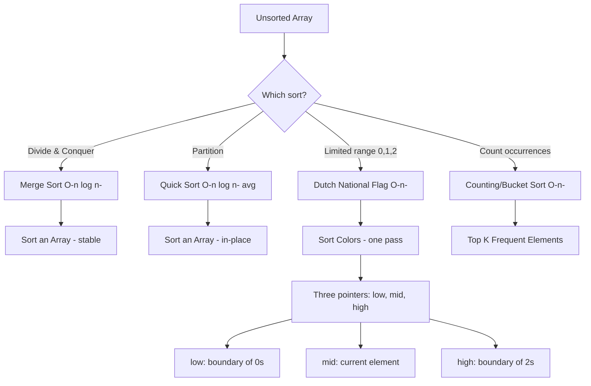
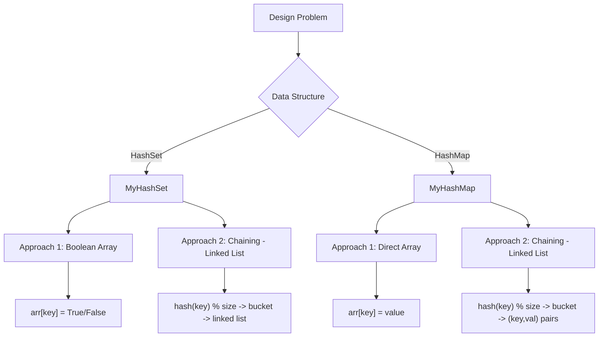
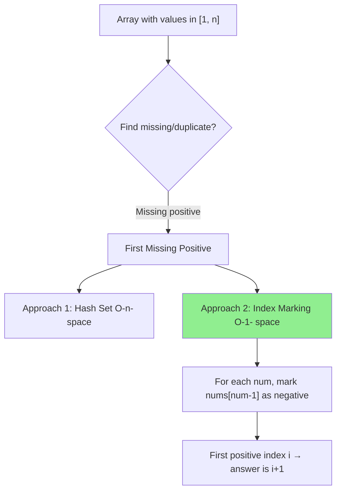
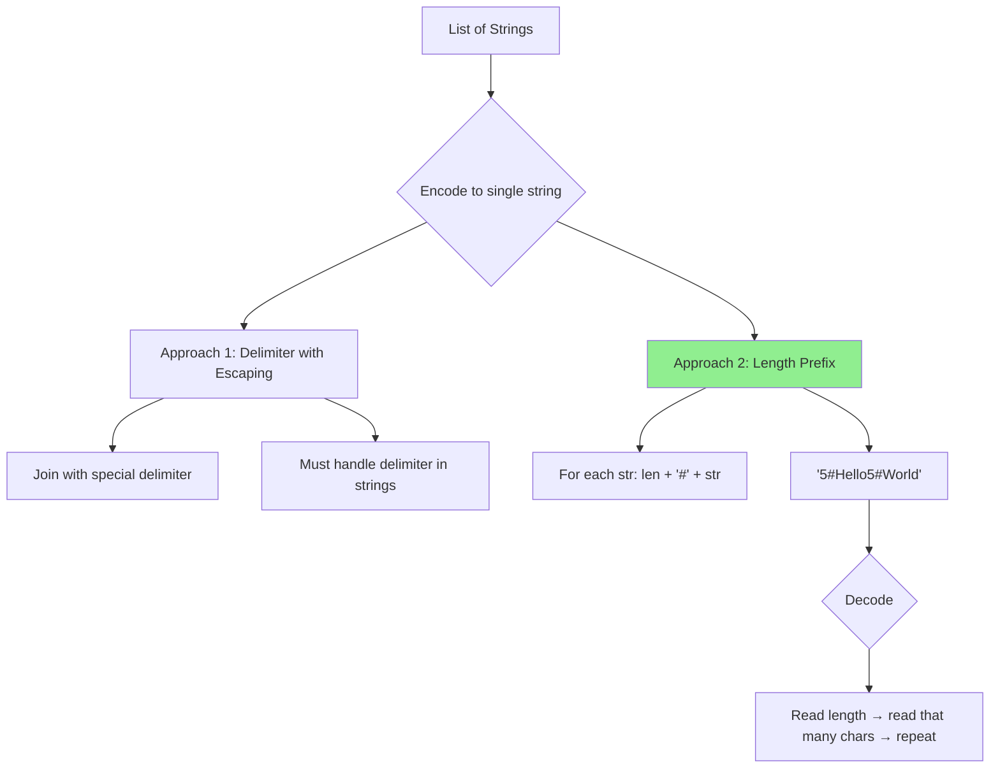
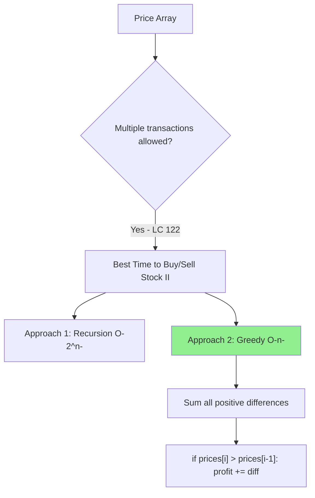
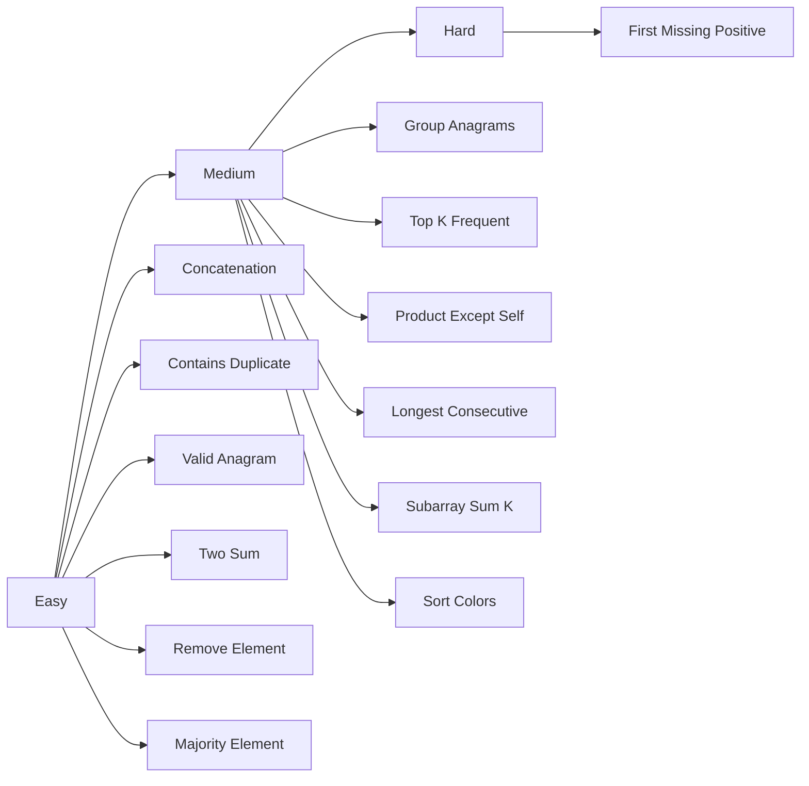

# Arrays & Hashing

## Overview

This section covers 22 problems focusing on array manipulation, hashing techniques, and frequency counting.

## Problem List

| # | Problem | LC # | Difficulty | Key Techniques |
|---|---------|------|-----------|----------------|
| 1 | Concatenation of Array | 1929 | Easy | Array |
| 2 | Contains Duplicate | 217 | Easy | Hash Set |
| 3 | Valid Anagram | 242 | Easy | Char Counting |
| 4 | Two Sum | 1 | Easy | Hash Map |
| 5 | Longest Common Prefix | 14 | Easy | String Scan |
| 6 | Group Anagrams | 49 | Medium | Hash Map + Sort |
| 7 | Remove Element | 27 | Easy | Two Pointers |
| 8 | Majority Element | 169 | Easy | Boyer-Moore |
| 9 | Design HashSet | 705 | Easy | Design |
| 10 | Design HashMap | 706 | Easy | Design |
| 11 | Sort an Array | 912 | Medium | Merge/Quick Sort |
| 12 | Sort Colors | 75 | Medium | Dutch National Flag |
| 13 | Top K Frequent Elements | 347 | Medium | Bucket Sort |
| 14 | Encode and Decode Strings | 271 | Medium | Length Prefix |
| 15 | Range Sum Query 2D | 304 | Medium | Prefix Sum 2D |
| 16 | Product of Array Except Self | 238 | Medium | Prefix/Suffix |
| 17 | Valid Sudoku | 36 | Medium | Hash Sets |
| 18 | Longest Consecutive Sequence | 128 | Medium | Hash Set |
| 19 | Best Time to Buy/Sell Stock II | 122 | Medium | Greedy |
| 20 | Majority Element II | 229 | Medium | Boyer-Moore Extended |
| 21 | Subarray Sum Equals K | 560 | Medium | Prefix Sum + Map |
| 22 | First Missing Positive | 41 | Hard | Index Marking |

---

## Approach Flow Diagrams

### Hash Map / Hash Set Pattern

### Frequency Counting Pattern

### Prefix Sum Pattern

### Sorting-Based Pattern

### Design Pattern (HashSet / HashMap)

### Index Marking / Cyclic Sort Pattern

### Encode/Decode Pattern

### Greedy Pattern (Stock Problems)

---

## Complexity Summary

| Problem | Time | Space | Pattern |
|---------|------|-------|---------|
| concatenation_of_array | O(n) | O(n) | Array copy |
| contains_duplicate | O(n) | O(n) | Hash set |
| valid_anagram | O(n) | O(1) | Char counting |
| two_sum | O(n) | O(n) | Hash map |
| longest_common_prefix | O(n·k) | O(1) | String scan |
| group_anagrams | O(n·k log k) | O(n·k) | Hash map + sort |
| remove_element | O(n) | O(1) | Two pointers |
| majority_element | O(n) | O(1) | Boyer-Moore |
| design_hashset | O(1) avg | O(n) | Chaining |
| design_hashmap | O(1) avg | O(n) | Chaining |
| sort_an_array | O(n log n) | O(n) | Merge/Quick sort |
| sort_colors | O(n) | O(1) | Dutch national flag |
| top_k_frequent_elements | O(n) | O(n) | Bucket sort |
| encode_and_decode_strings | O(n) | O(n) | Length prefix |
| range_sum_query_2d | O(mn) pre / O(1) query | O(mn) | 2D prefix sum |
| product_of_array_except_self | O(n) | O(1) | Prefix/suffix products |
| valid_sudoku | O(1) | O(1) | Hash sets (fixed 9×9) |
| longest_consecutive_sequence | O(n) | O(n) | Hash set |
| best_time_to_buy_sell_stock_ii | O(n) | O(1) | Greedy |
| majority_element_ii | O(n) | O(1) | Boyer-Moore extended |
| subarray_sum_equals_k | O(n) | O(n) | Prefix sum + map |
| first_missing_positive | O(n) | O(1) | Index marking |

---

## Study Order (Recommended)

