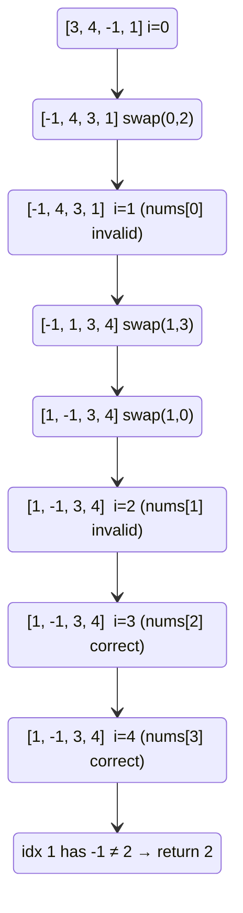

# LC 41 — First Missing Positive

## Problem Statement

Given an unsorted integer array `nums`, return the smallest missing positive integer. Must run in O(n) time and O(1) extra space.

```
Input:  [3, 4, -1, 1]  →  Output: 2
Input:  [1, 2, 0]      →  Output: 3
```

---

## Key Insight: Answer is Always in [1, n+1]

**Pigeonhole Principle:**  
The array has `n` elements. The candidates `1, 2, ..., n` are exactly `n` values. If all are present, the answer is `n+1`. If any is absent, the answer is ≤ n.

Therefore the answer is always in `[1, n+1]`, and values ≤ 0 or > n are irrelevant — they can never be the answer.

---

## Approach 1 — Cyclic Sort

### Idea

Value `v` belongs at index `v-1`. Rearrange in-place so each value sits at its correct index. Then scan for the first mismatch.

```python
def firstMissingPositive(nums):
    n = len(nums)
    i = 0
    while i < n:
        j = nums[i] - 1                           # correct index for nums[i]
        if 1 <= nums[i] <= n and nums[i] != nums[j]:
            nums[i], nums[j] = nums[j], nums[i]   # swap to correct position
        else:
            i += 1

    for i in range(n):
        if nums[i] != i + 1:
            return i + 1
    return n + 1
```

### PROOF of O(n) Time

**Claim:** The while loop executes at most 2n iterations total.

**Proof:**
- Each **swap** places `nums[j]` at its correct index `j`. Once placed, `nums[j] == j+1` and the condition `nums[i] != nums[j]` prevents it from being swapped again.
- Each element is placed correctly **at most once** → at most **n swaps**.
- Each non-swap step increments `i` → at most **n increments**.
- Total iterations ≤ n + n = **2n = O(n)**. ∎

### Why skip values ≤ 0 or > n

- `j = nums[i] - 1` would be negative or ≥ n → invalid index.
- These values cannot be the answer (answer ∈ [1, n+1]), so we leave `i` in place and advance.

---

## Approach 2 — Index Marking (Sign Trick)

Use the sign of `nums[i]` as a boolean: if value `v` exists, mark `nums[v-1]` negative.

```python
def firstMissingPositive(nums):
    n = len(nums)
    # Replace out-of-range values with sentinel n+1
    for i in range(n):
        if nums[i] <= 0 or nums[i] > n:
            nums[i] = n + 1

    # Mark: if value v exists, negate nums[v-1]
    for i in range(n):
        v = abs(nums[i])
        if 1 <= v <= n:
            nums[v - 1] = -abs(nums[v - 1])

    # First positive index → that value is missing
    for i in range(n):
        if nums[i] > 0:
            return i + 1
    return n + 1
```

**Why it works:** After marking, `nums[i] < 0` means value `i+1` was seen. First `nums[i] > 0` means `i+1` was never seen → it's the answer.

---

## Step-by-Step Walkthrough — Cyclic Sort

`nums = [3, 4, -1, 1]`, n = 4

```
[3, 4, -1, 1]
i=0: nums[0]=3, j=2. nums[2]=-1 ≠ 3 → swap → [-1, 4, 3, 1]
i=0: nums[0]=-1, out of range → i=1
i=1: nums[1]=4, j=3. nums[3]=1 ≠ 4 → swap → [-1, 1, 3, 4]
i=1: nums[1]=1, j=0. nums[0]=-1 ≠ 1 → swap → [1, -1, 3, 4]
i=1: nums[1]=-1, out of range → i=2
i=2: nums[2]=3, j=2. nums[2]=3 == 3 → already correct → i=3
i=3: nums[3]=4, j=3. nums[3]=4 == 4 → already correct → i=4

Final: [1, -1, 3, 4]
Scan:  idx 0 → 1==1 ✓
       idx 1 → -1 ≠ 2 → return 2
```

**Answer: 2** ✓

---

## Mermaid Diagram — Cyclic Sort



---

## Complexity

| Approach | Time | Space |
|---|---|---|
| Cyclic Sort | O(n) | O(1) |
| Index Marking | O(n) | O(1) |
| Hash Set | O(n) | O(n) |
| Sort-based | O(n log n) | O(1) |

Both optimal approaches use the input array itself as the data structure, achieving O(1) extra space.
