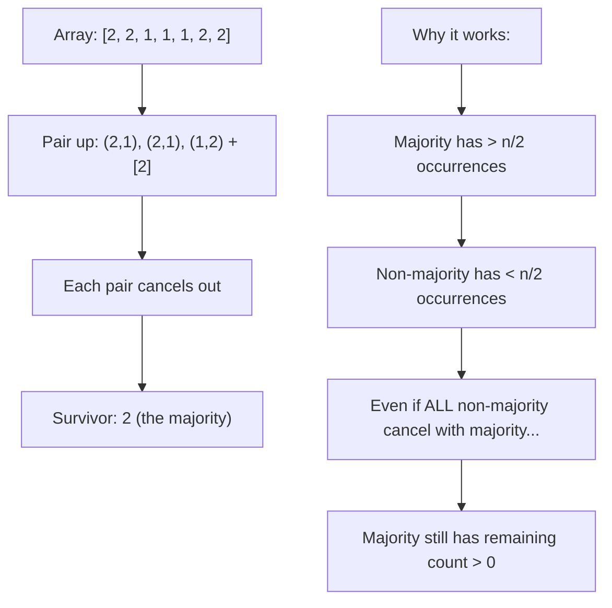

# LC 169 + LC 229: Boyer-Moore Voting Algorithm — Proof

## Problem
- **LC 169:** Find element appearing > n/2 times (guaranteed to exist)
- **LC 229:** Find all elements appearing > n/3 times

---

## The Algorithm (LC 169)

```python
candidate, count = None, 0
for num in nums:
    if count == 0:
        candidate = num
    count += 1 if num == candidate else -1
return candidate
```

---

## 🧮 Proof of Correctness

### Intuition: "Cancellation"

Think of it as a battle: the majority element fights all others. Since it has > n/2 soldiers, it wins.



### Formal Proof

**Claim:** If element `m` appears more than `n/2` times, Boyer-Moore returns `m`.

**Proof by contradiction:**
1. Let `count(m)` = number of times `m` appears. We know `count(m) > n/2`.
2. Suppose the algorithm returns some other element `x ≠ m`.
3. The algorithm's counter reaches 0 and resets multiple times. Consider the segments between resets.
4. In each segment where `candidate ≠ m`: the segment has equal numbers of `candidate` and "others" (including `m`). So `m` appears ≤ half of that segment.
5. In segments where `candidate = m`: `m` appears at least as many times as non-`m`.
6. **Key:** Across ALL segments, `m` must appear > n/2 times total. But if the final candidate is `x ≠ m`, then in the final segment, `x` has net positive count, meaning `m` was "used up" in cancellations. But `m` has > n/2 appearances — it cannot be fully cancelled by < n/2 non-`m` elements. **Contradiction.** ∎

### Why Count Can Go Negative Conceptually

```
nums = [1, 2, 2, 2, 1]

Step 1: candidate=1, count=1
Step 2: candidate=1, count=0  (1 cancelled by 2)
Step 3: candidate=2, count=1  (reset)
Step 4: candidate=2, count=2
Step 5: candidate=2, count=1  (2 survives cancellation with 1)

Result: 2 ✓ (appears 3 times > 5/2)
```

---

## Extension: LC 229 (> n/3)

**Key insight:** At most **2** elements can appear > n/3 times.

**Algorithm:** Maintain 2 candidates with 2 counters. Cancel in triplets.

```python
c1, c2, cnt1, cnt2 = None, None, 0, 0
for num in nums:
    if num == c1:
        cnt1 += 1
    elif num == c2:
        cnt2 += 1
    elif cnt1 == 0:
        c1, cnt1 = num, 1
    elif cnt2 == 0:
        c2, cnt2 = num, 1
    else:
        cnt1 -= 1
        cnt2 -= 1
# MUST verify c1 and c2 actually appear > n/3 times
```

**Proof:** Each cancellation removes one of each of 3 distinct values. If element `m` appears > n/3 times, there aren't enough "triplets" to fully cancel it (at most n/3 cancellations possible).

### Complexity
- **Time:** O(n) single pass
- **Space:** O(1)
