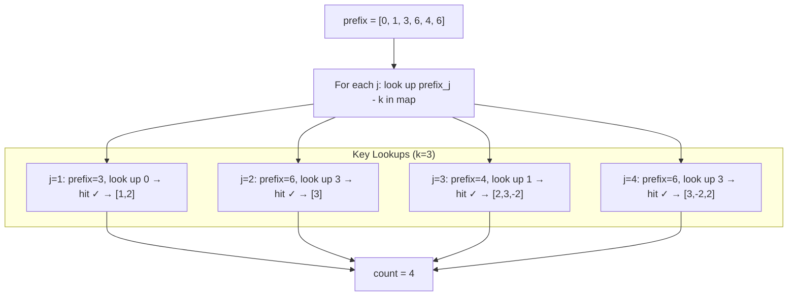

# LC 560 — Subarray Sum Equals K

## Problem Statement

Given an integer array `nums` and an integer `k`, return the total number of subarrays whose sum equals `k`.

```
Input:  nums = [1,2,3,-2,2], k = 3
Output: 4
```

---

## Why Sliding Window DOESN'T Work

Sliding window relies on **monotonicity**: expanding the window increases the sum, shrinking decreases it. With negative numbers this breaks:

- Adding an element can **decrease** the sum
- Removing an element can **increase** the sum

There is no greedy direction to move the pointers. Sliding window is only valid for non-negative arrays.

---

## Approach 1 — Brute Force O(n²)

```python
def subarraySum(nums, k):
    count = 0
    for i in range(len(nums)):
        total = 0
        for j in range(i, len(nums)):
            total += nums[j]
            if total == k:
                count += 1
    return count
```

---

## Approach 2 — Prefix Sum + Hash Map (Optimal)

### Derivation

Define `prefix[i]` = sum of `nums[0..i-1]`, with `prefix[0] = 0`.

```
sum(i, j) = prefix[j+1] - prefix[i]
```

We want `sum(i, j) = k`:
```
prefix[j+1] - prefix[i] = k
→ prefix[i] = prefix[j+1] - k
```

For each `j`, count how many previous prefix sums equal `(current_prefix - k)`.

### PROOF: Every subarray sum is captured

**Claim:** Every subarray `[i, j]` with sum `k` is counted exactly once.

**Proof:**
- Every subarray sum equals `prefix[j+1] - prefix[i]` by definition.
- When processing index `j`, `prefix[j+1]` is the running sum.
- We look up `prefix[j+1] - k` in the map, which holds all `prefix[i]` for `i ≤ j`.
- Every valid `i` forming a subarray ending at `j` is counted.
- Since we process every `j`, every valid subarray is counted exactly once. ∎

### Algorithm

```python
def subarraySum(nums, k):
    count = 0
    prefix = 0
    freq = {0: 1}   # seed: empty prefix exists once

    for num in nums:
        prefix += num
        count += freq.get(prefix - k, 0)
        freq[prefix] = freq.get(prefix, 0) + 1

    return count
```

**Why `{0: 1}`?** If `prefix[j+1] == k`, we need `prefix[i] = 0` at `i=0`. Without this seed we miss subarrays starting at index 0.

---

## Step-by-Step Walkthrough

`nums = [1, 2, 3, -2, 2]`, `k = 3`

| Step | num | prefix | lookup (prefix-3) | count | freq map after |
|------|-----|--------|-------------------|-------|----------------|
| init | —   | 0      | —                 | 0     | {0:1} |
| 0    | 1   | 1      | -2 → 0            | 0     | {0:1, 1:1} |
| 1    | 2   | 3      | 0 → **1 ✓**       | 1     | {0:1, 1:1, 3:1} |
| 2    | 3   | 6      | 3 → **1 ✓**       | 2     | {0:1, 1:1, 3:1, 6:1} |
| 3    | -2  | 4      | 1 → **1 ✓**       | 3     | {0:1, 1:1, 3:1, 6:1, 4:1} |
| 4    | 2   | 6      | 3 → **1 ✓**       | 4     | {0:1, 1:1, 3:1, 6:2, 4:1} |

**Answer: 4**

The 4 subarrays (verified via prefix differences):
- `prefix[2]-prefix[0] = 3` → `[1,2]`
- `prefix[3]-prefix[2] = 3` → `[3]`
- `prefix[4]-prefix[1] = 3` → `[2,3,-2]`
- `prefix[5]-prefix[2] = 3` → `[3,-2,2]`

---

## Mermaid Diagram



---

## Complexity

| Approach | Time | Space |
|---|---|---|
| Brute Force | O(n²) | O(1) |
| Prefix + HashMap | O(n) | O(n) |

**Time:** Single pass, O(1) hash map ops → O(n).  
**Space:** At most n+1 distinct prefix sums stored → O(n).
