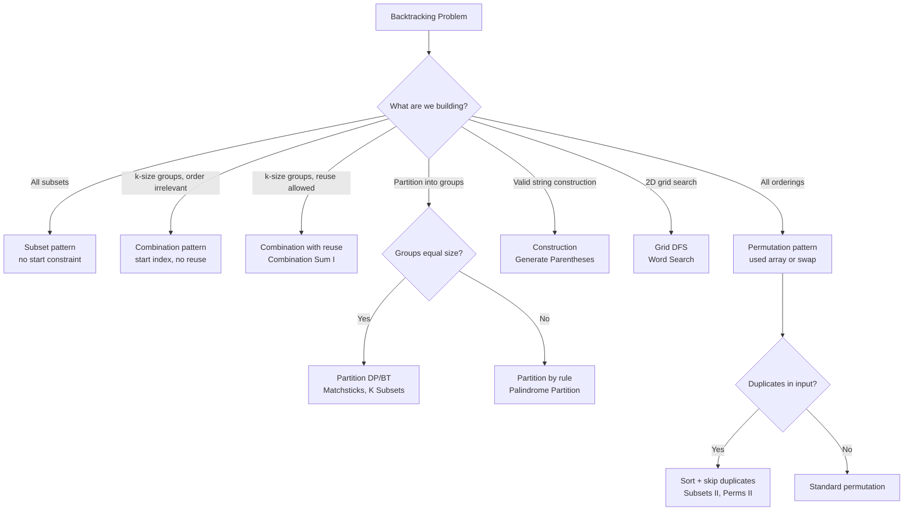

# Backtracking

## Core Intuition
Explore all possibilities via DFS, pruning branches that can't lead to a valid solution. The key is the **choice → explore → unchoose** loop.

- **Subsets**: Every element is either included or not
- **Combinations**: Order doesn't matter; use a `start` index to avoid duplicates
- **Permutations**: Order matters; use a `used` array or swap-in-place
- **Constraint satisfaction**: Prune early when constraints are violated (N-Queens, Sudoku)

## Decision Flowchart

## Problems

### Subset XOR Trick — LC 1863 | Easy
- **Learn**: XOR of all subsets = XOR of each element × 2^(n-1); no backtracking needed
- **Mistake**: Actually enumerating all 2^n subsets
- **Complexity**: O(n) time, O(1) space
- **Edge**: n=1 → nums[0]; empty array → 0

---

### Subsets — LC 78 | Medium
- **Learn**: At each index, branch: include or skip; or iteratively add each element to existing subsets
- **Mistake**: Forgetting to add the empty subset
- **Complexity**: O(n·2^n) time, O(n) space (recursion stack)
- **Edge**: Empty array → [[]]

---

### Combination Sum — LC 39 | Medium
- **Learn**: Unbounded — same element can be reused; pass same `start` index on reuse
- **Mistake**: Incrementing start (prevents reuse); not pruning when current sum > target
- **Complexity**: O(2^(target/min)) time, O(target/min) space
- **Edge**: No valid combination → []; target=0 → [[]]

---

### Combination Sum II — LC 40 | Medium
- **Learn**: Each element used once; sort + skip duplicates at same recursion level
- **Mistake**: Skipping duplicates across levels (removes valid combos); only skip at same depth
- **Complexity**: O(2^n) time, O(n) space
- **Edge**: Duplicate elements in input; target not achievable

---

### Combinations — LC 77 | Medium
- **Learn**: Choose k numbers from [1..n]; classic combination with start index
- **Mistake**: Not pruning when remaining numbers < k needed
- **Complexity**: O(C(n,k)·k) time, O(k) space
- **Edge**: k=n → single combination; k=0 → [[]]

---

### Permutations — LC 46 | Medium
- **Learn**: Use `used[]` boolean array or swap elements in-place
- **Mistake**: Using a set for visited (slower); not restoring state after recursion
- **Complexity**: O(n·n!) time, O(n) space
- **Edge**: Single element → [[element]]

---

### Subsets II — LC 90 | Medium
- **Learn**: Sort input; skip `nums[i] == nums[i-1]` when `i > start` (same level duplicate)
- **Mistake**: Skipping when `i > 0` (too aggressive — removes valid subsets from deeper levels)
- **Complexity**: O(n·2^n) time, O(n) space
- **Edge**: All duplicates → subsets of unique counts

---

### Permutations II — LC 47 | Medium
- **Learn**: Sort + skip if `nums[i]==nums[i-1]` and `not used[i-1]` (ensures canonical order)
- **Mistake**: Using `used[i-1]` condition backwards; both `used[i-1]` and `not used[i-1]` are valid but have different semantics
- **Complexity**: O(n·n!) time, O(n) space
- **Edge**: All same elements → single permutation

---

### Generate Parentheses — LC 22 | Medium
- **Learn**: Track open and close counts; add '(' if open < n, add ')' if close < open
- **Mistake**: Not pruning invalid states early
- **Complexity**: O(4^n / √n) time (Catalan number), O(n) space
- **Edge**: n=0 → [""] or []; n=1 → ["()"]

---

### Word Search — LC 79 | Medium
- **Learn**: DFS from each cell; mark visited in-place (modify grid, restore after)
- **Mistake**: Not restoring the cell after backtracking; revisiting same cell in path
- **Complexity**: O(m·n·4^L) time where L=word length, O(L) space
- **Edge**: Word longer than grid cells; single cell grid

---

### Palindrome Partitioning — LC 131 | Medium
- **Learn**: At each index, try all substrings starting here; add to path if palindrome
- **Mistake**: Recomputing palindrome check — precompute with DP or expand-around-center
- **Complexity**: O(n·2^n) time, O(n) space
- **Edge**: Single character → always palindrome; all same chars

---

### Letter Combinations of Phone Number — LC 17 | Medium
- **Learn**: Map digits to letters; standard combination building
- **Mistake**: Not handling empty input (return [])
- **Complexity**: O(4^n·n) time, O(n) space
- **Edge**: Empty string → []; digit '1' has no letters

---

### Matchsticks to Square — LC 473 | Medium
- **Learn**: Partition into 4 equal subsets; sort descending for pruning; skip duplicate bucket sums
- **Mistake**: Not sorting (poor pruning); not skipping when two buckets have same current sum
- **Complexity**: O(4^n) time, O(n) space
- **Edge**: Total not divisible by 4 → false; single stick = perimeter/4

---

### Partition to K Equal Sum Subsets — LC 698 | Medium
- **Learn**: Generalization of matchsticks; sort descending; skip duplicate bucket states
- **Mistake**: Not pruning when a bucket sum exceeds target; not skipping equal-sum buckets
- **Complexity**: O(k^n) time, O(n) space
- **Edge**: Total not divisible by k → false; k=1 → always true

---

### N-Queens — LC 51 | Hard
- **Learn**: Track columns, diagonals (r-c), anti-diagonals (r+c) in sets; place queen row by row
- **Mistake**: Using O(n²) board scan to check validity instead of O(1) sets
- **Complexity**: O(n!) time, O(n) space
- **Edge**: n=1 → [["Q"]]; n=2,3 → no solution

---

### N-Queens II — LC 52 | Hard
- **Learn**: Same as N-Queens but only count solutions
- **Mistake**: Building full board strings when only count needed
- **Complexity**: O(n!) time, O(n) space
- **Edge**: Same as N-Queens

---

### Word Break II — LC 140 | Hard
- **Learn**: Backtracking + memoization; cache which start indices lead to valid completions
- **Mistake**: Pure backtracking without memo → TLE on adversarial inputs
- **Complexity**: O(n·2^n) worst case, much better with memo; O(n²) space
- **Edge**: No valid segmentation → []; single word equals s

---

## General Edge Cases
- Empty input → return [[]] for subsets, [] for combinations/permutations
- Duplicate elements → always sort first
- Large n → check if pruning is sufficient or memoization needed
- Restoring state: always undo mutations (grid cells, used[], path.pop())
- Avoid modifying the input array permanently
