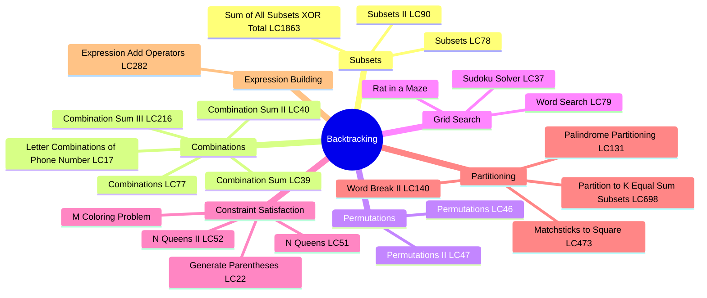
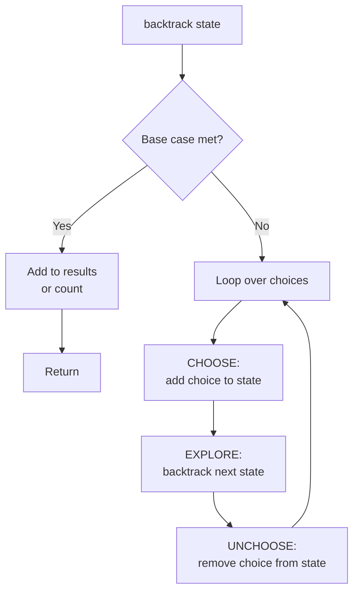
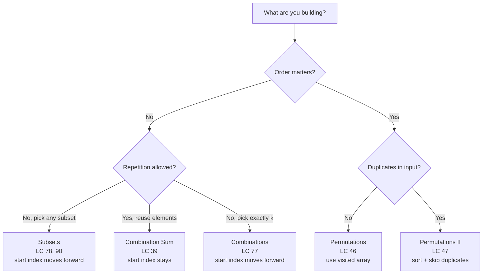
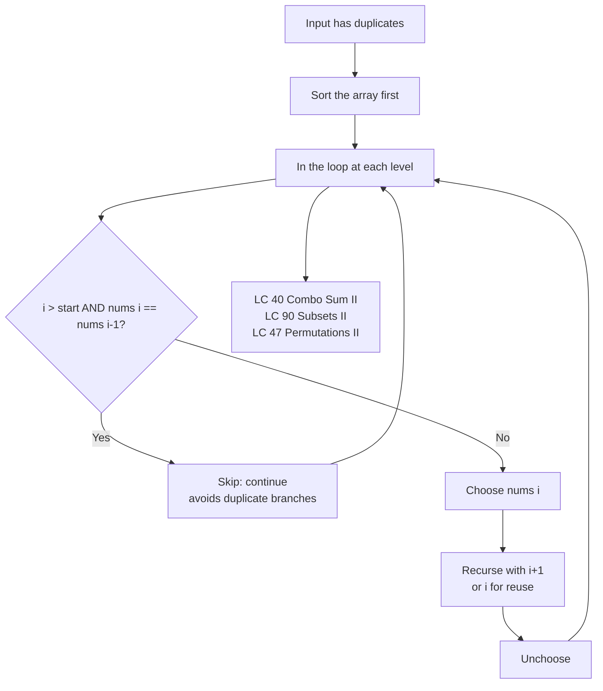
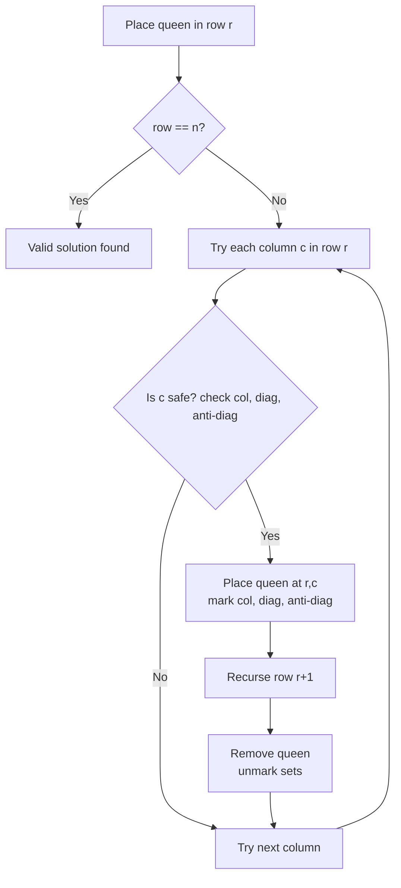
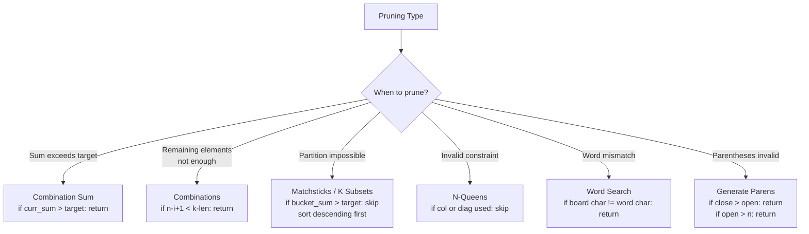

# Backtracking

## Problem List

| # | Problem | LC | Difficulty |
|---|---------|-----|------------|
| 1 | Sum of All Subsets XOR Total | [1863](https://leetcode.com/problems/sum-of-all-subset-xor-totals/) | 🟢 Easy |
| 2 | Subsets | [78](https://leetcode.com/problems/subsets/) | 🟡 Medium |
| 3 | Combination Sum | [39](https://leetcode.com/problems/combination-sum/) | 🟡 Medium |
| 4 | Combination Sum II | [40](https://leetcode.com/problems/combination-sum-ii/) | 🟡 Medium |
| 5 | Combinations | [77](https://leetcode.com/problems/combinations/) | 🟡 Medium |
| 6 | Permutations | [46](https://leetcode.com/problems/permutations/) | 🟡 Medium |
| 7 | Subsets II | [90](https://leetcode.com/problems/subsets-ii/) | 🟡 Medium |
| 8 | Permutations II | [47](https://leetcode.com/problems/permutations-ii/) | 🟡 Medium |
| 9 | Generate Parentheses | [22](https://leetcode.com/problems/generate-parentheses/) | 🟡 Medium |
| 10 | Word Search | [79](https://leetcode.com/problems/word-search/) | 🟡 Medium |
| 11 | Palindrome Partitioning | [131](https://leetcode.com/problems/palindrome-partitioning/) | 🟡 Medium |
| 12 | Letter Combinations of Phone Number | [17](https://leetcode.com/problems/letter-combinations-of-a-phone-number/) | 🟡 Medium |
| 13 | Matchsticks to Square | [473](https://leetcode.com/problems/matchsticks-to-square/) | 🟡 Medium |
| 14 | Partition to K Equal Sum Subsets | [698](https://leetcode.com/problems/partition-to-k-equal-sum-subsets/) | 🟡 Medium |
| 15 | N Queens | [51](https://leetcode.com/problems/n-queens/) | 🔴 Hard |
| 16 | N Queens II | [52](https://leetcode.com/problems/n-queens-ii/) | 🔴 Hard |
| 17 | Word Break II | [140](https://leetcode.com/problems/word-break-ii/) | 🔴 Hard |
| 18 | Combination Sum III | [216](https://leetcode.com/problems/combination-sum-iii/) | 🟡 Medium |
| 19 | Rat in a Maze | — | 🟡 Medium |
| 20 | M Coloring Problem | — | 🟡 Medium |
| 21 | Sudoku Solver | [37](https://leetcode.com/problems/sudoku-solver/) | 🔴 Hard |
| 22 | Expression Add Operators | [282](https://leetcode.com/problems/expression-add-operators/) | 🔴 Hard |

---

## Approach Diagrams

### Backtracking Template

### Subsets vs Combinations vs Permutations

### Duplicate Handling Pattern

### Constraint Satisfaction — N-Queens Flow

### Pruning Strategies

---

## Complexity Summary

| Problem | Time | Space | Pattern |
|---------|------|-------|---------|
| sum_of_all_subset_xor_totals | O(2ⁿ) | O(n) | Include/exclude |
| subsets | O(n·2ⁿ) | O(n) | Include/exclude |
| combination_sum | O(2^(t/min)) | O(t/min) | Unbounded pick |
| combination_sum_ii | O(2ⁿ) | O(n) | Sort + skip dups |
| combinations | O(k·C(n,k)) | O(k) | Fixed-size pick |
| permutations | O(n·n!) | O(n) | Visited array |
| subsets_ii | O(n·2ⁿ) | O(n) | Sort + skip dups |
| permutations_ii | O(n·n!) | O(n) | Sort + skip dups |
| generate_parentheses | O(4ⁿ/√n) | O(n) | Open/close count |
| word_search | O(m·n·4^L) | O(L) | Grid DFS + backtrack |
| palindrome_partitioning | O(n·2ⁿ) | O(n²) | Palindrome check + split |
| letter_combinations_of_a_phone_number | O(4^n·n) | O(n) | Digit-to-letters map |
| matchsticks_to_square | O(k·2ⁿ) | O(n) | Partition into k buckets |
| partition_to_k_equal_sum_subsets | O(k·2ⁿ) | O(n) | Partition into k buckets |
| n_queens | O(n!) | O(n) | Constraint satisfaction |
| n_queens_ii | O(n!) | O(n) | Constraint satisfaction |
| word_break_ii | O(2ⁿ) | O(n) | Prefix match + memo |
| combination_sum_iii | O(k·C(9,k)) | O(k) | Fixed-size pick with sum |
| rat_in_a_maze | O(4^(m·n)) | O(m·n) | Grid DFS + backtrack |
| m_coloring_problem | O(m^V) | O(V) | Constraint coloring |
| sudoku_solver | O(9^m) | O(1) | Constraint satisfaction |
| expression_add_operators | O(4^n·n) | O(n) | Expression building |

---

## Study Order

```mermaid
flowchart LR
    subgraph W1["Week 1: Subsets + Permutations"]
        b1["sum_xor_totals(1863) → subsets(78) → subsets_ii(90)"]
        b2["permutations(46) → permutations_ii(47)"]
    end

    subgraph W2["Week 2: Combinations"]
        b3["combination_sum(39) → combination_sum_ii(40) → combination_sum_iii(216)"]
        b4["combinations(77) → letter_combinations(17)"]
    end

    subgraph W3["Week 3: String + Grid Backtracking"]
        b5["generate_parentheses(22) → word_search(79)"]
        b6["palindrome_partitioning(131) → word_break_ii(140)"]
    end

    subgraph W4["Week 4: Partitioning"]
        b7["matchsticks_to_square(473) → partition_k_subsets(698)"]
    end

    subgraph W5["Week 5: Hard Constraint Satisfaction"]
        b8["n_queens(51) → n_queens_ii(52) → rat_in_a_maze"]
        b9["m_coloring_problem → sudoku_solver(37) → expression_add_operators(282)"]
    end

    W1 --> W2 --> W3 --> W4 --> W5
```

**Key insight:** Every backtracking problem follows choose → explore → unchoose. The difference is *what* you choose (index vs element), *when* you record a result (at every node vs only at leaves), and *how* you prune (sum, length, constraint checks).
