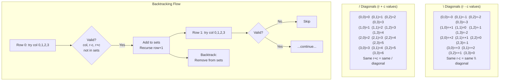

# LC 51: N-Queens — Diagonal Constraint Proof

## Problem Statement

Place `n` queens on an `n×n` chessboard such that no two queens attack each other. Return all distinct solutions. A queen attacks along rows, columns, and both diagonals.

**Example:** `n = 4` → 2 solutions

---

## Why Row-by-Row Placement is Complete

**Claim:** Placing exactly one queen per row covers all valid configurations.

**Proof (Pigeonhole Principle):**
- We have `n` queens and `n` rows.
- If any row has 0 queens, some other row has ≥ 2 queens.
- Two queens in the same row attack each other → invalid.
- Therefore, every valid solution has **exactly one queen per row**.
- Placing queens row by row (one per row) generates all and only valid configurations. ∎

This reduces the search space from `C(n², n)` to `n!` (at most), and backtracking prunes it further.

---

## Diagonal Constraint Proof

### `\` Diagonal (top-left to bottom-right)

**Claim:** All cells `(r, c)` on the same `\` diagonal share the same value of `r - c`.

**Proof:**
Moving one step along `\` means going from `(r, c)` to `(r+1, c+1)`:
```
(r+1) - (c+1) = r + 1 - c - 1 = r - c  ✓
```
The value `r - c` is invariant under `\` movement. Therefore, two queens at `(r1, c1)` and `(r2, c2)` are on the same `\` diagonal iff `r1 - c1 == r2 - c2`. ∎

### `/` Diagonal (top-right to bottom-left)

**Claim:** All cells `(r, c)` on the same `/` diagonal share the same value of `r + c`.

**Proof:**
Moving one step along `/` means going from `(r, c)` to `(r+1, c-1)`:
```
(r+1) + (c-1) = r + 1 + c - 1 = r + c  ✓
```
The value `r + c` is invariant under `/` movement. Therefore, two queens at `(r1, c1)` and `(r2, c2)` are on the same `/` diagonal iff `r1 + c1 == r2 + c2`. ∎

---

## The Three Constraint Sets

```
used_cols   : set of occupied columns
used_diag1  : set of occupied (r - c) values  → \ diagonals
used_diag2  : set of occupied (r + c) values  → / diagonals
```

A placement at `(row, col)` is valid iff:
```
col     not in used_cols
row-col not in used_diag1
row+col not in used_diag2
```

All three checks are O(1) with hash sets.

---

## Mermaid Diagram: Diagonal Indexing on 4×4 Board



---

## Step-by-Step Walkthrough: `n = 4`

### Solution 1: Queens at columns `[1, 3, 0, 2]`

```
. Q . .    row 0, col 1
. . . Q    row 1, col 3
Q . . .    row 2, col 0
. . Q .    row 3, col 2
```

Verification:
- Columns: {1, 3, 0, 2} — all distinct ✓
- `r-c` values: {-1, -2, 2, 1} — all distinct ✓
- `r+c` values: {1, 4, 2, 5} — all distinct ✓

### Solution 2: Queens at columns `[2, 0, 3, 1]`

```
. . Q .    row 0, col 2
Q . . .    row 1, col 0
. . . Q    row 2, col 3
. Q . .    row 3, col 1
```

Verification:
- Columns: {2, 0, 3, 1} — all distinct ✓
- `r-c` values: {-2, 1, -1, 2} — all distinct ✓
- `r+c` values: {2, 1, 5, 4} — all distinct ✓

---

## Implementation

```python
def solveNQueens(n: int) -> list[list[str]]:
    results = []
    queens = []  # queens[r] = column of queen in row r
    used_cols, used_diag1, used_diag2 = set(), set(), set()

    def backtrack(row: int):
        if row == n:
            board = []
            for r in range(n):
                board.append('.' * queens[r] + 'Q' + '.' * (n - queens[r] - 1))
            results.append(board)
            return
        for col in range(n):
            if col in used_cols or (row-col) in used_diag1 or (row+col) in used_diag2:
                continue
            queens.append(col)
            used_cols.add(col); used_diag1.add(row-col); used_diag2.add(row+col)
            backtrack(row + 1)
            queens.pop()
            used_cols.remove(col); used_diag1.remove(row-col); used_diag2.remove(row+col)

    backtrack(0)
    return results
```

---

## Complexity

| | Value | Justification |
|---|---|---|
| **Time** | O(n!) | At most n choices for row 0, n-1 for row 1, etc. (column constraint prunes) |
| **Space** | O(n) | Recursion depth n, sets of size ≤ n |

The actual runtime is much better than O(n!) due to diagonal pruning. For `n=8`, only 92 solutions exist out of 8! = 40320 permutations.
