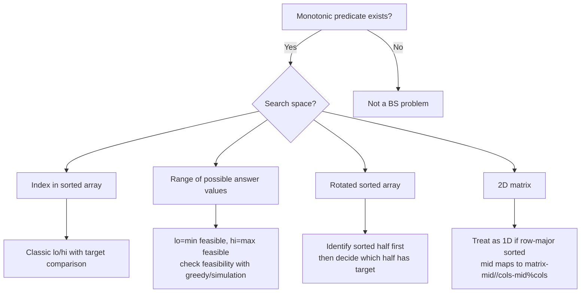

# Binary Search — Pattern Notes

## Core Intuition
Binary search works on any **monotonic search space**. If you can define a predicate `f(x)` where all values on one side are `True` and the other `False`, you can binary search it. This extends to searching on the *answer itself* rather than an index.

Sub-patterns:
- **Classic BS** — find exact value or insertion point in sorted array
- **BS on Answer** — search space is the range of possible answers; check feasibility with a helper
- **Rotated Arrays** — one half is always sorted; use that to decide which half to search
- **2D / Implicit** — flatten or use row/col properties

---

## Decision Diagram

---

## Per-Problem Notes

| # | Problem | LC | Difficulty | What to Learn | Common Mistakes | Time / Space |
|---|---------|-----|------------|---------------|-----------------|--------------|
| 1 | Binary Search | 704 | Easy | Template: `lo+(hi-lo)//2`; loop `while lo<=hi` | `lo+hi` overflow; wrong loop condition | O(log n) / O(1) |
| 2 | Search Insert Position | 35 | Easy | Return `lo` at end — that's the insertion point | Returning `mid` when element absent | O(log n) / O(1) |
| 3 | Guess Number | 374 | Easy | API-based BS; `guess(mid)` returns -1/0/1 | Confusing return value semantics | O(log n) / O(1) |
| 4 | Sqrt(x) | 69 | Easy | BS on `[0,x]`; find largest `mid` where `mid*mid<=x`; return `hi` | Overflow: use `mid <= x//mid` | O(log x) / O(1) |
| 5 | Search 2D Matrix | 74 | Medium | Flatten: `mid` → `matrix[mid//cols][mid%cols]` | Using staircase search (not needed here) | O(log mn) / O(1) |
| 6 | Koko Bananas | 875 | Medium | BS on answer `[1, max(piles)]`; feasibility: `sum(ceil(p/k)) <= h` | `p//k` instead of `(p+k-1)//k` | O(n log M) / O(1) |
| 7 | Ship Packages | 1011 | Medium | BS on answer; `lo=max(weights)`, `hi=sum(weights)`; greedy feasibility | Setting `lo=1` instead of `max(weights)` | O(n log S) / O(1) |
| 8 | Find Min Rotated | 153 | Medium | If `nums[mid] > nums[hi]` → min in right half; else left (incl. mid) | Comparing with `nums[lo]` instead of `nums[hi]` | O(log n) / O(1) |
| 9 | Search Rotated | 33 | Medium | Identify sorted half first, then check if target in that half | Skipping the "which half is sorted" check | O(log n) / O(1) |
| 10 | Search Rotated II | 81 | Medium | Same as 33 but when `nums[lo]==nums[mid]==nums[hi]` → `lo++, hi--` | Not handling equal case → infinite loop | O(log n) avg, O(n) worst / O(1) |
| 11 | Time Map | 981 | Medium | Store `(timestamp, value)` list per key; `bisect_right` then subtract 1 for floor | Off-by-one with bisect_right | O(log n) get, O(1) set / O(n) |
| 12 | Split Array | 410 | Hard | BS on answer; `lo=max(nums)`, `hi=sum(nums)`; greedy count of pieces | Feasibility off-by-one: start pieces=1 | O(n log S) / O(1) |
| 13 | Median Two Arrays | 4 | Hard | BS on partition of smaller array; ensure left halves total `(m+n+1)//2` | Not BS-ing on smaller array; odd/even handling | O(log min(m,n)) / O(1) |
| 14 | Mountain Array | 1095 | Hard | Three-phase: find peak, BS ascending left, BS descending right | Not searching right side; forgetting right is descending | O(log n) / O(1) |

---

## Edge Cases to Watch
- Single-element array — loop runs once, works correctly
- All duplicates (LC 81) — must handle `lo++, hi--` shrink
- Target smaller/larger than all elements → insertion at 0 or n
- `x=0` for Sqrt → return 0
- Rotated array that is not actually rotated (pivot at index 0)
- Median with very different sized arrays — always BS on smaller
- Koko/Ship: `h >= n` always feasible at `hi`; `h=1` means one trip
