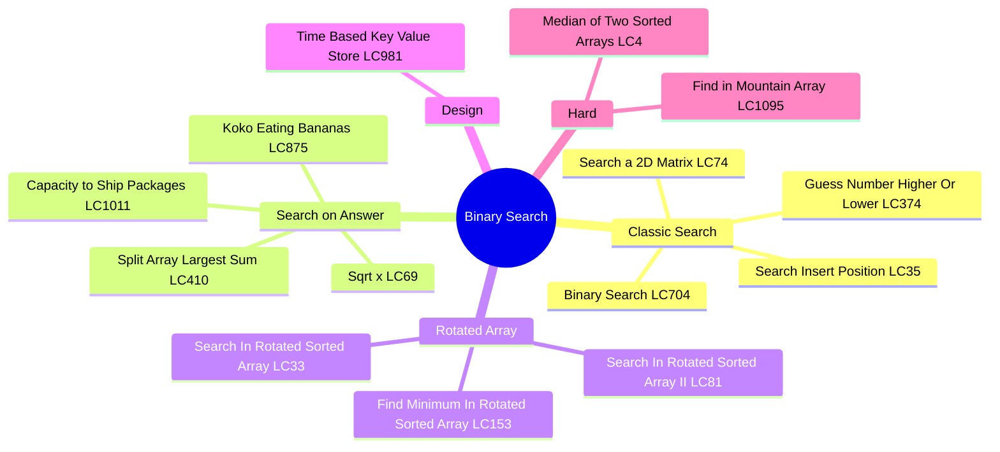
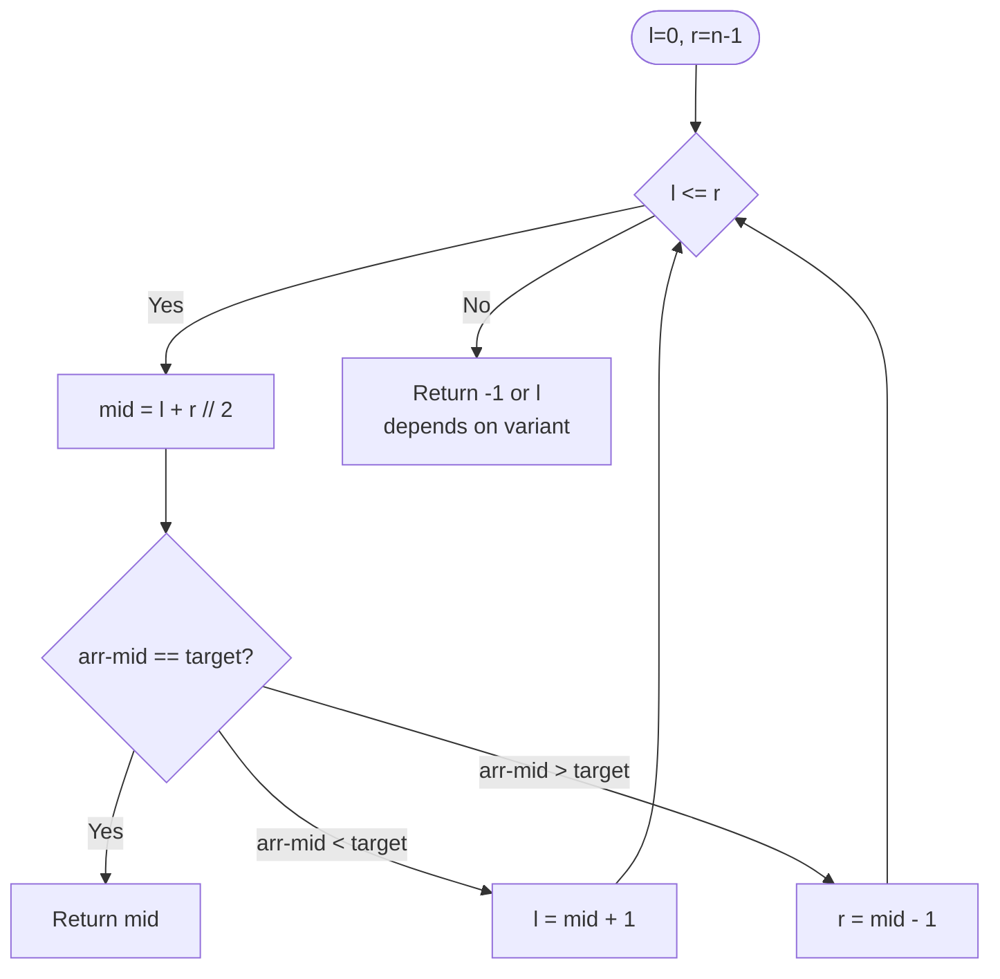
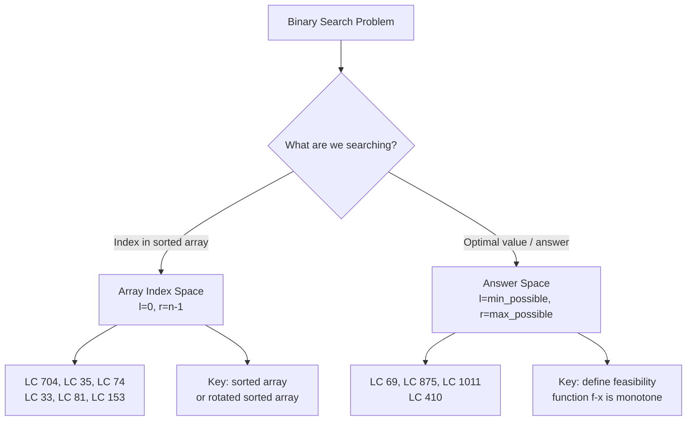
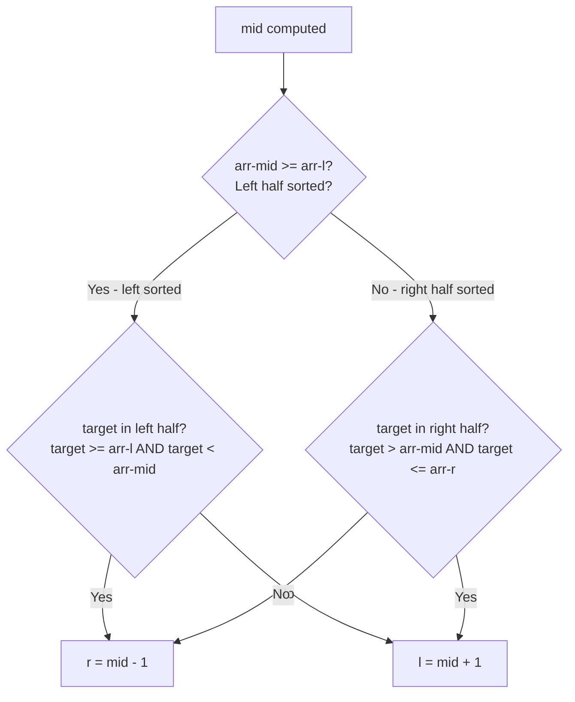
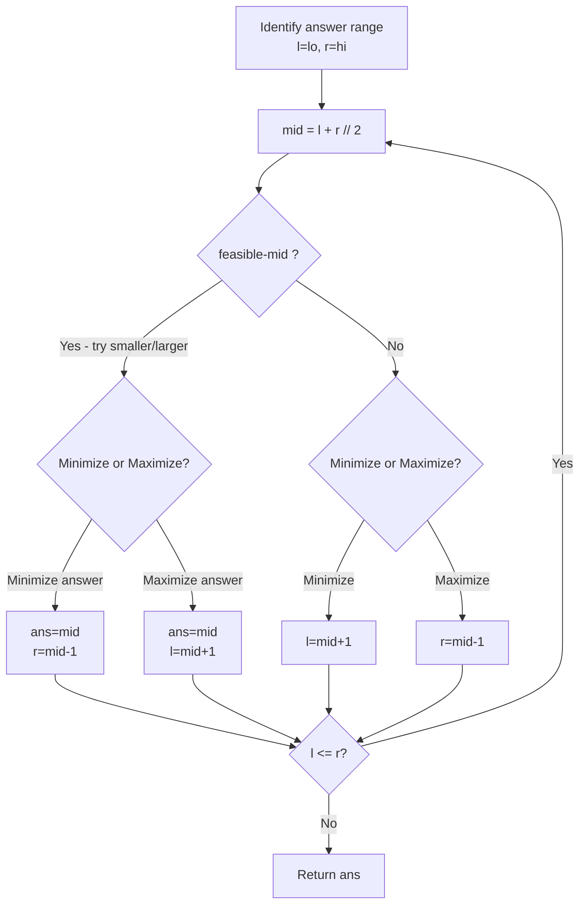

# Binary Search

## Problem List

| # | Problem | Difficulty | Technique |
|---|---------|------------|-----------|
| 1 | [Binary Search (LC 704)](https://leetcode.com/problems/binary-search/) | Easy | Classic |
| 2 | [Search Insert Position (LC 35)](https://leetcode.com/problems/search-insert-position/) | Easy | Lower Bound |
| 3 | [Guess Number Higher Or Lower (LC 374)](https://leetcode.com/problems/guess-number-higher-or-lower/) | Easy | Classic |
| 4 | [Sqrt(x) (LC 69)](https://leetcode.com/problems/sqrtx/) | Easy | Answer Space |
| 5 | [Search a 2D Matrix (LC 74)](https://leetcode.com/problems/search-a-2d-matrix/) | Medium | Flatten Index |
| 6 | [Koko Eating Bananas (LC 875)](https://leetcode.com/problems/koko-eating-bananas/) | Medium | Answer Space |
| 7 | [Capacity to Ship Packages (LC 1011)](https://leetcode.com/problems/capacity-to-ship-packages-within-d-days/) | Medium | Answer Space |
| 8 | [Find Minimum In Rotated Sorted Array (LC 153)](https://leetcode.com/problems/find-minimum-in-rotated-sorted-array/) | Medium | Rotated Array |
| 9 | [Search In Rotated Sorted Array (LC 33)](https://leetcode.com/problems/search-in-rotated-sorted-array/) | Medium | Rotated Array |
| 10 | [Search In Rotated Sorted Array II (LC 81)](https://leetcode.com/problems/search-in-rotated-sorted-array-ii/) | Medium | Rotated + Duplicates |
| 11 | [Time Based Key Value Store (LC 981)](https://leetcode.com/problems/time-based-key-value-store/) | Medium | Lower Bound |
| 12 | [Split Array Largest Sum (LC 410)](https://leetcode.com/problems/split-array-largest-sum/) | Hard | Answer Space |
| 13 | [Median of Two Sorted Arrays (LC 4)](https://leetcode.com/problems/median-of-two-sorted-arrays/) | Hard | Partition |
| 14 | [Find in Mountain Array (LC 1095)](https://leetcode.com/problems/find-in-mountain-array/) | Hard | Peak + Two BS |

---

## Mermaid Diagrams

### 1. Binary Search Template

### 2. Search Space Categories

### 3. Rotated Array Binary Search Logic (LC 33 / LC 153)

### 4. Binary Search on Answer Pattern

---

## Complexity Summary

| Problem | Time | Space | Key Insight |
|---------|------|-------|-------------|
| LC 704 | O(log n) | O(1) | Classic template |
| LC 35 | O(log n) | O(1) | Return `l` when not found |
| LC 374 | O(log n) | O(1) | Use API as comparator |
| LC 69 | O(log x) | O(1) | Answer space [0, x] |
| LC 74 | O(log mn) | O(1) | Treat as 1D array |
| LC 875 | O(n log m) | O(1) | Feasibility: hours <= h |
| LC 1011 | O(n log s) | O(1) | Feasibility: days <= d |
| LC 153 | O(log n) | O(1) | Find inflection point |
| LC 33 | O(log n) | O(1) | Identify sorted half |
| LC 81 | O(log n) avg | O(1) | Skip duplicates: l++ |
| LC 981 | O(log n) per query | O(n) | Lower bound on timestamps |
| LC 410 | O(n log s) | O(1) | Feasibility: splits <= m |
| LC 4 | O(log min(m,n)) | O(1) | Partition smaller array |
| LC 1095 | O(log n) | O(1) | Find peak, BS each side |

---

## Study Order

```mermaid
flowchart LR
    subgraph S1["Stage 1: Classic Binary Search"]
        bs1["binary_search(704) → search_insert_position(35)"]
        bs2["guess_number(374) → sqrtx(69)"]
    end

    subgraph S2["Stage 2: Modified Arrays"]
        bs3["search_2d_matrix(74) → find_minimum_rotated(153)"]
        bs4["search_rotated(33) → search_rotated_ii(81)"]
    end

    subgraph S3["Stage 3: Binary Search on Answer"]
        bs5["koko_eating_bananas(875) → capacity_to_ship(1011)"]
        bs6["split_array_largest_sum(410)"]
    end

    subgraph S4["Stage 4: Hard"]
        bs7["time_based_key_value(981) → find_in_mountain_array(1095)"]
        bs8["median_two_arrays(4)"]
    end

    S1 --> S2 --> S3 --> S4
```

**Recommended order:** Classic → Lower bound → Answer space → Rotated → Hard
