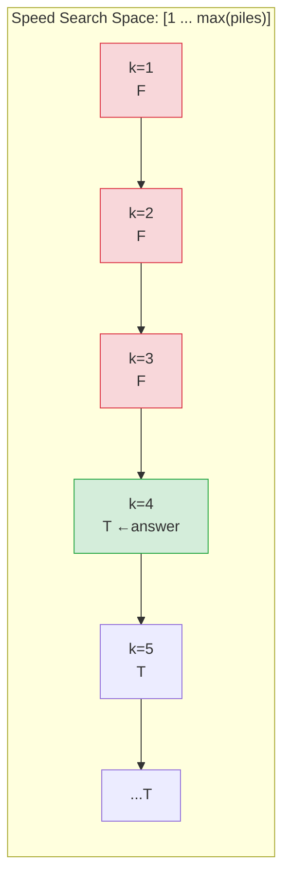
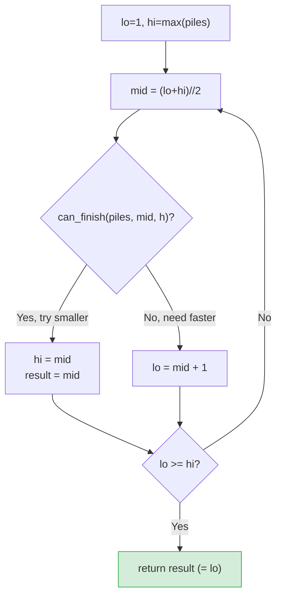

# LC 875 — Koko Eating Bananas

**Difficulty:** Medium | **Pattern:** Binary Search on Answer Space

---

## Problem Statement

Koko has `piles` of bananas. She can eat at most `k` bananas per hour. Each hour she picks one pile and eats up to `k` bananas from it (leftover stays for next hour). Find the **minimum integer speed `k`** such that she can finish all piles within `h` hours.

```
piles = [3, 6, 7, 11],  h = 8   →  4
piles = [30, 11, 23, 5, 20],  h = 5  →  30
```

---

## The Pattern: Binary Search on Answer Space

This problem belongs to a family: **"find the minimum X such that condition(X) is satisfiable."**

The key requirement for binary search to work: **the condition must be monotonic**.

---

## PROOF: Monotonicity of the Feasibility Condition

**Claim:** If speed `k` allows finishing in ≤ `h` hours, then speed `k+1` also allows finishing in ≤ `h` hours.

**Proof:**  
For a pile of size `p`, hours needed at speed `k` = `⌈p/k⌉`.  
Since `k+1 > k`, we have `⌈p/(k+1)⌉ ≤ ⌈p/k⌉` for all `p > 0`.  
(Larger denominator → smaller or equal ceiling.)

Therefore: `total_hours(k+1) = Σ⌈p/(k+1)⌉ ≤ Σ⌈p/k⌉ = total_hours(k) ≤ h`. ∎

This creates a boolean array over the speed space:

```
speed:     1      2      3      4      5    ...  max(piles)
feasible:  F      F      F      T      T    ...  T
                              ↑
                         FIRST TRUE = answer
```

Binary search finds the **leftmost True** in O(log(max(piles))) iterations.

---

## Search Space Justification

- **Lower bound `lo = 1`:** Speed 0 is meaningless (infinite hours). Minimum meaningful speed is 1.
- **Upper bound `hi = max(piles)`:** At speed `max(piles)`, every pile is finished in exactly 1 hour. With `len(piles)` piles and `h ≥ len(piles)` (guaranteed by problem), this always works. No need to go higher — eating faster than the largest pile wastes capacity.

---

## Feasibility Check

```python
def can_finish(piles, speed, h):
    return sum(math.ceil(p / speed) for p in piles) <= h
```

**Why `ceil`?** Each pile takes `⌈pile/speed⌉` hours — you can't split an hour across piles.

**Integer ceiling trick:** `⌈a/b⌉ = (a + b - 1) // b` — avoids floating point.

---

## Monotonic Feasibility Diagram





---

## Algorithm

```python
import math

def minEatingSpeed(piles: list[int], h: int) -> int:
    lo, hi = 1, max(piles)

    while lo < hi:
        mid = (lo + hi) // 2
        hours = sum((p + mid - 1) // mid for p in piles)  # ceil without float
        if hours <= h:
            hi = mid        # mid works, try smaller
        else:
            lo = mid + 1    # mid too slow, need faster

    return lo
```

**Why `hi = mid` (not `mid - 1`) when feasible?**  
`mid` itself might be the answer. We can't exclude it. We narrow to `[lo, mid]`.

**Why return `lo`?**  
Loop exits when `lo == hi`. At that point, `lo` is the smallest feasible speed.

---

## Step-by-Step Walkthrough

### `piles = [3, 6, 7, 11]`, `h = 8`

```
lo=1, hi=11

Iteration 1: mid=6
  hours = ⌈3/6⌉+⌈6/6⌉+⌈7/6⌉+⌈11/6⌉ = 1+1+2+2 = 6 ≤ 8 ✓
  hi = 6

Iteration 2: mid=3
  hours = ⌈3/3⌉+⌈6/3⌉+⌈7/3⌉+⌈11/3⌉ = 1+2+3+4 = 10 > 8 ✗
  lo = 4

Iteration 3: mid=5
  hours = ⌈3/5⌉+⌈6/5⌉+⌈7/5⌉+⌈11/5⌉ = 1+2+2+3 = 8 ≤ 8 ✓
  hi = 5

Iteration 4: mid=4
  hours = ⌈3/4⌉+⌈6/4⌉+⌈7/4⌉+⌈11/4⌉ = 1+2+2+3 = 8 ≤ 8 ✓
  hi = 4

lo=4 == hi=4 → return 4  ✓
```

---

## PROOF of Optimality

**Claim:** The returned `lo` is the global minimum feasible speed.

**Proof by loop invariant:**  
Maintain: the answer always lies in `[lo, hi]`.

- Initially: `lo=1` (minimum possible), `hi=max(piles)` (definitely feasible) → answer ∈ `[1, max(piles)]` ✓
- When `can_finish(mid)` is True: answer could be `mid` or smaller → `hi = mid` keeps answer in `[lo, mid]` ✓
- When `can_finish(mid)` is False: `mid` and everything smaller fails → `lo = mid+1` keeps answer in `[mid+1, hi]` ✓
- When `lo == hi`: only one candidate remains, and by invariant it's the answer. ∎

---

## Generalization: The Binary Search on Answer Template

This exact pattern applies to many problems:

| Problem | Minimize | Condition |
|---|---|---|
| LC 875 Koko Eating Bananas | eating speed | finish in ≤ h hours |
| LC 1011 Ship Packages in D Days | ship capacity | ship all in ≤ D days |
| LC 410 Split Array Largest Sum | largest subarray sum | split into ≤ m parts |
| LC 1482 Minimum Days to Make Bouquets | days | make m bouquets |
| LC 1283 Smallest Divisor | divisor | sum of ceilings ≤ threshold |

**Template:**
```python
lo, hi = min_possible, max_possible
while lo < hi:
    mid = (lo + hi) // 2
    if condition(mid):
        hi = mid
    else:
        lo = mid + 1
return lo
```

---

## Complexity

| | Value | Justification |
|---|---|---|
| **Time** | O(n · log(max(piles))) | log(max(piles)) binary search iterations × O(n) feasibility check |
| **Space** | O(1) | Only pointers and running sum |

**Why `log(max(piles))` and not `log(n)`?**  
The search space is the speed range `[1, max(piles)]`, not the array size. For `piles=[10^9]`, we'd do ~30 iterations regardless of array length.
