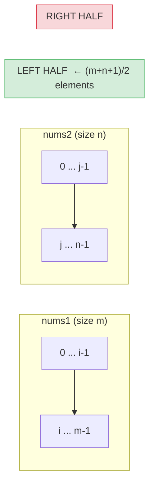
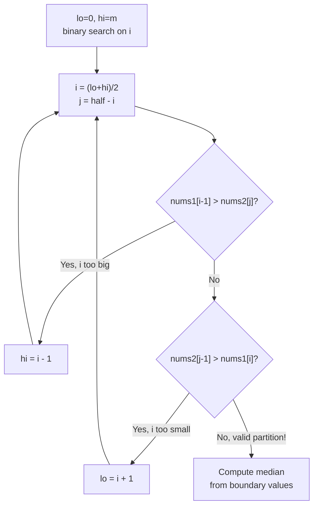

# LC 4 — Median of Two Sorted Arrays

**Difficulty:** Hard | **Pattern:** Binary Search on Partition

---

## Problem Statement

Given two sorted arrays `nums1` (size `m`) and `nums2` (size `n`), return the median of the combined sorted array in **O(log(m+n))** time.

```
nums1 = [1, 3],  nums2 = [2]       → median = 2.0
nums1 = [1, 2],  nums2 = [3, 4]    → median = 2.5
```

---

## Why Naive Approaches Fall Short

| Approach | Time | Why it fails |
|---|---|---|
| Merge then find middle | O(m+n) | Too slow — violates the constraint |
| Binary search on value | O(log(max_val) · log(m+n)) | Complicated, not clean |
| **Binary search on partition** | **O(log(min(m,n)))** | ✅ Elegant and optimal |

---

## Core Insight: Binary Search on Partition

We don't need to merge. We need to find a **cut** in both arrays such that:

- Left half has exactly `(m+n+1)/2` elements
- Every element on the left ≤ every element on the right

If we choose `i` elements from `nums1` for the left half, then we must take exactly `j = (m+n+1)/2 - i` elements from `nums2`.

```
nums1: [ ... | nums1[i-1]  |  nums1[i] ... ]
                    ↑ cut at i
nums2: [ ... | nums2[j-1]  |  nums2[j] ... ]
                    ↑ cut at j
```

**Valid partition condition:**
```
nums1[i-1] <= nums2[j]   AND   nums2[j-1] <= nums1[i]
```

---

## PROOF: The Condition is Monotonic

**Claim:** As `i` increases, `nums1[i-1]` increases and `nums2[j]` decreases (since `j` decreases). This means:

- If `nums1[i-1] > nums2[j]` → `i` is **too large** → move left (`hi = i - 1`)
- If `nums2[j-1] > nums1[i]` → `i` is **too small** → move right (`lo = i + 1`)

Since both arrays are sorted:
- `nums1[i-1]` is non-decreasing as `i` grows
- `nums2[j]` is non-increasing as `i` grows (because `j` shrinks)

Therefore the violation `nums1[i-1] > nums2[j]` is monotonic: once true for some `i`, it stays true for all larger `i`. Binary search is valid. ∎

---

## Partition Diagram





---

## Edge Cases: Using ±∞

When `i=0`: no elements from `nums1` on left → `nums1[i-1]` = **−∞**  
When `i=m`: all of `nums1` on left → `nums1[i]` = **+∞**  
Same logic applies for `j=0` and `j=n`.

This ensures boundary comparisons never fail due to out-of-bounds.

---

## Algorithm

```python
def findMedianSortedArrays(nums1: list[int], nums2: list[int]) -> float:
    # Always binary search on the smaller array
    if len(nums1) > len(nums2):
        nums1, nums2 = nums2, nums1

    m, n = len(nums1), len(nums2)
    half = (m + n + 1) // 2
    lo, hi = 0, m

    while lo <= hi:
        i = (lo + hi) // 2
        j = half - i

        left1  = nums1[i-1] if i > 0 else float('-inf')
        right1 = nums1[i]   if i < m else float('inf')
        left2  = nums2[j-1] if j > 0 else float('-inf')
        right2 = nums2[j]   if j < n else float('inf')

        if left1 <= right2 and left2 <= right1:
            # Valid partition found
            max_left  = max(left1, left2)
            min_right = min(right1, right2)
            if (m + n) % 2 == 1:
                return float(max_left)
            return (max_left + min_right) / 2.0
        elif left1 > right2:
            hi = i - 1   # i too large
        else:
            lo = i + 1   # i too small

    raise ValueError("Input arrays are not sorted")
```

---

## Step-by-Step Walkthrough

### Example 1: `nums1=[1,3]`, `nums2=[2]`

```
m=2, n=1, half=(2+1+1)//2 = 2
lo=0, hi=2

Iteration 1: i=1, j=1
  left1  = nums1[0] = 1
  right1 = nums1[1] = 3
  left2  = nums2[0] = 2
  right2 = nums2[1] = +inf

  left1(1) <= right2(inf) ✓
  left2(2) <= right1(3)   ✓  → VALID PARTITION

  max_left  = max(1, 2) = 2
  min_right = min(3, inf) = 3
  (m+n)=3 is odd → return max_left = 2.0  ✓
```

### Example 2: `nums1=[1,2]`, `nums2=[3,4]`

```
m=2, n=2, half=(2+2+1)//2 = 2
lo=0, hi=2

Iteration 1: i=1, j=1
  left1  = nums1[0] = 1
  right1 = nums1[1] = 2
  left2  = nums2[0] = 3
  right2 = nums2[1] = 4

  left1(1) <= right2(4) ✓
  left2(3) <= right1(2) ✗  → i too small, lo = 2

Iteration 2: i=2, j=0
  left1  = nums1[1] = 2
  right1 = nums1[2] = +inf
  left2  = nums2[-1] = -inf
  right2 = nums2[0]  = 3

  left1(2) <= right2(3) ✓
  left2(-inf) <= right1(inf) ✓  → VALID PARTITION

  max_left  = max(2, -inf) = 2
  min_right = min(inf, 3)  = 3
  (m+n)=4 is even → return (2+3)/2 = 2.5  ✓
```

---

## Complexity

| | Value | Justification |
|---|---|---|
| **Time** | O(log(min(m,n))) | Binary search over the smaller array's partition space [0, m] |
| **Space** | O(1) | Only boundary variables, no extra arrays |

**Why log(min(m,n)) and not log(m+n)?**  
We always binary search on the smaller array. The search space is `[0, m]` where `m ≤ n`, so it's `O(log m) = O(log(min(m,n)))`.
