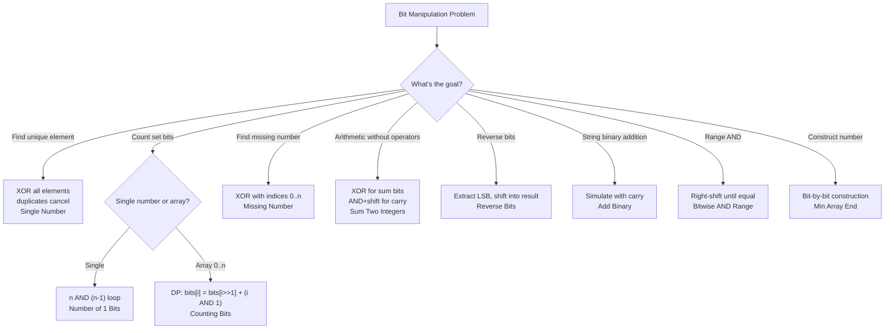

# Bit Manipulation

## Core Intuition
Operate directly on binary representations. Key tricks:
- **XOR**: `a ^ a = 0`, `a ^ 0 = a` → cancels duplicates, finds missing numbers
- **AND**: `n & (n-1)` clears lowest set bit; `n & (-n)` isolates lowest set bit
- **Shift**: `n >> 1` divides by 2; `1 << k` creates a mask for bit k
- **Two's complement**: `-n = ~n + 1`; negative numbers have all high bits set

## Decision Flowchart

## Problems

### Single Number — LC 136 | Easy
- **Learn**: XOR all numbers; pairs cancel to 0, leaving the unique element
- **Mistake**: Using a hash set (O(n) space); XOR is O(1) space
- **Complexity**: O(n) time, O(1) space
- **Edge**: Single element array → that element; all pairs present

---

### Number of 1 Bits — LC 191 | Easy
- **Learn**: `n & (n-1)` clears the lowest set bit; count iterations until n=0
- **Mistake**: Using string conversion `bin(n).count('1')` (valid but not bit manipulation)
- **Complexity**: O(k) time where k = number of set bits, O(1) space
- **Edge**: n=0 → 0; n=2^31-1 → 32 (all bits set)

---

### Counting Bits — LC 338 | Easy
- **Learn**: `dp[i] = dp[i >> 1] + (i & 1)` — right shift removes LSB, add 1 if LSB was set
- **Mistake**: Calling popcount for each number separately (O(n log n) vs O(n))
- **Complexity**: O(n) time, O(n) space
- **Edge**: n=0 → [0]; relies on dp[0]=0 base case

---

### Add Binary — LC 67 | Easy
- **Learn**: Simulate addition from right with carry; use two pointers on both strings
- **Mistake**: Converting to int (overflow for very long binary strings)
- **Complexity**: O(max(m,n)) time, O(max(m,n)) space
- **Edge**: Different length strings; carry propagates past the longer string ("1"+"1"→"10")

---

### Reverse Bits — LC 190 | Easy
- **Learn**: Extract LSB with `n & 1`, shift into result from MSB position; repeat 32 times
- **Mistake**: Not doing exactly 32 iterations (leading zeros matter for 32-bit representation)
- **Complexity**: O(1) time (fixed 32 bits), O(1) space
- **Edge**: n=0 → 0; n=1 → 2^31 (bit moves to MSB)

---

### Missing Number — LC 268 | Easy
- **Learn**: XOR indices 0..n with all array values; missing number remains. Or: expected_sum - actual_sum
- **Mistake**: Using sort O(n log n) when O(n) XOR or math works
- **Complexity**: O(n) time, O(1) space
- **Edge**: Missing 0; missing n (last element); single element array

---

### Sum of Two Integers — LC 371 | Medium
- **Learn**: `a ^ b` gives sum without carry; `(a & b) << 1` gives carry; repeat until carry=0
- **Mistake**: Infinite loop with negative numbers in Python (arbitrary precision integers); mask with `0xFFFFFFFF`
- **Complexity**: O(1) time (max 32 iterations), O(1) space
- **Edge**: One operand is 0; negative numbers (Python needs masking); a = -b → 0

---

### Reverse Integer — LC 7 | Medium
- **Learn**: Extract digits with `% 10`, build reversed number with `* 10`; check overflow before each step
- **Mistake**: Reversing string then converting (misses overflow check); checking overflow after (too late)
- **Complexity**: O(log n) time, O(1) space
- **Edge**: Negative numbers (preserve sign); trailing zeros become leading zeros; overflow → return 0

---

### Bitwise AND of Numbers Range — LC 201 | Medium
- **Learn**: AND of a range = common prefix of a and b in binary; right-shift both until equal, then shift back
- **Mistake**: Iterating through all numbers in range (TLE for large ranges)
- **Complexity**: O(log n) time, O(1) space
- **Edge**: a=0 → 0 (AND with 0 is always 0); a=b → return a

---

### Minimum Array End — LC 3133 | Medium
- **Learn**: Start with x; OR in bits of (n-1) into the zero-bit positions of x to construct the minimum valid end
- **Mistake**: Incrementing from x and checking conditions (too slow for large n)
- **Algorithm**: Spread bits of (n-1) into the 0-positions of x using bit-by-bit construction
- **Complexity**: O(log n) time, O(1) space
- **Edge**: n=1 → x itself; x=0 → n-1

---

## General Edge Cases
- n=0 (XOR and bit count edge cases)
- Negative numbers (two's complement; Python needs `& 0xFFFFFFFF` masking)
- 32-bit overflow (Reverse Integer, Sum Two Integers)
- All bits set (0xFFFFFFFF)
- Single bit set vs all bits set
- Range where left=right (Bitwise AND)
