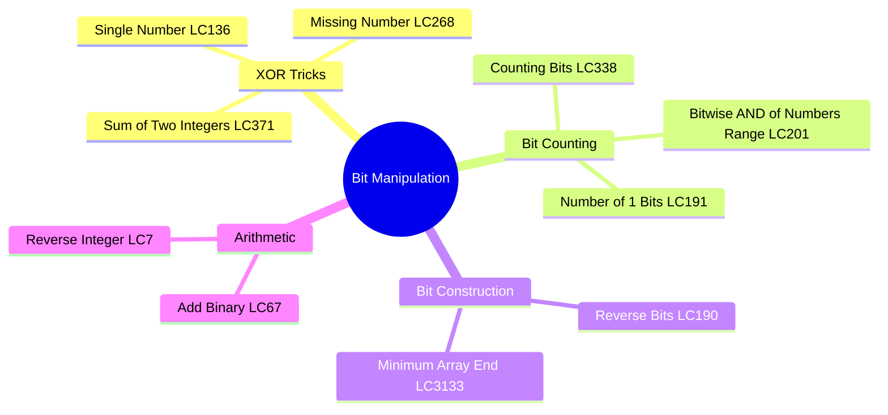
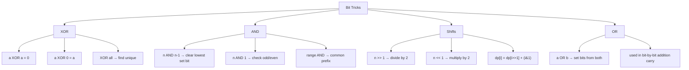
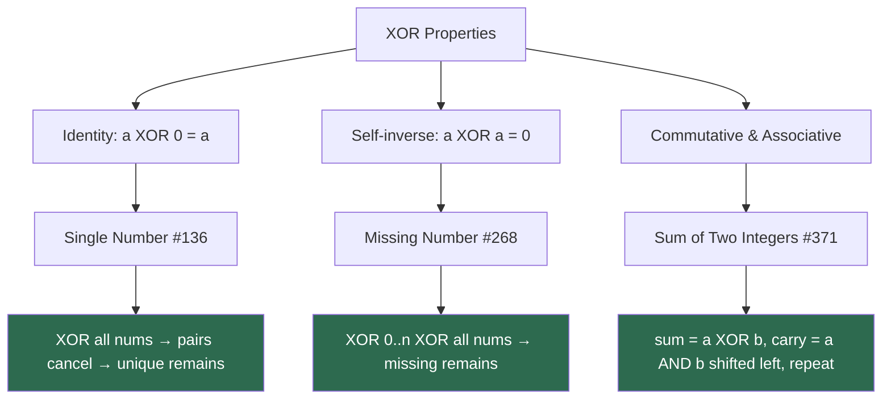
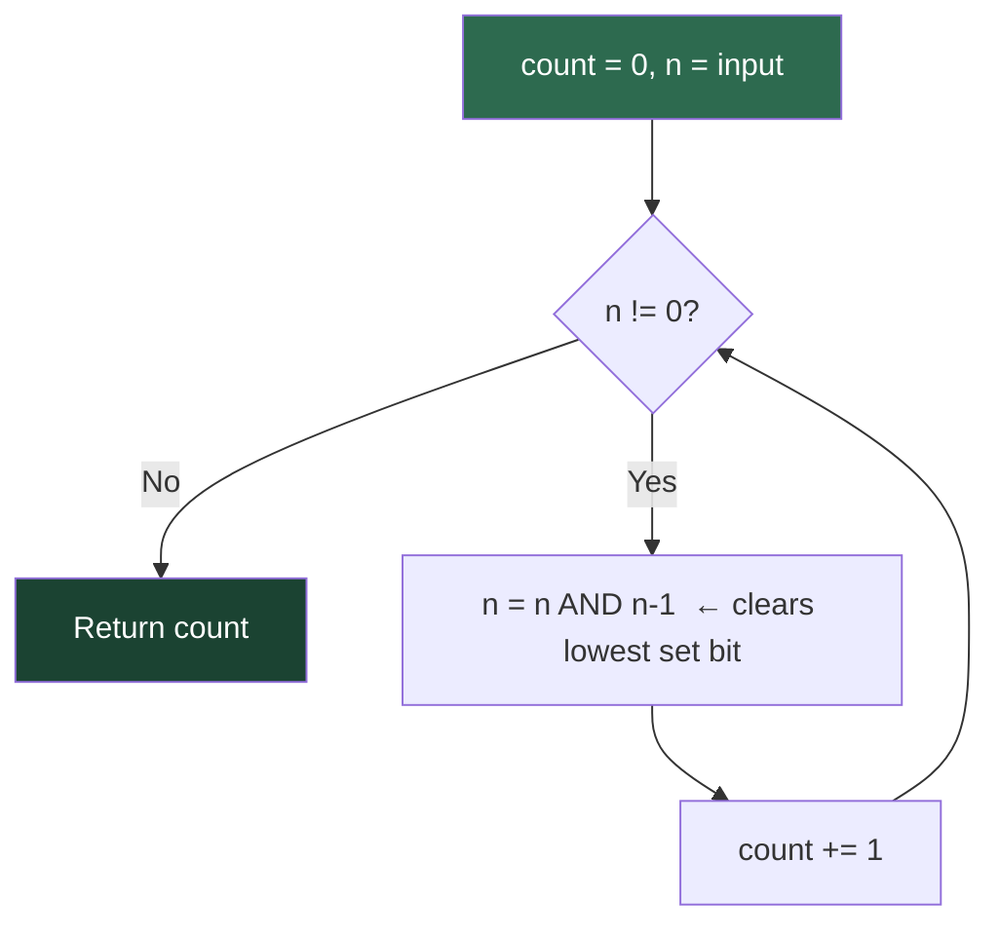
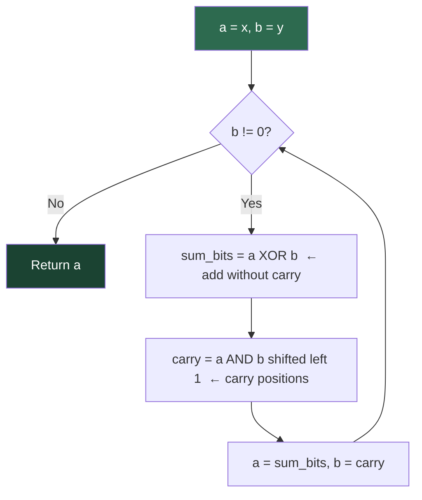
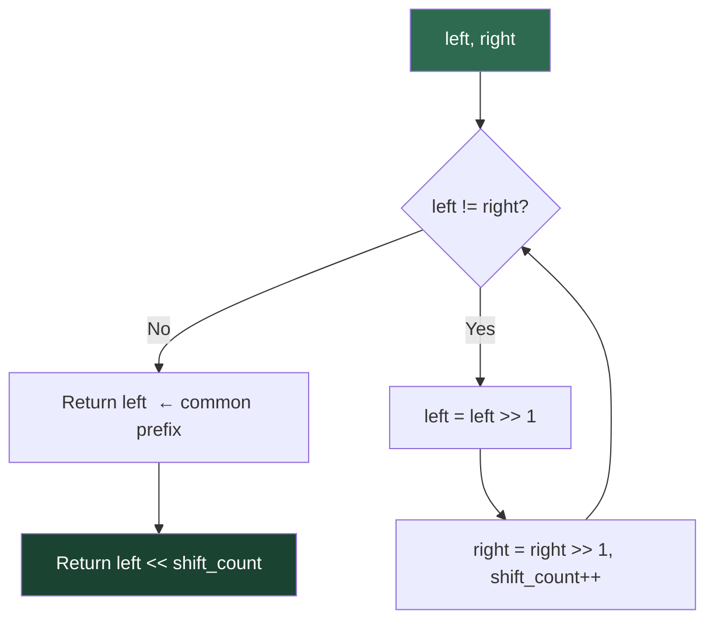

# Bit Manipulation

## Problem List

| # | Problem | LC # | Difficulty | Key Technique |
|---|---------|------|------------|---------------|
| 1 | Single Number | 136 | Easy | XOR all elements |
| 2 | Number of 1 Bits | 191 | Easy | Brian Kernighan's |
| 3 | Counting Bits | 338 | Easy | DP with bit shift |
| 4 | Add Binary | 67 | Easy | Bit-by-bit addition |
| 5 | Reverse Bits | 190 | Easy | Shift and OR |
| 6 | Missing Number | 268 | Easy | XOR or Gauss sum |
| 7 | Sum of Two Integers | 371 | Medium | XOR + AND carry |
| 8 | Reverse Integer | 7 | Medium | Mod + overflow check |
| 9 | Bitwise AND of Numbers Range | 201 | Medium | Common prefix |
| 10 | Minimum Array End | 3133 | Medium | Bit construction |

---

## Bit Manipulation Tricks Cheat Sheet

---

## XOR Properties and Applications

---

## Brian Kernighan's Algorithm Flow

*Each iteration removes exactly one set bit → O(number of set bits)*

**Counting Bits (LC 338) DP shortcut:** `dp[i] = dp[i >> 1] + (i & 1)`

---

## Bit-by-Bit Addition Flow (No + Operator)

*Terminates when no carry remains. Used in: Sum of Two Integers #371*

---

## Common Prefix — Range AND Flow

*All bits that differ between left and right become 0 in the AND of the range.*

---

## Complexity Summary

| Problem | Time | Space |
|---------|------|-------|
| Single Number | O(n) | O(1) |
| Number of 1 Bits | O(log n) | O(1) |
| Counting Bits | O(n) | O(n) |
| Add Binary | O(n) | O(n) |
| Reverse Bits | O(1) — 32 iters | O(1) |
| Missing Number | O(n) | O(1) |
| Sum of Two Integers | O(1) — 32 iters | O(1) |
| Reverse Integer | O(log n) | O(1) |
| Bitwise AND of Range | O(log n) | O(1) |
| Minimum Array End | O(log n) | O(1) |

---

## Study Order

1. **Single Number** — XOR identity
2. **Missing Number** — XOR or Gauss
3. **Number of 1 Bits** — Brian Kernighan's
4. **Counting Bits** — DP with right shift
5. **Reverse Bits** — shift and OR
6. **Add Binary** — string bit addition
7. **Sum of Two Integers** — XOR + carry loop
8. **Reverse Integer** — overflow handling
9. **Bitwise AND of Numbers Range** — common prefix
10. **Minimum Array End** — bit construction
