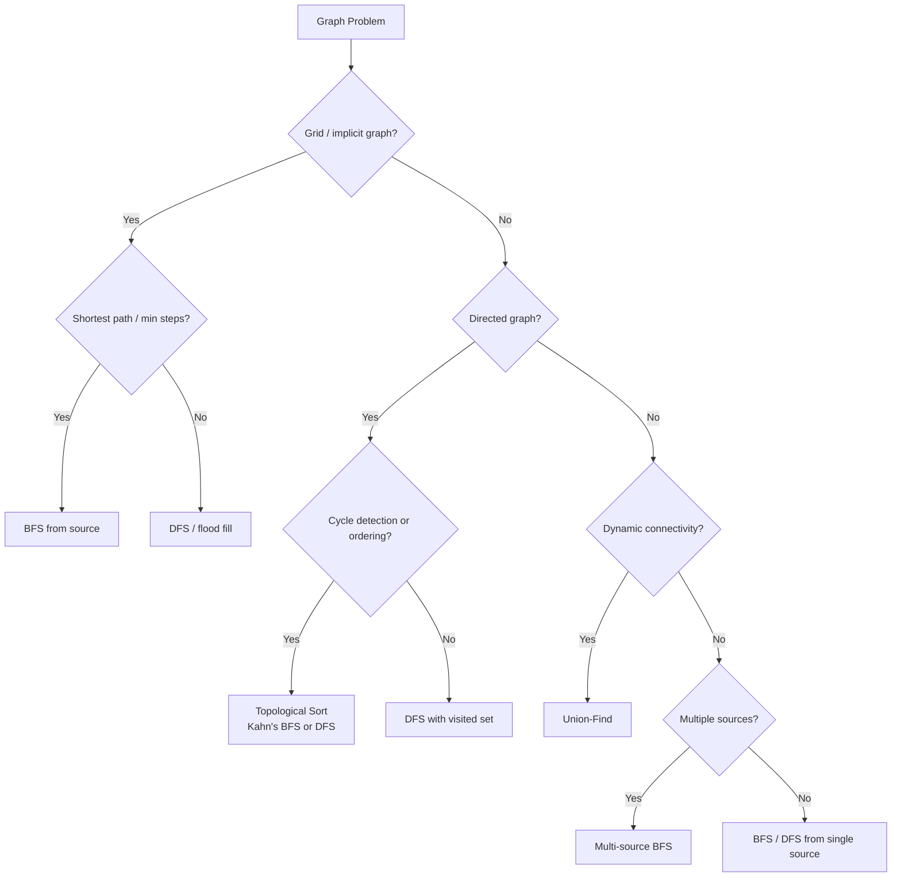

# Graphs — Pattern Notes

## Core Intuition

Graphs are about **connectivity and traversal**. The key questions: Is it a grid (implicit graph)? Do edges have direction? Are there cycles? Do you need shortest path or just reachability?

- **BFS** = shortest path in unweighted graphs, level-by-level exploration.
- **DFS** = connectivity, cycle detection, topological sort.
- **Union-Find** = dynamic connectivity, cycle detection in undirected graphs.
- **Topological Sort** = ordering with dependencies (DAG only).
- **Multi-source BFS** = start from multiple nodes simultaneously (e.g., rotting oranges).

---

## Decision Flowchart

---

## Per-Problem Notes

### 1. Island Perimeter — LC 463 | Easy
- **Key insight:** For each land cell, contribute 4 edges. Subtract 2 for each shared edge with a neighbor land cell.
- **Tricky:** No BFS/DFS needed — pure math on the grid.
- **Common mistakes:** Trying to use DFS when a simple O(n·m) scan works.
- **Time:** O(n·m) | **Space:** O(1)

### 2. Verifying Alien Dictionary — LC 953 | Easy
- **Key insight:** Build order map from alien alphabet. For each adjacent word pair, find first differing char and check order.
- **Tricky:** If word1 is a prefix of word2 but longer → invalid (e.g., "apple" before "app").
- **Common mistakes:** Not handling the prefix case.
- **Time:** O(n·m) | **Space:** O(1) (26 chars)

### 3. Find the Town Judge — LC 997 | Easy
- **Key insight:** Judge is trusted by everyone (in-degree = n-1) and trusts nobody (out-degree = 0). Track both with arrays.
- **Tricky:** A person can't be the judge if they trust anyone.
- **Common mistakes:** Only checking in-degree, forgetting out-degree check.
- **Time:** O(n + e) | **Space:** O(n)

### 4. Number of Islands — LC 200 | Medium
- **Key insight:** DFS/BFS flood fill. Mark visited cells as '0' (or use visited set). Count connected components.
- **Tricky:** Modify grid in-place vs. using a visited set — in-place is O(1) extra space.
- **Common mistakes:** Not marking cells visited before adding to queue (BFS) → duplicates.
- **Time:** O(n·m) | **Space:** O(n·m)

### 5. Max Area of Island — LC 695 | Medium
- **Key insight:** Same flood fill as #200, but return size of each component and track max.
- **Tricky:** Return count from DFS recursion.
- **Common mistakes:** Forgetting to mark visited before recursing → infinite loop.
- **Time:** O(n·m) | **Space:** O(n·m)

### 6. Clone Graph — LC 133 | Medium
- **Key insight:** DFS/BFS with a hashmap `{original: clone}`. If node already cloned, return clone.
- **Tricky:** The hashmap serves as both visited set and clone registry.
- **Common mistakes:** Not using the hashmap as visited → infinite loop on cycles.
- **Time:** O(n + e) | **Space:** O(n)

### 7. Walls and Gates — LC 286 | Medium
- **Key insight:** Multi-source BFS from all gates (0s) simultaneously. Fill INF cells with distance.
- **Tricky:** Start BFS from all gates at once — don't BFS from each gate separately (O(n·m·g)).
- **Common mistakes:** BFS from each gate individually → TLE. Not skipping walls (-1).
- **Time:** O(n·m) | **Space:** O(n·m)

### 8. Rotting Oranges — LC 994 | Medium
- **Key insight:** Multi-source BFS from all rotten oranges. Count fresh oranges; decrement as they rot.
- **Tricky:** If fresh > 0 after BFS, return -1 (unreachable fresh oranges).
- **Common mistakes:** Not counting initial fresh oranges. Returning time when queue is empty instead of when fresh == 0.
- **Time:** O(n·m) | **Space:** O(n·m)

### 9. Pacific Atlantic Water Flow — LC 417 | Medium
- **Key insight:** Reverse thinking — BFS/DFS from ocean borders inward. Find cells reachable from both oceans.
- **Tricky:** Going "uphill" from ocean (water flows downhill, so reverse: mark cells that can reach ocean).
- **Common mistakes:** Forward DFS from each cell → O(n²·m²). Must reverse the direction.
- **Time:** O(n·m) | **Space:** O(n·m)

### 10. Surrounded Regions — LC 130 | Medium
- **Key insight:** Mark 'O's connected to border as safe (DFS from borders). Flip remaining 'O' to 'X'.
- **Tricky:** Only 'O's NOT connected to border get flipped.
- **Common mistakes:** Flipping all 'O's. Not doing the border-connected DFS first.
- **Time:** O(n·m) | **Space:** O(n·m)

### 11. Open the Lock — LC 752 | Medium
- **Key insight:** BFS on state space. Each state is a 4-digit string. 8 neighbors per state (each wheel ±1).
- **Tricky:** Start state "0000" might be in deadends. Handle this upfront.
- **Common mistakes:** Not adding initial state to visited before BFS. Forgetting wrap-around (9→0, 0→9).
- **Time:** O(10⁴) | **Space:** O(10⁴)

### 12. Course Schedule — LC 207 | Medium
- **Key insight:** Detect cycle in directed graph. DFS with 3 states: unvisited(0), visiting(1), visited(2). Cycle if we hit a "visiting" node.
- **Tricky:** Must distinguish "currently in stack" (visiting) from "fully processed" (visited).
- **Common mistakes:** Using only a boolean visited — can't detect back edges properly.
- **Time:** O(V + E) | **Space:** O(V + E)

### 13. Course Schedule II — LC 210 | Medium
- **Key insight:** Topological sort. DFS postorder (add to result after all descendants processed) or Kahn's BFS (in-degree).
- **Tricky:** If cycle exists, return []. Kahn's: if result size < numCourses → cycle.
- **Common mistakes:** Not reversing DFS postorder result. Not detecting cycles.
- **Time:** O(V + E) | **Space:** O(V + E)

### 14. Graph Valid Tree — LC 261 | Medium
- **Key insight:** Valid tree = connected + no cycles = exactly n-1 edges + all nodes connected.
- **Tricky:** Check edge count first: if edges != n-1, return False immediately.
- **Common mistakes:** Not checking edge count. Using Union-Find but forgetting connectivity check.
- **Time:** O(n + e) | **Space:** O(n)

### 15. Course Schedule IV — LC 1462 | Medium
- **Key insight:** Transitive closure. BFS/DFS from each node, or Floyd-Warshall for dense graphs. Store reachability matrix.
- **Tricky:** Precompute all reachability, then answer queries in O(1).
- **Common mistakes:** Running BFS per query → TLE.
- **Time:** O(V·(V+E)) | **Space:** O(V²)

### 16. Number of Connected Components — LC 323 | Medium
- **Key insight:** Union-Find or DFS. Count components = n - number of successful unions.
- **Tricky:** Union-Find with path compression + union by rank is cleanest.
- **Common mistakes:** Forgetting to initialize each node as its own parent.
- **Time:** O(n + e · α(n)) | **Space:** O(n)

### 17. Redundant Connection — LC 684 | Medium
- **Key insight:** Union-Find. Process edges in order; the first edge that connects two already-connected nodes is redundant.
- **Tricky:** Return the last such edge if multiple exist (problem guarantees one answer).
- **Common mistakes:** Using DFS cycle detection — works but Union-Find is cleaner and O(α(n)) per operation.
- **Time:** O(n · α(n)) | **Space:** O(n)

### 18. Accounts Merge — LC 721 | Medium
- **Key insight:** Union-Find on emails. Union all emails in same account. Group by root, sort, prepend name.
- **Tricky:** Map email → account name for the root email. Sort emails within each group.
- **Common mistakes:** Not sorting the final email lists. Forgetting to map root email to account name.
- **Time:** O(n·m · α(n·m)) | **Space:** O(n·m)

### 19. Evaluate Division — LC 399 | Medium
- **Key insight:** Build weighted directed graph. BFS/DFS to find path product between query nodes.
- **Tricky:** Add both directions: a/b = x means add edge a→b (x) and b→a (1/x).
- **Common mistakes:** Not adding reverse edges. Not handling queries where nodes don't exist in graph.
- **Time:** O((V+E) · Q) | **Space:** O(V + E)

### 20. Minimum Height Trees — LC 310 | Medium
- **Key insight:** Topological sort from leaves inward. Iteratively remove leaf nodes. Last 1-2 nodes are roots.
- **Tricky:** Answer is always 1 or 2 nodes. Stop when ≤ 2 nodes remain.
- **Common mistakes:** BFS from all nodes to find min height — O(n²). Must use leaf-trimming approach.
- **Time:** O(n) | **Space:** O(n)

### 21. Word Ladder — LC 127 | Hard
- **Key insight:** BFS on word state space. Each word's neighbors = all words differing by 1 char. Use word set for O(1) lookup.
- **Tricky:** Generate neighbors by replacing each char with a-z (26·L neighbors per word). Remove from set when visited.
- **Common mistakes:** Using edit distance between all pairs → O(n²·L). Not removing visited words from set → TLE.
- **Time:** O(n·L·26) | **Space:** O(n·L)

---

## Edge Cases to Watch For

- **Disconnected graph:** Always check if all nodes are visited after traversal.
- **Self-loops:** Handle in cycle detection and Union-Find.
- **Empty graph / single node:** Return appropriate base case.
- **Grid boundaries:** Always check `0 <= r < rows and 0 <= c < cols` before accessing.
- **Already visited in BFS:** Add to visited when enqueuing, not when dequeuing — prevents duplicates.
- **Directed vs undirected:** Cycle detection differs. Undirected: parent tracking. Directed: 3-color DFS.
- **Topological sort on cyclic graph:** Must detect cycle and return empty/invalid.
- **Multi-source BFS initial state:** Add ALL sources to queue and visited set before starting BFS.
