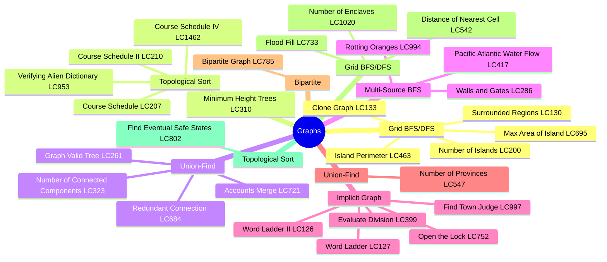
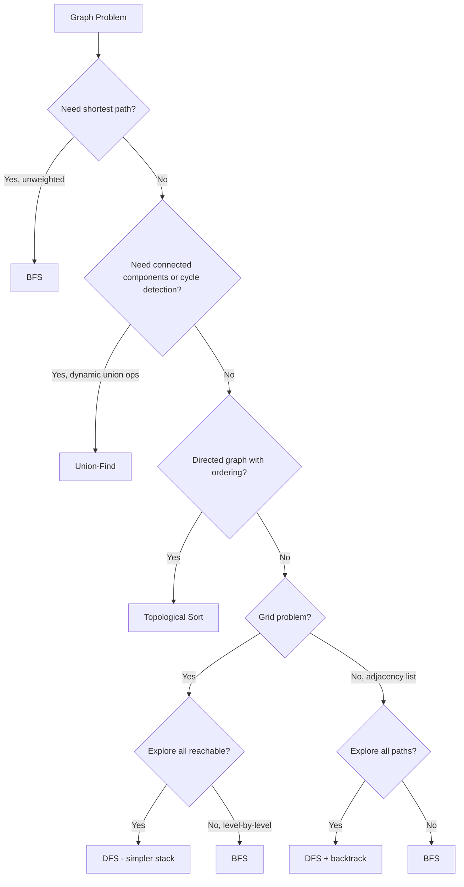
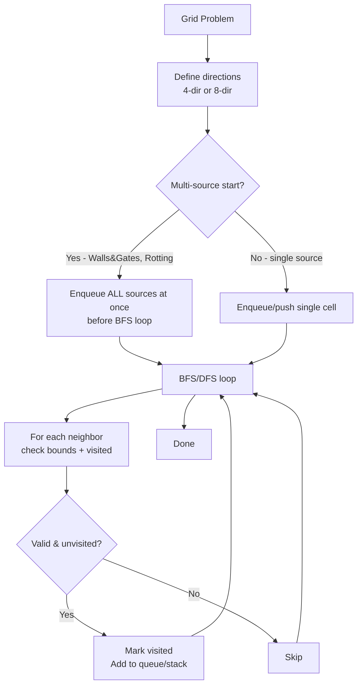
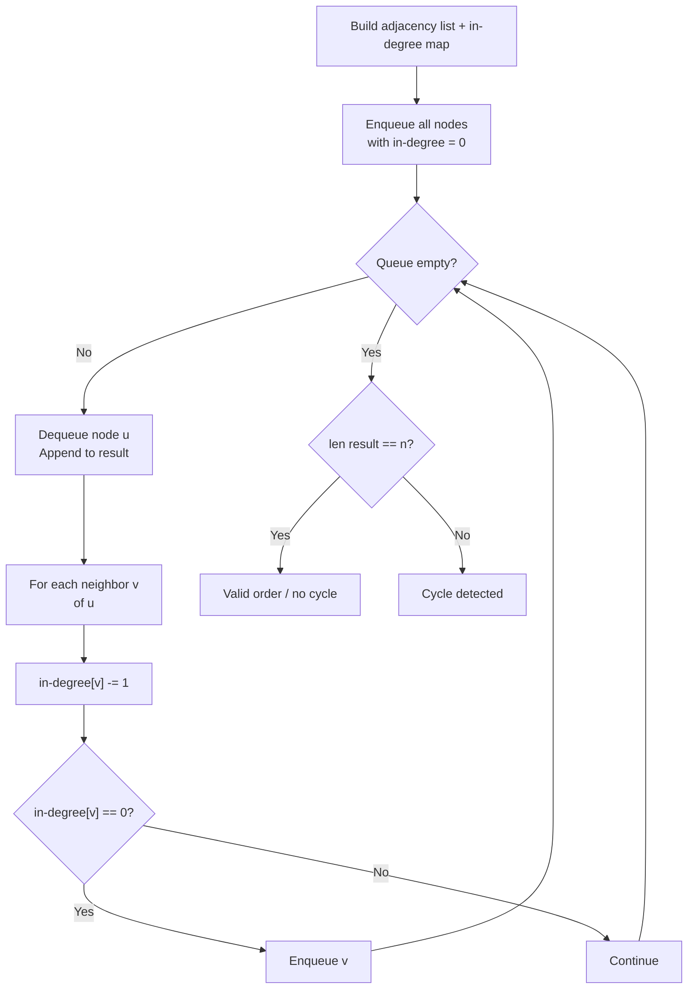
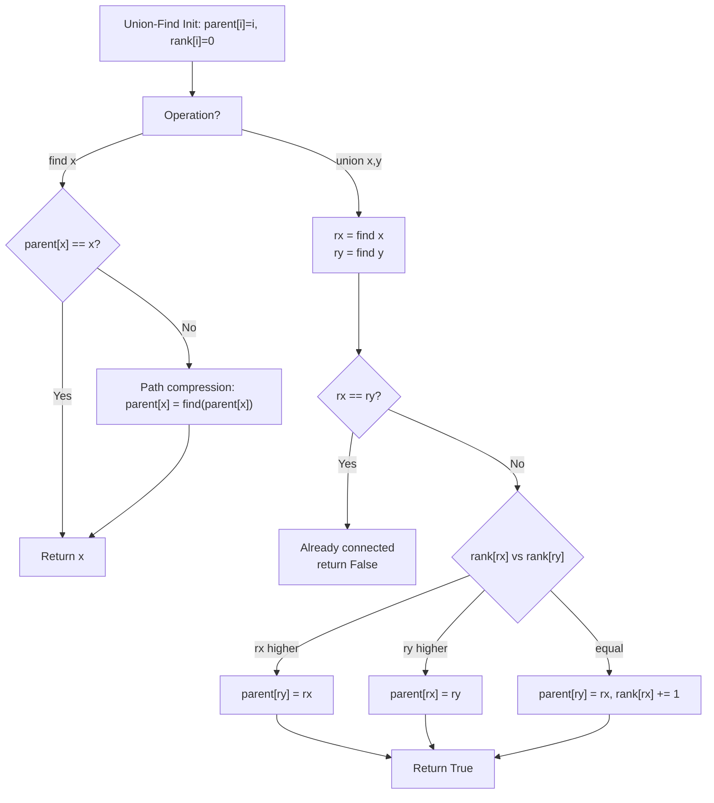
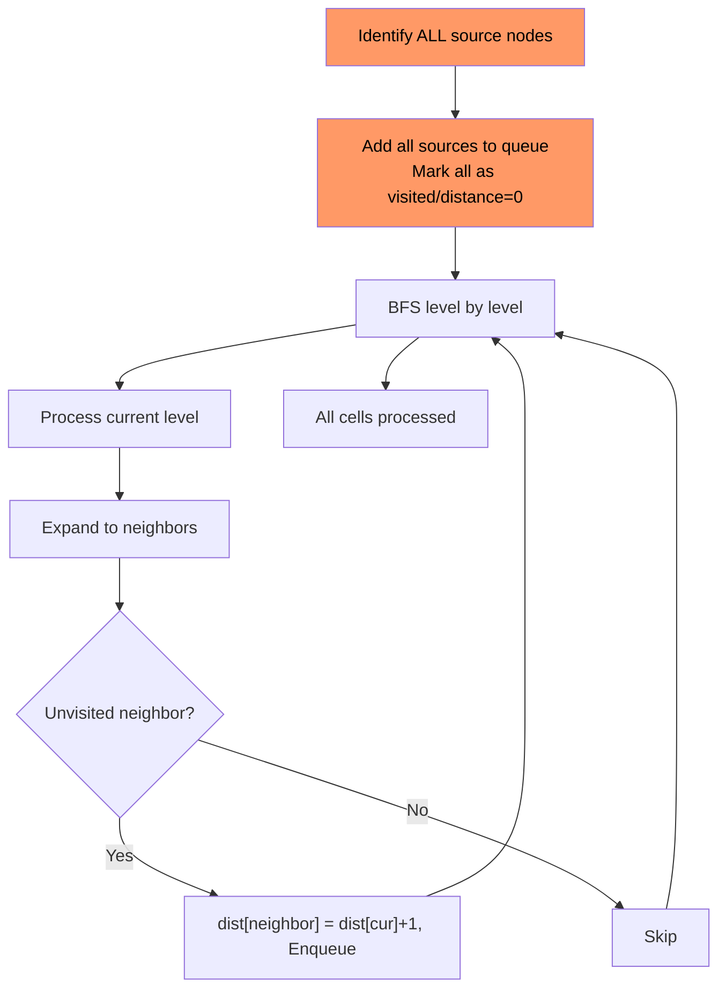

# Graphs

## Problem List

| # | Problem | LC # | Difficulty | Key Technique |
|---|---------|------|------------|---------------|
| 1 | Island Perimeter | 463 | Easy | Grid traversal |
| 2 | Verifying Alien Dictionary | 953 | Easy | Order mapping |
| 3 | Find Town Judge | 997 | Easy | In/out degree |
| 4 | Number of Islands | 200 | Medium | DFS/BFS/Union-Find |
| 5 | Max Area of Island | 695 | Medium | DFS |
| 6 | Clone Graph | 133 | Medium | DFS + hashmap |
| 7 | Walls and Gates | 286 | Medium | Multi-source BFS |
| 8 | Rotting Oranges | 994 | Medium | Multi-source BFS |
| 9 | Pacific Atlantic Water Flow | 417 | Medium | Multi-source BFS |
| 10 | Surrounded Regions | 130 | Medium | DFS from border |
| 11 | Open the Lock | 752 | Medium | BFS shortest path |
| 12 | Course Schedule | 207 | Medium | Topological sort / cycle detection |
| 13 | Course Schedule II | 210 | Medium | Topological sort (Kahn's) |
| 14 | Graph Valid Tree | 261 | Medium | Union-Find / DFS |
| 15 | Course Schedule IV | 1462 | Medium | Topological sort + reachability |
| 16 | Number of Connected Components | 323 | Medium | Union-Find |
| 17 | Redundant Connection | 684 | Medium | Union-Find |
| 18 | Accounts Merge | 721 | Medium | Union-Find |
| 19 | Evaluate Division | 399 | Medium | Weighted DFS/BFS |
| 20 | Minimum Height Trees | 310 | Medium | Topological sort (leaf trimming) |
| 21 | Word Ladder | 127 | Hard | BFS shortest path |
| 22 | Number of Provinces | 547 | Medium | Union-Find / DFS |
| 23 | Flood Fill | 733 | Easy | Grid DFS |
| 24 | Bipartite Graph | 785 | Medium | BFS/DFS coloring |
| 25 | Number of Enclaves | 1020 | Medium | Grid DFS from border |
| 26 | Distance of Nearest Cell (01 Matrix) | 542 | Medium | Multi-source BFS |
| 27 | Word Ladder II | 126 | Hard | BFS + backtrack |
| 28 | Find Eventual Safe States | 802 | Medium | Topological sort / reverse DFS |

---

## Patterns & Diagrams

### 1. Graph Traversal Decision Tree

### 2. Grid BFS/DFS Pattern

### 3. Topological Sort — Kahn's BFS

### 4. Union-Find Operations

### 5. Multi-Source BFS Pattern

---

## Complexity Summary

| Problem | Time | Space | Pattern |
|---------|------|-------|---------|
| island_perimeter | O(m×n) | O(1) | Grid traversal |
| verifying_alien_dictionary | O(n·k) | O(1) | Order mapping |
| find_the_town_judge | O(V+E) | O(V) | In/out degree |
| number_of_islands | O(m×n) | O(m×n) | Grid DFS/BFS |
| max_area_of_island | O(m×n) | O(m×n) | Grid DFS |
| clone_graph | O(V+E) | O(V) | DFS + hashmap |
| walls_and_gates | O(m×n) | O(m×n) | Multi-source BFS |
| rotting_oranges | O(m×n) | O(m×n) | Multi-source BFS |
| pacific_atlantic_water_flow | O(m×n) | O(m×n) | Multi-source BFS |
| surrounded_regions | O(m×n) | O(m×n) | DFS from border |
| open_the_lock | O(10⁴) | O(10⁴) | BFS shortest path |
| course_schedule | O(V+E) | O(V+E) | Topological sort / cycle detection |
| course_schedule_ii | O(V+E) | O(V+E) | Topological sort (Kahn's) |
| graph_valid_tree | O(V+E) | O(V) | Union-Find / DFS |
| course_schedule_iv | O(V+E) | O(V²) | Topological sort + reachability |
| number_of_connected_components | O(V·α(V)) | O(V) | Union-Find |
| redundant_connection | O(V·α(V)) | O(V) | Union-Find |
| accounts_merge | O(n·k·α(n)) | O(n·k) | Union-Find |
| evaluate_division | O(Q·(V+E)) | O(V+E) | Weighted DFS/BFS |
| minimum_height_trees | O(V+E) | O(V+E) | Topological sort (leaf trimming) |
| word_ladder | O(M²·N) | O(M²·N) | BFS shortest path |
| number_of_provinces | O(V²·α(V)) | O(V) | Union-Find / DFS |
| flood_fill | O(m×n) | O(m×n) | Grid DFS |
| bipartite_graph | O(V+E) | O(V) | BFS/DFS coloring |
| number_of_enclaves | O(m×n) | O(m×n) | Grid DFS from border |
| distance_of_nearest_cell | O(m×n) | O(m×n) | Multi-source BFS |
| word_ladder_ii | O(M²·N) | O(M²·N) | BFS + backtrack |
| find_eventual_safe_states | O(V+E) | O(V+E) | Topological sort / reverse DFS |

---

## Study Order

1. **Warm-up** — 463, 953, 997 (no traversal needed)
2. **Grid DFS** — 200, 695, 130 (flood fill pattern)
3. **Grid BFS / Multi-source** — 286, 994, 417 (multi-source BFS)
4. **General graph BFS/DFS** — 133, 752, 127 (adjacency list)
5. **Topological Sort** — 207, 210, 1462, 310 (Kahn's algorithm)
6. **Union-Find** — 261, 323, 684, 721 (union-find template)
7. **Weighted/Advanced** — 399 (weighted BFS/DFS)
