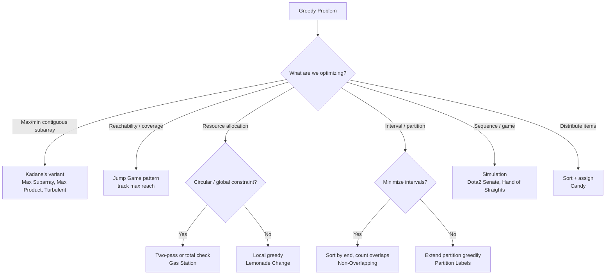

# Greedy

## Core Intuition
Make the locally optimal choice at each step, trusting it leads to a global optimum. Greedy works when the problem has **optimal substructure** and a **greedy choice property** — you never need to reconsider a past decision.

- **Kadane's**: Extend or restart subarray based on current sum
- **Jump games**: Track the farthest reachable index
- **Scheduling**: Sort by end time / deadline
- **Partitioning**: Greedily extend current partition as far as possible

## Decision Flowchart

## Problems

### Lemonade Change — LC 860 | Easy
- **Learn**: Greedy: prefer giving $10+$5 change over three $5s (preserve $5 bills)
- **Mistake**: Not prioritizing $10 bill for $20 change
- **Complexity**: O(n) time, O(1) space
- **Edge**: First customer pays $10 or $20 → false immediately

---

### Maximum Subarray — LC 53 | Medium
- **Learn**: Kadane's: curr = max(num, curr+num); update global max each step
- **Mistake**: Initializing curr/max to 0 (fails all-negative arrays)
- **Complexity**: O(n) time, O(1) space
- **Edge**: All negative → return max element; single element

---

### Maximum Sum Circular Subarray — LC 918 | Medium
- **Learn**: Answer is max(normal Kadane, total_sum - min_subarray); handle all-negative case
- **Mistake**: Forgetting the all-negative edge case (circular answer would be 0, but must pick at least one)
- **Complexity**: O(n) time, O(1) space
- **Edge**: All negative → return max element (not circular)

---

### Longest Turbulent Subarray — LC 978 | Medium
- **Learn**: Track current run length; reset when pattern breaks (inc→inc or dec→dec)
- **Mistake**: Not handling equal adjacent elements (turbulent length resets to 1)
- **Complexity**: O(n) time, O(1) space
- **Edge**: All equal elements → 1; length 1 → 1

---

### Jump Game — LC 55 | Medium
- **Learn**: Track `maxReach`; if current index > maxReach, return false
- **Mistake**: Simulating all jumps instead of just tracking max reach
- **Complexity**: O(n) time, O(1) space
- **Edge**: Single element → true; last element is 0 but already at end

---

### Jump Game II — LC 45 | Medium
- **Learn**: BFS-like: track current level's farthest reach; increment jumps when exhausting current level
- **Mistake**: Greedy "always jump to farthest" without tracking level boundaries
- **Complexity**: O(n) time, O(1) space
- **Edge**: Already at last index → 0 jumps; guaranteed reachable

---

### Jump Game VII — LC 1871 | Medium
- **Learn**: Use a sliding window / BFS with a pointer to track reachable positions; avoid re-processing
- **Mistake**: O(n²) BFS without the "last processed" pointer optimization
- **Complexity**: O(n) time, O(n) space
- **Edge**: Start or end is '1' → false; minJump > maxJump

---

### Gas Station — LC 134 | Medium
- **Learn**: If total gas ≥ total cost, a solution exists; find start by resetting when tank < 0
- **Mistake**: Not using the total sum check (guarantees unique solution exists)
- **Complexity**: O(n) time, O(1) space
- **Edge**: Single station; all costs equal all gas

---

### Hand of Straights — LC 846 | Medium
- **Learn**: Sort + use ordered map; greedily form groups starting from smallest card
- **Mistake**: Not checking if total cards divisible by groupSize first
- **Complexity**: O(n log n) time, O(n) space
- **Edge**: groupSize=1 → always true; cards not divisible by groupSize → false

---

### Dota2 Senate — LC 649 | Medium
- **Learn**: Two queues (Radiant, Dire); smaller index bans the other, re-queues with index+n
- **Mistake**: Using a single array simulation instead of queues (O(n²))
- **Complexity**: O(n) time, O(n) space
- **Edge**: All same party → that party wins immediately

---

### Merge Triplets to Form Target — LC 1899 | Medium
- **Learn**: Filter triplets where any component exceeds target; then check if max of remaining equals target
- **Mistake**: Including triplets that exceed target in any dimension
- **Complexity**: O(n) time, O(1) space
- **Edge**: No valid triplets after filtering → false

---

### Partition Labels — LC 763 | Medium
- **Learn**: Last occurrence of each char; greedily extend partition end; cut when i == end
- **Mistake**: Not updating the partition end as you scan
- **Complexity**: O(n) time, O(1) space (26-char map)
- **Edge**: All same character → single partition; all unique → n partitions of size 1

---

### Valid Parenthesis String — LC 678 | Medium
- **Learn**: Track range [lo, hi] of possible open counts; '*' expands range; prune lo < 0
- **Mistake**: Only tracking one count; not clamping lo to 0
- **Complexity**: O(n) time, O(1) space
- **Edge**: All '*' → true; empty string → true

---

### Candy — LC 135 | Hard
- **Learn**: Two passes: left→right (higher rating than left neighbor gets +1), right→left (same for right); take max at each position
- **Mistake**: Single pass; not taking max of both passes at each index
- **Complexity**: O(n) time, O(n) space
- **Edge**: All equal ratings → n candies; strictly increasing → 1,2,...,n

---

## General Edge Cases
- All-negative arrays (Kadane's variants)
- Single element input
- Circular arrays (Gas Station, Max Sum Circular)
- Ties in greedy ordering (break ties consistently)
- Empty input → 0 or true depending on problem
- Integer overflow for sum-based problems
