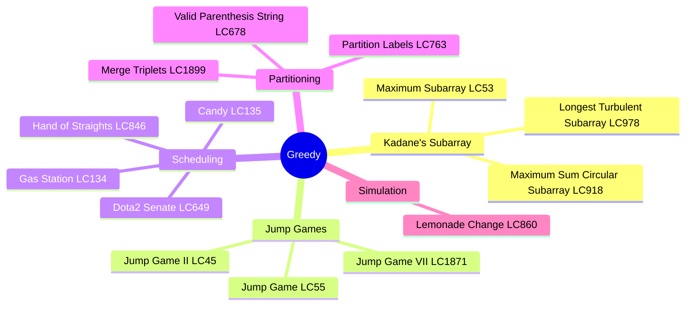
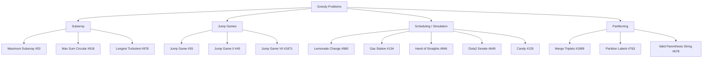
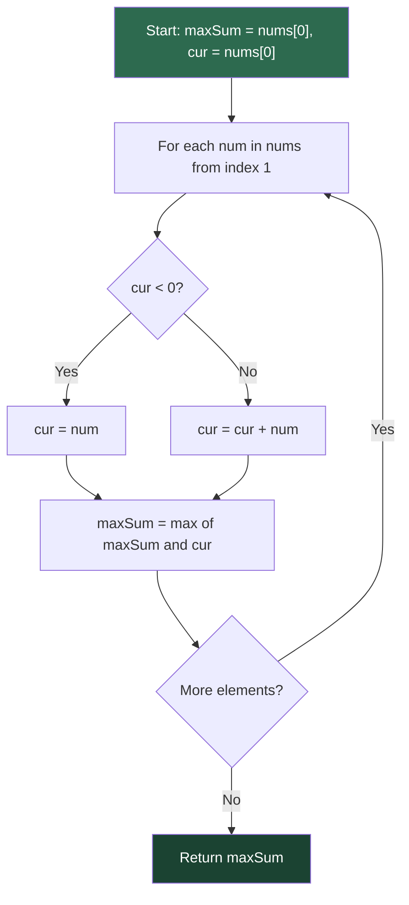
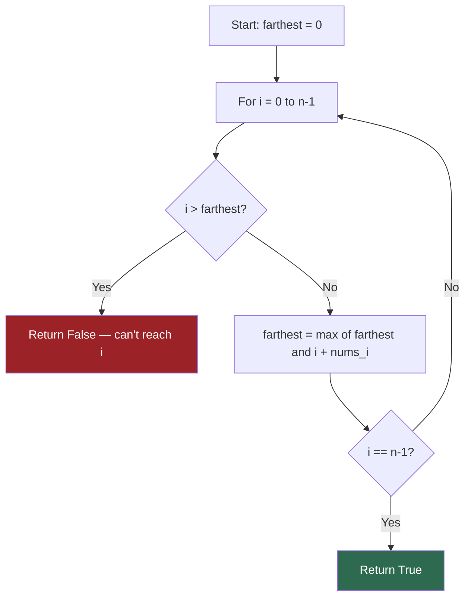
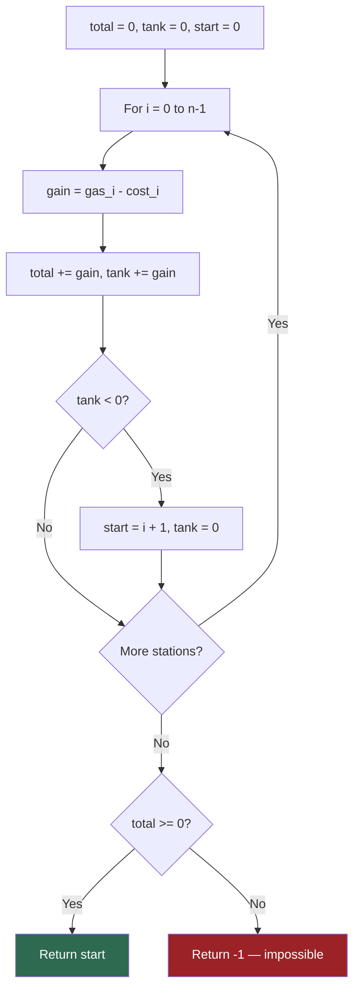
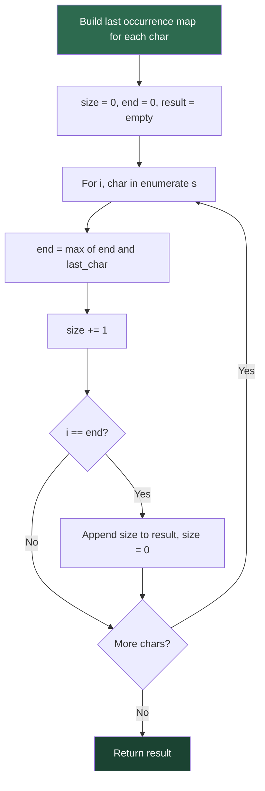

# Greedy

## Problem List

| # | Problem | LC # | Difficulty | Key Technique |
|---|---------|------|------------|---------------|
| 1 | Lemonade Change | 860 | Easy | Greedy simulation |
| 2 | Maximum Subarray | 53 | Medium | Kadane's algorithm |
| 3 | Maximum Sum Circular Subarray | 918 | Medium | Kadane's + total - min subarray |
| 4 | Longest Turbulent Subarray | 978 | Medium | Kadane's variant |
| 5 | Jump Game | 55 | Medium | Greedy farthest reach |
| 6 | Jump Game II | 45 | Medium | Greedy BFS levels |
| 7 | Jump Game VII | 1871 | Medium | Sliding window + greedy |
| 8 | Gas Station | 134 | Medium | Single-pass greedy |
| 9 | Hand of Straights | 846 | Medium | Greedy + sorted map |
| 10 | Dota2 Senate | 649 | Medium | Greedy queue |
| 11 | Merge Triplets | 1899 | Medium | Greedy filtering |
| 12 | Partition Labels | 763 | Medium | Last occurrence greedy |
| 13 | Valid Parenthesis String | 678 | Medium | Greedy range tracking |
| 14 | Candy | 135 | Hard | Two-pass greedy |

---

## Greedy Problem Categories

---

## Kadane's Algorithm Flow

**Circular variant (LC 918):** `answer = max(maxSubarray, totalSum - minSubarray)`

---

## Jump Game Greedy Flow

**Jump Game II (LC 45):** Track current window end; when `i == windowEnd`, increment jumps and extend window to `farthest`.

---

## Gas Station Single-Pass Logic

---

## Partition Labels Algorithm Flow

---

## Complexity Summary

| Problem | Time | Space |
|---------|------|-------|
| Lemonade Change | O(n) | O(1) |
| Maximum Subarray | O(n) | O(1) |
| Max Sum Circular | O(n) | O(1) |
| Longest Turbulent | O(n) | O(1) |
| Jump Game | O(n) | O(1) |
| Jump Game II | O(n) | O(1) |
| Jump Game VII | O(n) | O(n) |
| Gas Station | O(n) | O(1) |
| Hand of Straights | O(n log n) | O(n) |
| Dota2 Senate | O(n) | O(n) |
| Merge Triplets | O(n) | O(1) |
| Partition Labels | O(n) | O(1) |
| Valid Parenthesis String | O(n) | O(1) |
| Candy | O(n) | O(n) |

---

## Study Order

1. **Lemonade Change** — warm-up greedy simulation
2. **Maximum Subarray** — master Kadane's
3. **Max Sum Circular Subarray** — Kadane's variant
4. **Longest Turbulent Subarray** — Kadane's with conditions
5. **Jump Game** — greedy farthest reach
6. **Jump Game II** — greedy BFS levels
7. **Jump Game VII** — sliding window + greedy
8. **Gas Station** — single-pass invariant
9. **Partition Labels** — last occurrence greedy
10. **Valid Parenthesis String** — greedy range
11. **Merge Triplets** — greedy filtering
12. **Hand of Straights** — sorted map greedy
13. **Dota2 Senate** — queue-based greedy
14. **Candy** — two-pass hard greedy
