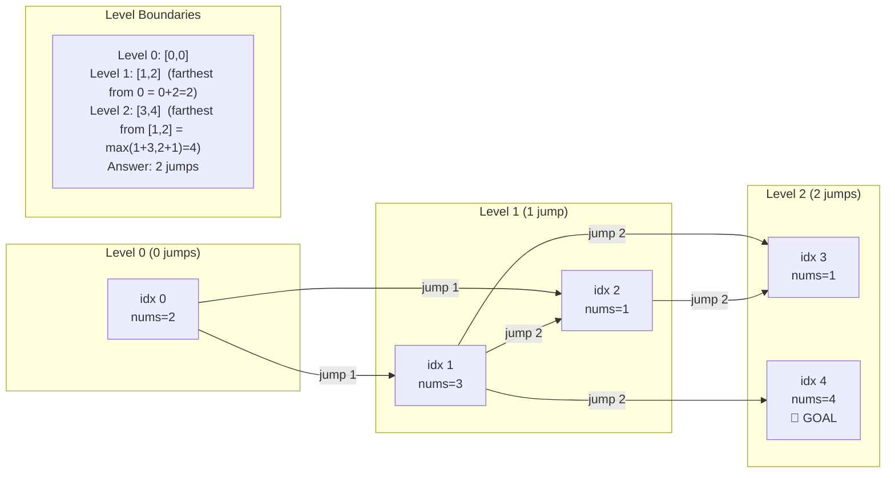

# LC 45: Jump Game II — BFS Equivalence Proof

## Problem Statement

Given array `nums` where `nums[i]` is the maximum jump length from index `i`, return the minimum number of jumps to reach the last index. It is guaranteed you can reach the last index.

**Example:** `nums = [2,3,1,1,4]` → Output: `2`

---

## The BFS Equivalence

The greedy algorithm is not just "greedy" — it is **exactly BFS** on an implicit graph.

### Graph Model

- **Nodes:** indices `0` to `n-1`
- **Edges:** from index `i`, there are edges to all indices in `[i+1, i+nums[i]]`
- **Goal:** shortest path from `0` to `n-1`
- **Edge weights:** all 1 (unweighted) → BFS gives shortest path

### BFS Levels = Jump Counts

In standard BFS, we process nodes level by level. Here:
- **Level 0:** just index `0` (we start here, 0 jumps)
- **Level 1:** all indices reachable in exactly 1 jump from level 0
- **Level k:** all indices reachable in exactly k jumps

The key observation: **BFS levels are contiguous ranges**.

---

## Proof: BFS Levels are Contiguous Ranges

**Claim:** The set of indices reachable in exactly `k` jumps forms a contiguous range `[prev_end+1, curr_end]`.

**Proof by induction:**

Base case (k=0): Level 0 = {0}, trivially contiguous. ✓

Inductive step: Assume level `k-1` is the contiguous range `[a, b]`.

Level `k` = all indices reachable in one jump from any index in `[a, b]`.

For any index `j` in level `k`, there exists some `i` in `[a, b]` with `i + nums[i] ≥ j` and `j > b`.

**Claim: level k is also contiguous.**

Let `farthest = max(i + nums[i] for i in [a, b])`. Level k covers `[b+1, farthest]`.

Why is every index in `[b+1, farthest]` reachable in exactly k jumps?
- Every index `> b` is not in level `k-1` (by definition of `b`).
- Every index `≤ farthest` is reachable from some `i` in `[a, b]` in one jump.
- Therefore level k = `[b+1, farthest]`, which is contiguous. ✓ ∎

**Consequence:** We don't need an actual queue. We just track the range boundaries.

---

## Algorithm

```
jumps = 0
current_end = 0    # right boundary of current BFS level
farthest = 0       # right boundary of next BFS level

for i in range(n-1):
    farthest = max(farthest, i + nums[i])
    if i == current_end:          # exhausted current level
        jumps += 1
        current_end = farthest    # advance to next level
        if current_end >= n-1:
            break
```

---

## Proof of Optimality

**Claim:** The algorithm returns the minimum number of jumps.

**Proof:**

BFS on an unweighted graph always finds the shortest path (minimum number of edges). This is a standard result.

Our algorithm simulates BFS exactly:
- `current_end` tracks the boundary of the current BFS level.
- `farthest` tracks the boundary of the next BFS level.
- `jumps` counts the number of levels crossed = number of edges in the path = number of jumps.

Since BFS is optimal for unweighted shortest paths, and our algorithm is BFS, it is optimal. ∎

---

## Mermaid Diagram: BFS Levels on `nums = [2,3,1,1,4]`



---

## Step-by-Step Walkthrough: `nums = [2,3,1,1,4]`

| i | nums[i] | i+nums[i] | farthest | i==current_end? | action |
|---|---------|-----------|----------|-----------------|--------|
| 0 | 2 | 2 | 2 | YES (end=0) | jumps=1, end=2 |
| 1 | 3 | 4 | 4 | | |
| 2 | 1 | 3 | 4 | YES (end=2) | jumps=2, end=4 |
| — | — | — | — | end≥n-1=4 | **break** |

**Answer: 2 jumps** ✓

Trace:
- Jump 1: from index 0, jump to index 1 (or 2)
- Jump 2: from index 1, jump to index 4 (the end)

---

## Implementation

```python
def jump(nums: list[int]) -> int:
    jumps = current_end = farthest = 0

    for i in range(len(nums) - 1):
        farthest = max(farthest, i + nums[i])
        if i == current_end:
            jumps += 1
            current_end = farthest

    return jumps
```

Note: we loop to `n-2` (not `n-1`) because we don't need to jump from the last index.

---

## Complexity

| | Value | Justification |
|---|---|---|
| **Time** | O(n) | Single pass through the array |
| **Space** | O(1) | Only three integer variables |

This is optimal — we must examine every element at least once (lower bound Ω(n)), and we do exactly that.
