# LC 763: Partition Labels — Greedy Correctness Proof

## Problem Statement

Given string `s`, partition it into as many parts as possible such that each letter appears in at most one part. Return a list of the sizes of these parts.

**Example:** `s = "ababcbacadefegdehijhklij"` → `[9, 7, 8]`

---

## Algorithm

1. Precompute `last[c]` = last index where character `c` appears.
2. Scan left to right, tracking `partition_end` = furthest last occurrence seen so far.
3. When `i == partition_end`: we've found a valid cut point. Record partition size, start new partition.

```python
def partitionLabels(s: str) -> list[int]:
    last = {c: i for i, c in enumerate(s)}
    result = []
    start = partition_end = 0

    for i, c in enumerate(s):
        partition_end = max(partition_end, last[c])
        if i == partition_end:
            result.append(i - start + 1)
            start = i + 1

    return result
```

---

## Proof of Correctness

### Claim 1: When `i == partition_end`, we can safely cut after index `i`

**Proof:**

We maintain the invariant: `partition_end = max(last[c] for c in s[start:i+1])`

This means: for every character `c` seen in `[start, i]`, its last occurrence is at index `≤ partition_end`.

When `i == partition_end`:
- Every character in `s[start:i+1]` has its last occurrence within `[start, i]`.
- No character from this partition appears at any index `> i`.
- Therefore, cutting after index `i` produces a valid partition (no character spans the cut). ∎

### Claim 2: This cut is the EARLIEST valid cut point (maximizes partition count)

**Proof by contradiction:**

Suppose we could cut at some index `j < partition_end` (an earlier cut).

Since `partition_end = max(last[c] for c in s[start:j+1])`, there exists some character `c` in `s[start:j+1]` with `last[c] = partition_end > j`.

This means character `c` appears both in `s[start:j+1]` (before the cut) and at index `partition_end > j` (after the cut).

This violates the partition constraint — `c` would appear in two different partitions. ∎

**Corollary:** Since our cut is the earliest valid cut, we maximize the number of partitions. Any algorithm that cuts later would merge partitions unnecessarily.

---

## Mermaid Diagram: Partition Extension Process

```mermaid
graph LR
    subgraph Scan["Scanning s = 'ababcbacadefegdehijhklij'"]
        direction LR
        S0["i=0, c='a'<br>last[a]=8<br>end=max(0,8)=8"]
        S1["i=1, c='b'<br>last[b]=5<br>end=max(8,5)=8"]
        S2["i=2, c='a'<br>last[a]=8<br>end=8"]
        S3["i=3, c='b'<br>end=8"]
        S4["i=4, c='c'<br>last[c]=7<br>end=8"]
        S5["..."]
        S6["i=8, c='a'<br>i==end=8<br>✂ CUT! size=9"]
        S7["i=9, c='d'<br>last[d]=14<br>end=14"]
        S8["i=10, c='e'<br>last[e]=15<br>end=15"]
        S9["..."]
        S10["i=15, c='e'<br>i==end=15<br>✂ CUT! size=7"]
        S11["i=16..23<br>✂ CUT at 23! size=8"]

        S0 --> S1 --> S2 --> S3 --> S4 --> S5 --> S6
        S6 --> S7 --> S8 --> S9 --> S10 --> S11
    end
```



---

## Step-by-Step Walkthrough: `s = "ababcbacadefegdehijhklij"`

### Precompute last occurrences

| char | last index |
|------|-----------|
| a | 8 |
| b | 5 |
| c | 7 |
| d | 14 |
| e | 15 |
| f | 11 |
| g | 13 |
| h | 19 |
| i | 22 |
| j | 23 |
| k | 20 |
| l | 21 |

### Scan

| i | s[i] | last[s[i]] | partition_end | cut? |
|---|------|-----------|---------------|------|
| 0 | a | 8 | 8 | |
| 1 | b | 5 | 8 | |
| 2 | a | 8 | 8 | |
| 3 | b | 5 | 8 | |
| 4 | c | 7 | 8 | |
| 5 | b | 5 | 8 | |
| 6 | a | 8 | 8 | |
| 7 | c | 7 | 8 | |
| 8 | a | 8 | **8** | ✂ size = 8-0+1 = **9** |
| 9 | d | 14 | 14 | |
| 10 | e | 15 | 15 | |
| 11 | f | 11 | 15 | |
| 12 | e | 15 | 15 | |
| 13 | g | 13 | 15 | |
| 14 | d | 14 | 15 | |
| 15 | e | 15 | **15** | ✂ size = 15-9+1 = **7** |
| 16 | h | 19 | 19 | |
| 17 | i | 22 | 22 | |
| 18 | j | 23 | 23 | |
| 19 | h | 19 | 23 | |
| 20 | k | 20 | 23 | |
| 21 | l | 21 | 23 | |
| 22 | i | 22 | 23 | |
| 23 | j | 23 | **23** | ✂ size = 23-16+1 = **8** |

**Answer: `[9, 7, 8]`** ✓

---

## Complexity

| | Value | Justification |
|---|---|---|
| **Time** | O(n) | One pass to build `last`, one pass to scan |
| **Space** | O(1) | `last` has at most 26 entries (fixed alphabet) |

The O(1) space claim holds because the alphabet is fixed (lowercase English letters). For a general alphabet of size Σ, space is O(Σ).
