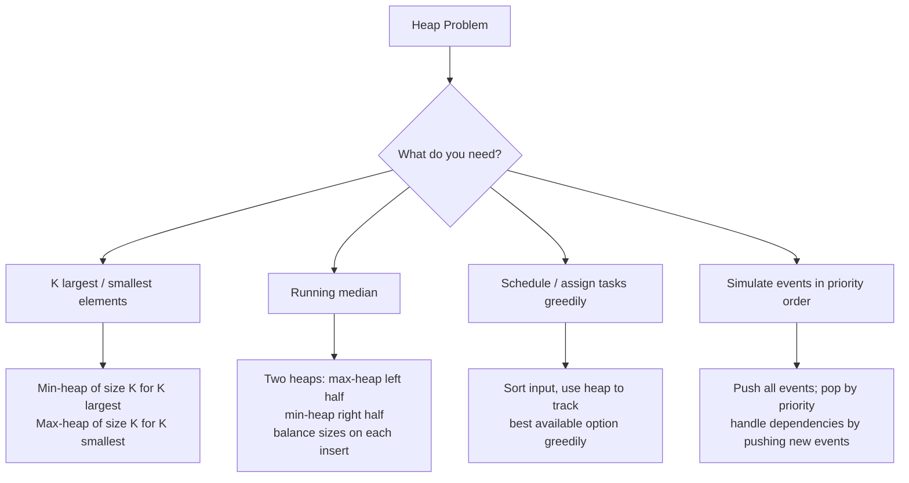

# Heap — Pattern Notes

## Core Intuition
A heap gives you O(log n) insert and O(1) peek at the min (or max). Use it whenever you need to **repeatedly extract the current best** from a dynamic set. Python only has `heapq` (min-heap) — negate values for max-heap.

Sub-patterns:
- **Top-K** — maintain a heap of size K; push and pop to keep only K best
- **Two Heaps** — max-heap for lower half + min-heap for upper half → O(1) median
- **Greedy + Heap** — sort by one dimension, use heap to greedily pick best on another
- **Event Simulation** — push events by time/priority, process in order

---

## Decision Diagram

---

## Per-Problem Notes

| # | Problem | LC | Difficulty | What to Learn | Common Mistakes | Time / Space |
|---|---------|-----|------------|---------------|-----------------|--------------|
| 1 | Kth Largest in Stream | 703 | Easy | Min-heap of size K; heap[0] is always the Kth largest | Heap size > K — must pop when size exceeds K | O(log k) add / O(k) space |
| 2 | Last Stone Weight | 1046 | Easy | Max-heap (negate); pop two heaviest, push difference if nonzero | Forgetting to push back when stones aren't equal | O(n log n) / O(n) |
| 3 | K Closest Points | 973 | Medium | Min-heap by distance; pop K times. Or max-heap of size K | Computing distance with sqrt (unnecessary — compare squared) | O(n log k) / O(k) |
| 4 | Kth Largest in Array | 215 | Medium | Min-heap of size K; final heap[0] is answer. Or quickselect O(n) avg | Using max-heap and popping n-k times (works but slower) | O(n log k) / O(k) |
| 5 | Task Scheduler | 621 | Medium | Greedy: always schedule most frequent available task. Use max-heap + cooldown queue | Not handling idle time correctly; forgetting cooldown queue | O(n log n) / O(n) |
| 6 | Design Twitter | 355 | Medium | Per-user tweet list; on `getNewsFeed` merge K lists with max-heap of (timestamp, user, idx) | Not limiting to 10 tweets; heap comparison on equal timestamps | O(f log f) getNewsFeed / O(n) |
| 7 | Single-Threaded CPU | 1834 | Medium | Sort tasks by enqueue time; use min-heap (processing_time, idx); simulate time jumps | Not jumping time forward when CPU is idle | O(n log n) / O(n) |
| 8 | Reorganize String | 767 | Medium | Max-heap by frequency; greedily pick most frequent, then second most frequent | Placing same char consecutively; not re-adding char with remaining count | O(n log k) / O(k) |
| 9 | Longest Happy String | 1405 | Medium | Same greedy as Reorganize String but allow up to 2 consecutive; pick 2nd most freq when top would make 3 | Not switching to second most frequent when top would violate constraint | O(n log k) / O(k) |
| 10 | Car Pooling | 1094 | Medium | Event simulation: push (time, +/-passengers); sort/heap by time; track current passengers | Not handling simultaneous drop-off before pick-up at same stop | O(n log n) / O(n) |
| 11 | Find Median from Stream | 295 | Hard | Two heaps: max-heap (lo) + min-heap (hi); balance so `len(lo) == len(hi)` or `len(lo) == len(hi)+1` | Not rebalancing after each insert; median formula for even/odd sizes | O(log n) add, O(1) median / O(n) |
| 12 | IPO | 502 | Hard | Sort projects by capital; greedily unlock affordable projects into max-heap by profit; pick top K times | Not re-checking newly affordable projects after each pick | O(n log n) / O(n) |

---

## Edge Cases to Watch
- K larger than array size — return all elements
- All stones equal weight in Last Stone — result is 0 (even count) or that weight (odd count)
- Task Scheduler with all unique tasks — no idle time needed
- Find Median with all same elements — median is that element
- Car Pooling: drop-off and pick-up at same location — drop off first
- IPO with 0 initial capital — only projects with `capital=0` are initially available
- Reorganize String impossible — when `max_freq > (n+1)//2`, return `""`
- Two heaps: always push to `lo` first, then rebalance to `hi` if needed
