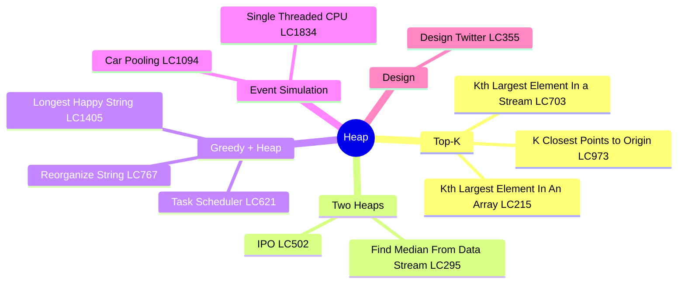
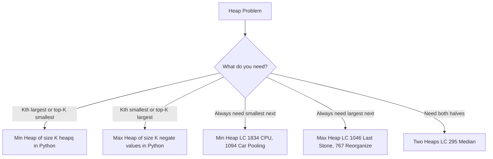
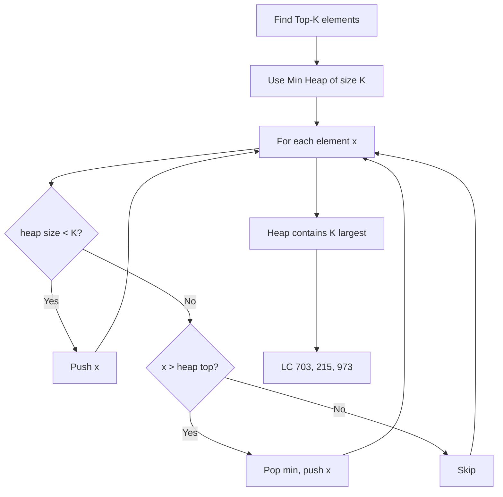
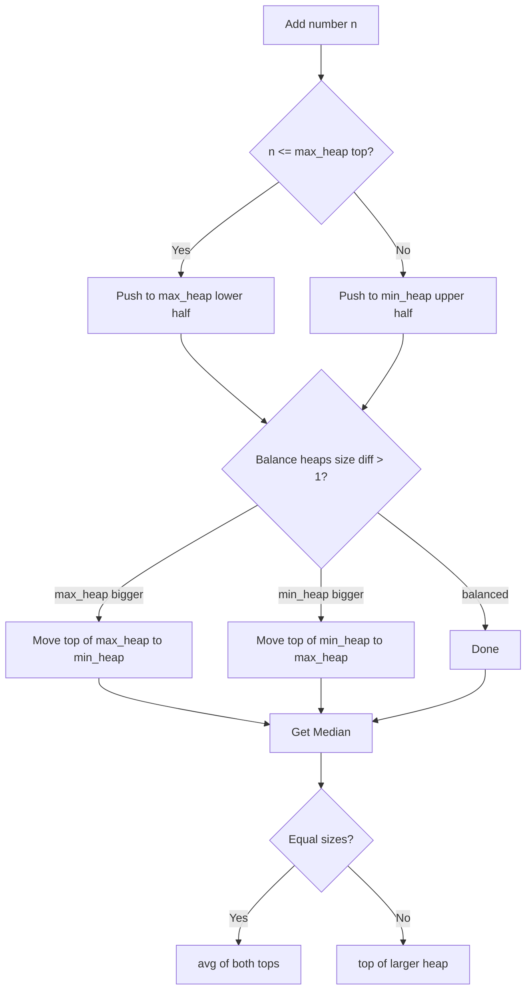
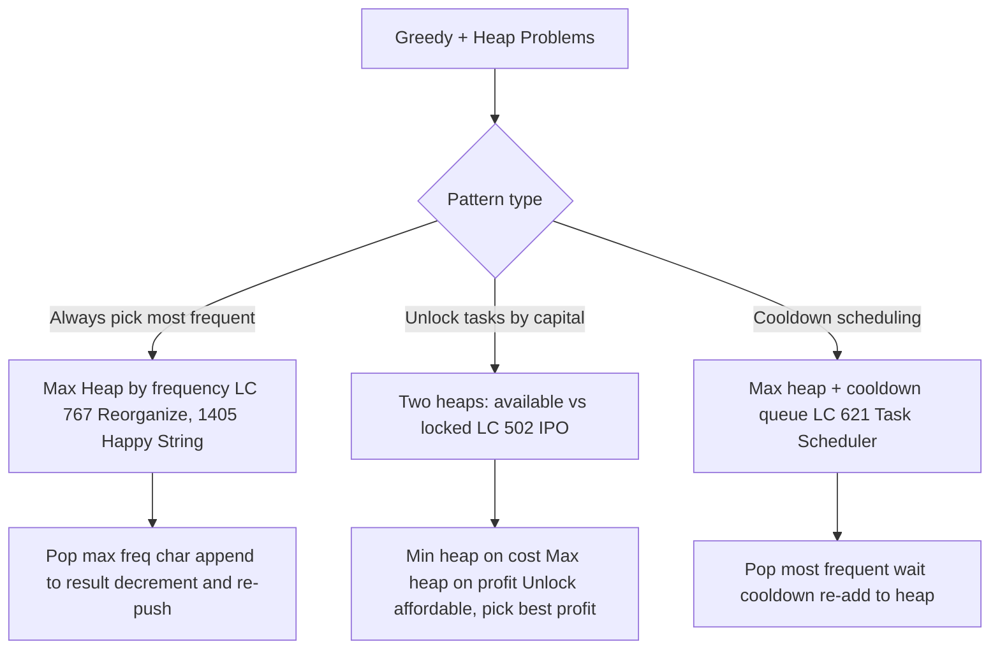
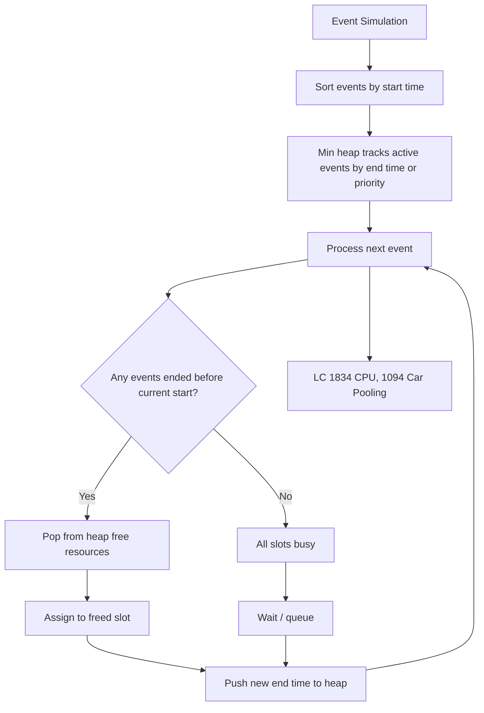
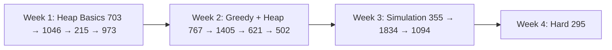

# Heap / Priority Queue

## Problem List

| # | Problem | LC | Difficulty |
|---|---------|-----|------------|
| 1 | Kth Largest Element In a Stream | [703](https://leetcode.com/problems/kth-largest-element-in-a-stream/) | 🟢 Easy |
| 2 | Last Stone Weight | [1046](https://leetcode.com/problems/last-stone-weight/) | 🟢 Easy |
| 3 | K Closest Points to Origin | [973](https://leetcode.com/problems/k-closest-points-to-origin/) | 🟡 Medium |
| 4 | Kth Largest Element In An Array | [215](https://leetcode.com/problems/kth-largest-element-in-an-array/) | 🟡 Medium |
| 5 | Task Scheduler | [621](https://leetcode.com/problems/task-scheduler/) | 🟡 Medium |
| 6 | Design Twitter | [355](https://leetcode.com/problems/design-twitter/) | 🟡 Medium |
| 7 | Single Threaded CPU | [1834](https://leetcode.com/problems/single-threaded-cpu/) | 🟡 Medium |
| 8 | Reorganize String | [767](https://leetcode.com/problems/reorganize-string/) | 🟡 Medium |
| 9 | Longest Happy String | [1405](https://leetcode.com/problems/longest-happy-string/) | 🟡 Medium |
| 10 | Car Pooling | [1094](https://leetcode.com/problems/car-pooling/) | 🟡 Medium |
| 11 | Find Median From Data Stream | [295](https://leetcode.com/problems/find-median-from-data-stream/) | 🔴 Hard |
| 12 | IPO | [502](https://leetcode.com/problems/ipo/) | 🔴 Hard |

---

## Approach Diagrams

### Min Heap vs Max Heap Decision

### Top-K Pattern Flow

### Two Heaps Pattern — Median Finding

### Greedy + Heap Pattern

### Event-Driven Simulation with Heap

---

## Complexity Summary

| Problem | Time | Space | Pattern |
|---------|------|-------|---------|
| Kth Largest in Stream (703) | O(log k) per add | O(k) | Min heap size k |
| Last Stone Weight (1046) | O(n log n) | O(n) | Max heap |
| K Closest Points (973) | O(n log k) | O(k) | Min heap size k |
| Kth Largest in Array (215) | O(n log k) | O(k) | Min heap size k |
| Task Scheduler (621) | O(n log n) | O(n) | Max heap + cooldown |
| Design Twitter (355) | O(k log n) per feed | O(n) | Min heap merge |
| Single Threaded CPU (1834) | O(n log n) | O(n) | Min heap by duration |
| Reorganize String (767) | O(n log k) | O(k) | Max heap by freq |
| Longest Happy String (1405) | O(n log k) | O(k) | Max heap by freq |
| Car Pooling (1094) | O(n log n) | O(n) | Min heap by dropoff |
| Find Median (295) | O(log n) add, O(1) query | O(n) | Two heaps |
| IPO (502) | O(n log n) | O(n) | Two heaps |

---

## Study Order

**Key insight:** Python only has `heapq` (min heap). For max heap, negate values. For top-K largest, maintain a min heap of size K — if new element beats the min, swap it in.
