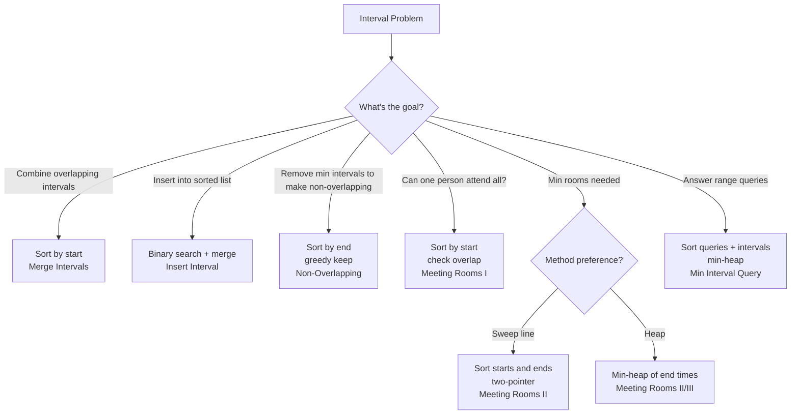

# Intervals

## Core Intuition
Interval problems reduce to: sort by start (or end), then decide how to merge, count, or schedule. The key insight is that after sorting, you only need to compare the current interval with the last processed one.

- **Merge**: Sort by start; merge if current.start ≤ last.end
- **Non-overlapping / scheduling**: Sort by end; greedy keep non-overlapping
- **Meeting rooms (count)**: Sort starts and ends separately (sweep line) or use a min-heap
- **Query problems**: Offline sort + heap

## Decision Flowchart

## Problems

### Insert Interval — LC 57 | Medium
- **Learn**: Three phases: add all intervals ending before new one, merge overlapping, add remaining
- **Mistake**: Forgetting to handle the case where new interval doesn't overlap anything
- **Complexity**: O(n) time, O(n) space
- **Edge**: Empty intervals list; new interval before all; new interval after all; complete overlap

---

### Merge Intervals — LC 56 | Medium
- **Learn**: Sort by start; if current.start ≤ last.end, extend last.end = max(last.end, current.end)
- **Mistake**: Not taking max of end times (one interval may be fully contained in another)
- **Complexity**: O(n log n) time, O(n) space
- **Edge**: Single interval; all intervals overlap into one; no overlaps at all

---

### Non-Overlapping Intervals — LC 435 | Medium
- **Learn**: Sort by end time; greedily keep intervals with earliest end; count removals
- **Mistake**: Sorting by start instead of end; counting kept instead of removed
- **Complexity**: O(n log n) time, O(1) space
- **Edge**: All overlapping → remove n-1; no overlaps → remove 0

---

### Meeting Rooms — LC 252 | Easy
- **Learn**: Sort by start; check if any interval starts before previous ends
- **Mistake**: Not sorting first
- **Complexity**: O(n log n) time, O(1) space
- **Edge**: Single meeting → true; empty → true

---

### Meeting Rooms II — LC 253 | Medium
- **Learn**: Min-heap of end times; if earliest end ≤ current start, reuse room (pop+push); else add room
- **Mistake**: Sweep line approach: sort starts and ends separately, two pointers, increment rooms when start < end
- **Complexity**: O(n log n) time, O(n) space
- **Edge**: All meetings at same time → n rooms; sequential meetings → 1 room

---

### Meeting Rooms III — LC 2402 | Hard
- **Learn**: Two heaps: available rooms (min-heap by room number), occupied rooms (min-heap by end time); assign to earliest-ending room when none available
- **Mistake**: Not tracking which room number is used (need to count per room); not handling tie-breaking (use lowest room number)
- **Complexity**: O(n log n + m log n) time where m=meetings, O(n) space
- **Edge**: More meetings than rooms; meetings with same start time (process in order)

---

### Minimum Interval to Include Each Query — LC 1851 | Hard
- **Learn**: Sort intervals by size; sort queries with original indices; sweep with min-heap (size, end); remove expired intervals
- **Mistake**: Not sorting queries offline; not removing intervals whose end < query
- **Complexity**: O((n+q) log n) time, O(n+q) space
- **Edge**: Query not covered by any interval → -1; multiple intervals covering same query → smallest size

---

## General Edge Cases
- Empty interval list
- Single interval
- Intervals with same start or end time
- Fully contained intervals (one inside another)
- Queries outside all interval ranges
- Integer overflow when computing interval sizes
- Intervals given in unsorted order (always sort first)
