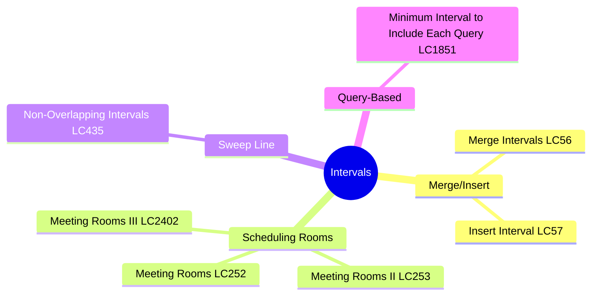
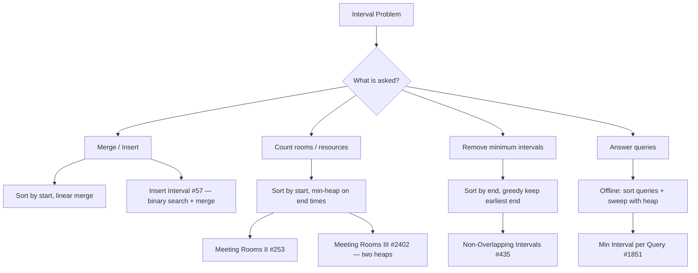
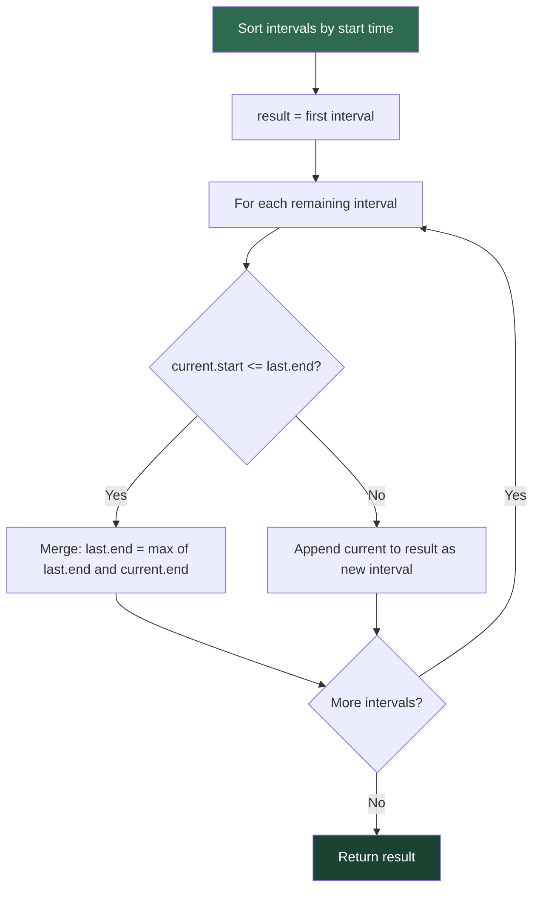
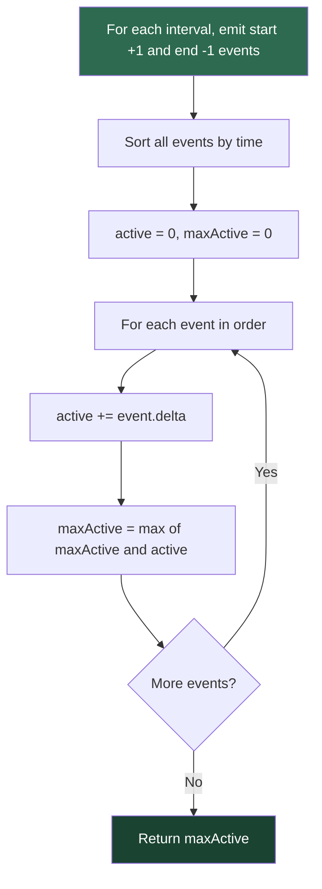
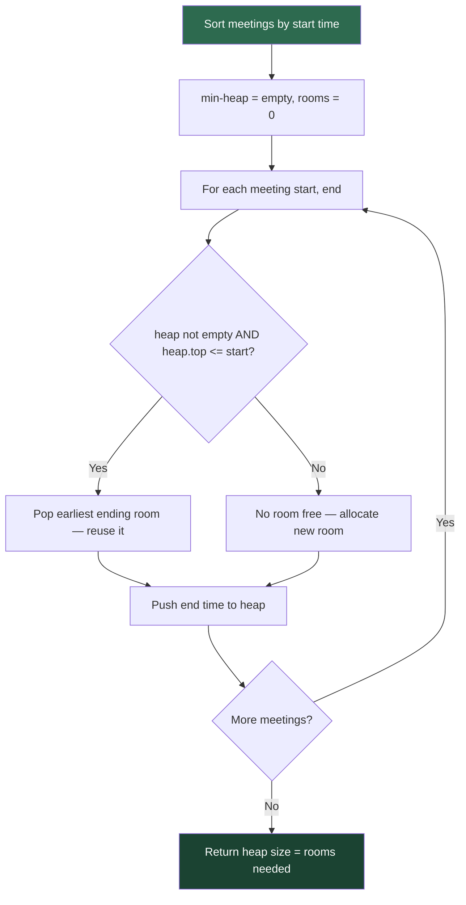
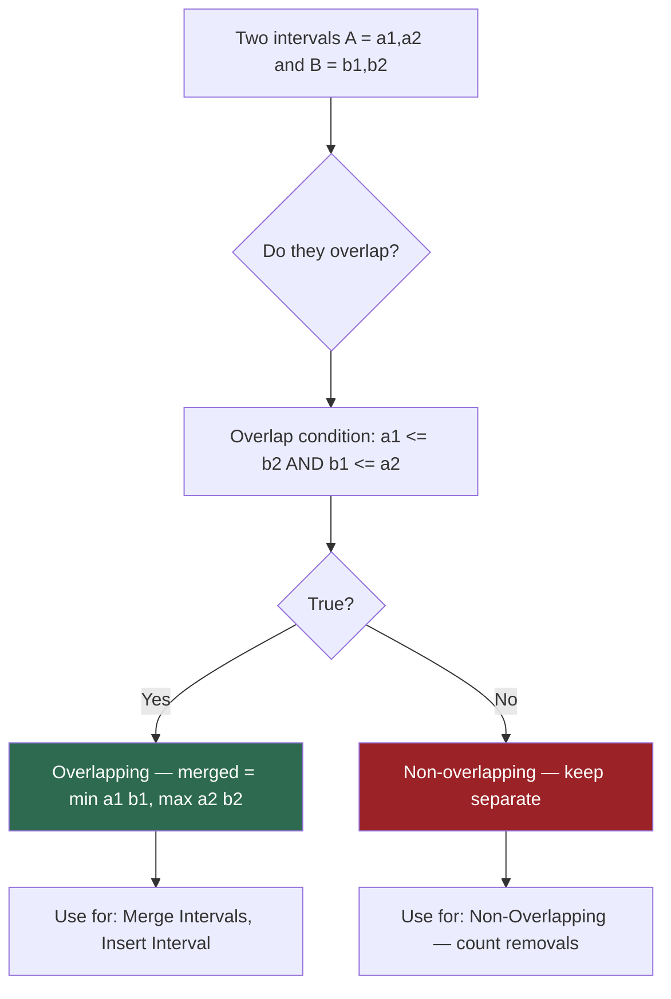

# Intervals

## Problem List

| # | Problem | LC # | Difficulty | Key Technique |
|---|---------|------|------------|---------------|
| 1 | Insert Interval | 57 | Medium | Linear scan + merge |
| 2 | Merge Intervals | 56 | Medium | Sort + merge |
| 3 | Non-Overlapping Intervals | 435 | Medium | Greedy scheduling |
| 4 | Meeting Rooms | 252 | Easy | Sort + check overlap |
| 5 | Meeting Rooms II | 253 | Medium | Min-heap |
| 6 | Meeting Rooms III | 2402 | Hard | Two heaps |
| 7 | Minimum Interval to Include Each Query | 1851 | Hard | Sort + heap + offline queries |

---

## Interval Problem Decision Tree

---

## Merge Intervals Algorithm Flow

---

## Sweep Line / Event-Based Approach

*Used for: counting max concurrent meetings (Meeting Rooms II alternative)*

---

## Meeting Rooms Heap Approach

---

## Interval Overlap Detection Logic

---

## Complexity Summary

| Problem | Time | Space |
|---------|------|-------|
| Insert Interval | O(n) | O(n) |
| Merge Intervals | O(n log n) | O(n) |
| Non-Overlapping Intervals | O(n log n) | O(1) |
| Meeting Rooms | O(n log n) | O(1) |
| Meeting Rooms II | O(n log n) | O(n) |
| Meeting Rooms III | O(n log n) | O(n) |
| Min Interval per Query | O((n+q) log n) | O(n+q) |

---

## Study Order

1. **Meeting Rooms** — basic overlap check
2. **Merge Intervals** — core merge pattern
3. **Insert Interval** — merge with binary search
4. **Non-Overlapping Intervals** — greedy scheduling
5. **Meeting Rooms II** — heap for resource counting
6. **Meeting Rooms III** — two-heap advanced
7. **Minimum Interval per Query** — offline + heap
