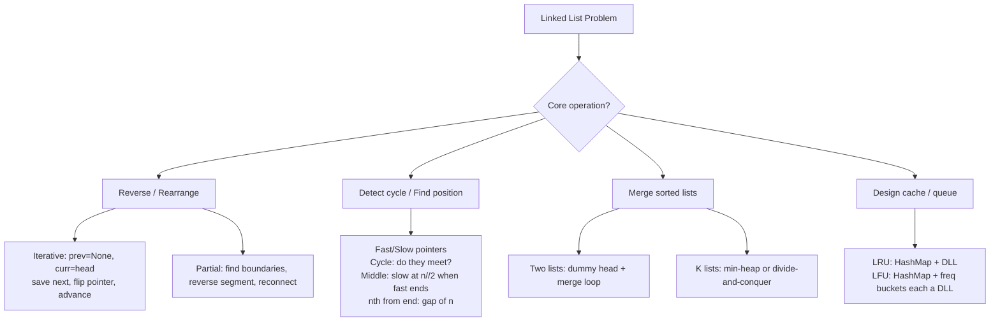

# Linked List — Pattern Notes

## Core Intuition
Linked list problems reduce to a small set of pointer manipulation techniques. The key is **drawing pointer state before and after** each operation. Most bugs come from losing a reference before saving it.

Sub-patterns:
- **Reversal** — iterative (prev/curr/next) or recursive; partial reversal needs careful boundary tracking
- **Fast/Slow Pointers** — cycle detection, finding middle, nth from end
- **Merge** — merge two sorted lists, merge k lists (heap or divide-and-conquer)
- **Design** — LRU/LFU combine a hashmap with a doubly-linked list for O(1) ops

---

## Decision Diagram

---

## Per-Problem Notes

| # | Problem | LC | Difficulty | What to Learn | Common Mistakes | Time / Space |
|---|---------|-----|------------|---------------|-----------------|--------------|
| 1 | Reverse Linked List | 206 | Easy | `prev=None, curr=head`; save `curr.next`, flip, advance | Losing `curr.next` before reassigning | O(n) / O(1) |
| 2 | Merge Two Sorted Lists | 21 | Easy | Dummy head; compare heads, attach smaller, advance | Forgetting to attach remaining non-null list | O(m+n) / O(1) |
| 3 | Linked List Cycle | 141 | Easy | Floyd's: fast=2, slow=1; meet → cycle; fast=null → no cycle | Checking equality before first advance | O(n) / O(1) |
| 4 | Reorder List | 143 | Medium | (1) find middle, (2) reverse second half, (3) interleave | Not severing first/second half → cycle | O(n) / O(1) |
| 5 | Remove Nth From End | 19 | Medium | Gap of n between fast and slow; remove `slow.next` | Removing `slow` not `slow.next`; no dummy for head removal | O(n) / O(1) |
| 6 | Copy List with Random Pointer | 138 | Medium | HashMap `{original: copy}`; two passes: create all, then assign `.next`/`.random` | One-pass fails — `.random` may not exist yet | O(n) / O(n) |
| 7 | Add Two Numbers | 2 | Medium | Simulate addition with carry; handle carry after both lists end | Forgetting final carry node | O(max(m,n)) / O(max(m,n)) |
| 8 | Find the Duplicate | 287 | Medium | Array as linked list; Floyd's finds cycle entrance = duplicate | Confusing with sort/set approach (need O(1) space) | O(n) / O(1) |
| 9 | Reverse Linked List II | 92 | Medium | Advance to node before `left`; reverse segment; reconnect both ends | Losing node after `right`; not saving `prev_left` | O(n) / O(1) |
| 10 | Design Circular Queue | 622 | Medium | Array with `head`, `tail`, `size`; `tail=(tail+1)%cap` | Off-by-one full/empty: use `size` counter | O(1) all ops / O(n) |
| 11 | LRU Cache | 146 | Medium | `OrderedDict` or HashMap+DLL; `get` moves to end; `put` evicts from front | Not moving existing key on `get`; not updating value on `put` | O(1) get/put / O(cap) |
| 12 | LFU Cache | 460 | Hard | `key→val`, `key→freq`, `freq→OrderedDict`; track `min_freq` | `min_freq` resets to 1 only on new key insert | O(1) get/put / O(cap) |
| 13 | Merge K Sorted Lists | 23 | Hard | Min-heap `(val, idx, node)`; pop min, push `.next` | Heap comparison error on equal vals — add tiebreaker idx | O(n log k) / O(k) |
| 14 | Reverse K-Group | 25 | Hard | Check k nodes remain; reverse k; connect to recursive result on remainder | Not checking k nodes remain; losing tail of reversed segment | O(n) / O(n/k) stack |

---

## Edge Cases to Watch
- Empty list or single node — return early
- Removing the head node — always use a dummy head
- Cycle at the very first node (head points to itself)
- `left == right` in Reverse II — no-op, don't break the list
- LRU/LFU capacity 0 — check constraints (usually ≥ 1)
- Add Two Numbers with different length lists — treat `None` as 0
- Merge K with empty lists in input — skip nulls when pushing to heap
- Floyd's: always check `fast and fast.next` before advancing
