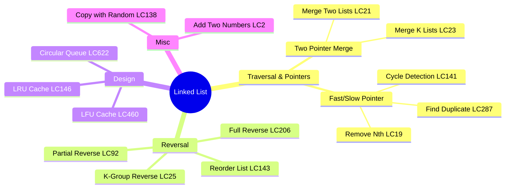
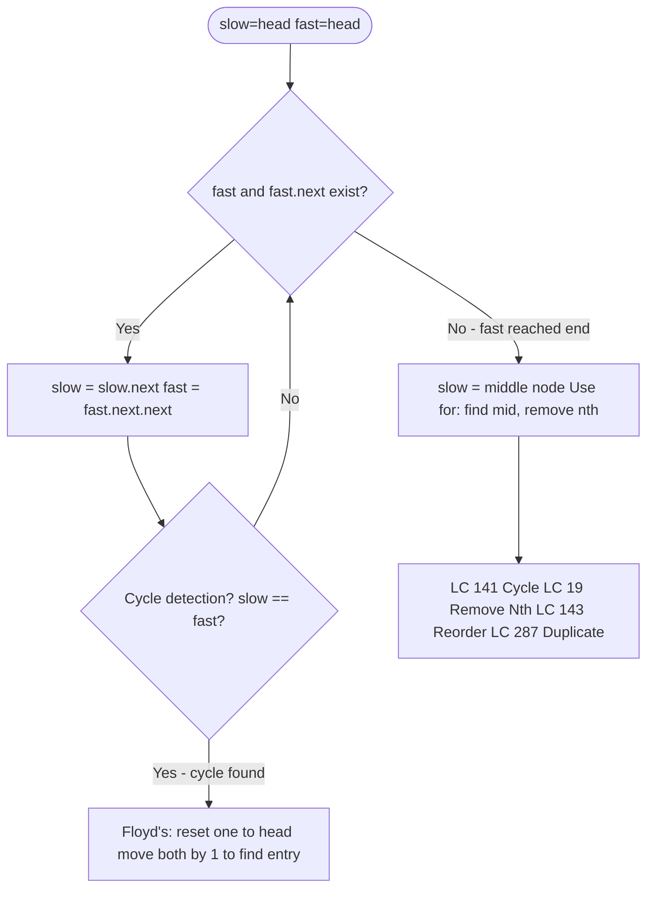
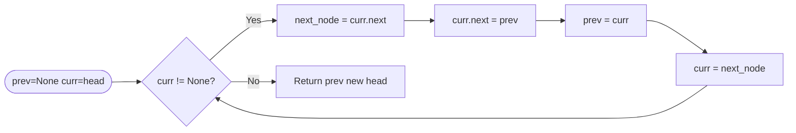
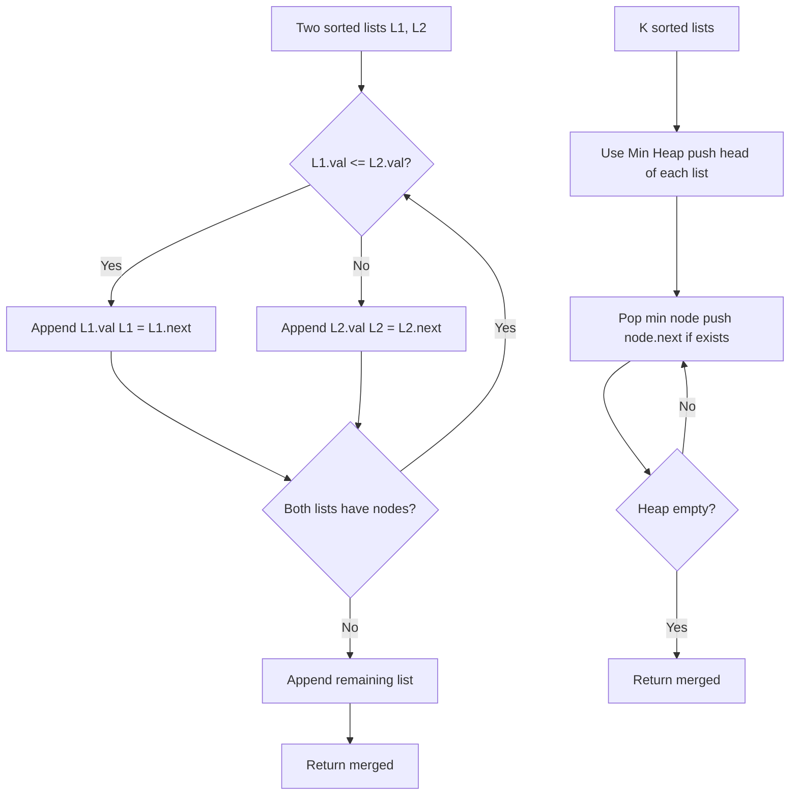
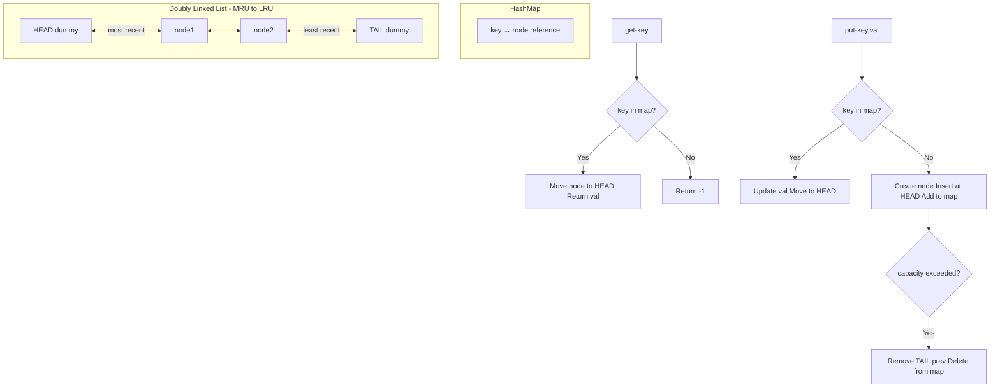

# Linked List

## Problem List

| # | Problem | Difficulty | Technique |
|---|---------|------------|-----------|
| 1 | [Reverse Linked List (LC 206)](https://leetcode.com/problems/reverse-linked-list/) | Easy | Iterative/Recursive |
| 2 | [Merge Two Sorted Lists (LC 21)](https://leetcode.com/problems/merge-two-sorted-lists/) | Easy | Two Pointer Merge |
| 3 | [Linked List Cycle (LC 141)](https://leetcode.com/problems/linked-list-cycle/) | Easy | Fast/Slow Pointer |
| 4 | [Reorder List (LC 143)](https://leetcode.com/problems/reorder-list/) | Medium | Find Mid + Reverse + Merge |
| 5 | [Remove Nth Node From End (LC 19)](https://leetcode.com/problems/remove-nth-node-from-end-of-list/) | Medium | Fast/Slow Pointer |
| 6 | [Copy List With Random Pointer (LC 138)](https://leetcode.com/problems/copy-list-with-random-pointer/) | Medium | HashMap |
| 7 | [Add Two Numbers (LC 2)](https://leetcode.com/problems/add-two-numbers/) | Medium | Carry Simulation |
| 8 | [Find The Duplicate Number (LC 287)](https://leetcode.com/problems/find-the-duplicate-number/) | Medium | Floyd's Cycle Detection |
| 9 | [Reverse Linked List II (LC 92)](https://leetcode.com/problems/reverse-linked-list-ii/) | Medium | In-place Reversal |
| 10 | [Design Circular Queue (LC 622)](https://leetcode.com/problems/design-circular-queue/) | Medium | Array + Pointers |
| 11 | [LRU Cache (LC 146)](https://leetcode.com/problems/lru-cache/) | Medium | DLL + HashMap |
| 12 | [LFU Cache (LC 460)](https://leetcode.com/problems/lfu-cache/) | Hard | Freq Map + DLL |
| 13 | [Merge K Sorted Lists (LC 23)](https://leetcode.com/problems/merge-k-sorted-lists/) | Hard | Min Heap |
| 14 | [Reverse Nodes In K Group (LC 25)](https://leetcode.com/problems/reverse-nodes-in-k-group/) | Hard | In-place Group Reversal |

---

## Mermaid Diagrams

### 1. Linked List Operation Categories

### 2. Fast/Slow Pointer Pattern

### 3. Reverse Linked List Iterative Flow (LC 206)

### 4. Merge Pattern (LC 21 / LC 23)

### 5. LRU Cache Architecture (DLL + HashMap)

---

## Complexity Summary

| Problem | Time | Space | Key Insight |
|---------|------|-------|-------------|
| LC 206 | O(n) | O(1) | Three pointer reversal |
| LC 21 | O(m+n) | O(1) | Dummy head simplifies |
| LC 141 | O(n) | O(1) | Floyd's tortoise & hare |
| LC 143 | O(n) | O(1) | Find mid → reverse → merge |
| LC 19 | O(n) | O(1) | Fast n+1 ahead of slow |
| LC 138 | O(n) | O(n) | Map old→new, then set random |
| LC 2 | O(max(m,n)) | O(1) | Carry through iteration |
| LC 287 | O(n) | O(1) | Array as linked list, Floyd's |
| LC 92 | O(n) | O(1) | Track prev of sublist start |
| LC 622 | O(1) all | O(k) | Circular index with modulo |
| LC 146 | O(1) all | O(n) | DLL + HashMap |
| LC 460 | O(1) all | O(n) | freq map + per-freq DLL |
| LC 23 | O(n log k) | O(k) | Min heap of k heads |
| LC 25 | O(n) | O(1) | Count k, reverse in-place |

---

## Study Order

**Recommended order:** Basic ops → Fast/slow pointer → In-place reversal → Design → Hard
