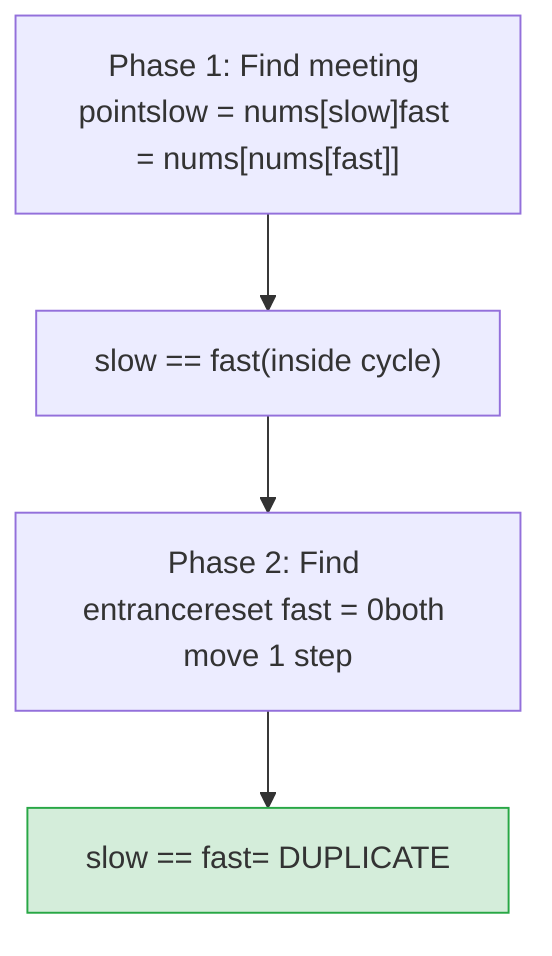

# LC 287 — Find the Duplicate Number

**Difficulty:** Medium | **Pattern:** Floyd's Cycle Detection (Tortoise & Hare)

---

## Problem Statement

Given an array `nums` of `n+1` integers where each integer is in `[1, n]`, find the **one duplicate number**. You must not modify the array and use only O(1) extra space.

```
nums = [1, 3, 4, 2, 2]  →  2
nums = [3, 1, 3, 4, 2]  →  3
```

---

## Why Obvious Approaches Fail

| Approach | Time | Space | Why it fails |
|---|---|---|---|
| Sort + scan | O(n log n) | O(1) | Modifies array (sort in-place) |
| HashSet | O(n) | O(n) | Violates O(1) space constraint |
| Bit manipulation | O(n) | O(1) | Only works if exactly one duplicate |
| **Floyd's Cycle Detection** | **O(n)** | **O(1)** | ✅ Satisfies all constraints |

---

## Core Insight: Array as a Linked List

Define a function `f(i) = nums[i]`. This maps every index to a value.

- Indices: `0, 1, 2, ..., n`
- Values: all in `[1, n]`

This creates a **functional graph**: each node `i` has exactly one outgoing edge to `nums[i]`.

**Why a cycle must exist:**  
Starting from index `0`, following `f` repeatedly: `0 → nums[0] → nums[nums[0]] → ...`  
Since values are in `[1, n]`, we never leave the range `[0, n]`. With `n+1` nodes and each having one outgoing edge, by the **Pigeonhole Principle**, some node must be visited twice → **cycle exists**.

**Why the duplicate = cycle entrance:**  
The duplicate value `d` means two different indices `a ≠ b` both satisfy `nums[a] = nums[b] = d`. Both edges point to node `d`. Node `d` has **in-degree ≥ 2** — it's the only such node — making it the **cycle entrance**.

---

## PROOF: Pigeonhole Guarantees a Cycle

We have `n+1` values, each in `[1, n]` (only `n` distinct possible values).  
By Pigeonhole: at least one value appears **at least twice**.  
That repeated value is the duplicate, and it's the node two edges point into → cycle entrance. ∎

---

## Floyd's Algorithm

### Phase 1: Find Meeting Point

```
slow = nums[slow]           # moves 1 step
fast = nums[nums[fast]]     # moves 2 steps
```

They meet somewhere **inside the cycle** (not necessarily at the entrance).

### Phase 2: Find Cycle Entrance

Reset one pointer to `0` (the start). Move both one step at a time:

```
slow = nums[slow]
fast = nums[fast]   # now also 1 step
```

They meet at the **cycle entrance** = the duplicate number.

---

## PROOF of Phase 2

Let:
- `μ` = distance from start (index 0) to cycle entrance
- `λ` = cycle length
- `k` = steps into cycle where slow and fast meet in Phase 1

**After Phase 1:**
- slow traveled: `μ + k` steps
- fast traveled: `2(μ + k)` steps
- fast also traveled: `μ + k + mλ` for some integer `m` (lapped the cycle)

So: `2(μ + k) = μ + k + mλ`  
→ `μ + k = mλ`  
→ `μ = mλ - k`

**In Phase 2:**  
- Pointer A starts at 0, travels `μ` steps → arrives at cycle entrance
- Pointer B starts at meeting point (which is `k` steps into cycle), travels `μ = mλ - k` steps → moves `mλ - k` steps from position `k` → arrives at position `k + mλ - k = mλ ≡ 0 (mod λ)` = cycle entrance

Both arrive at the cycle entrance simultaneously. ∎

---

## Array-as-Graph Diagram


*For `nums=[1,3,4,2,2]`: node 2 has in-degree 2 (from idx 3 and idx 4) → cycle entrance → duplicate*



---

## Step-by-Step Walkthrough

### `nums = [1, 3, 4, 2, 2]`

```
Index:  0  1  2  3  4
Value:  1  3  4  2  2

Functional graph: 0→1→3→2→4→2 (cycle: 2→4→2)
Cycle entrance: 2
```

**Phase 1:**
```
Start: slow=0, fast=0

Step 1: slow=nums[0]=1,  fast=nums[nums[0]]=nums[1]=3
Step 2: slow=nums[1]=3,  fast=nums[nums[3]]=nums[2]=4
Step 3: slow=nums[3]=2,  fast=nums[nums[4]]=nums[2]=4
Step 4: slow=nums[2]=4,  fast=nums[nums[4]]=nums[2]=4
        slow == fast == 4  → MEETING POINT
```

**Phase 2:**
```
Reset: slow=4 (stays), fast=0

Step 1: slow=nums[4]=2,  fast=nums[0]=1
Step 2: slow=nums[2]=4,  fast=nums[1]=3
Step 3: slow=nums[4]=2,  fast=nums[3]=2
        slow == fast == 2  → DUPLICATE = 2  ✓
```

---

## Algorithm

```python
def findDuplicate(nums: list[int]) -> int:
    # Phase 1: find meeting point
    slow = fast = 0
    while True:
        slow = nums[slow]
        fast = nums[nums[fast]]
        if slow == fast:
            break

    # Phase 2: find cycle entrance
    fast = 0
    while slow != fast:
        slow = nums[slow]
        fast = nums[fast]

    return slow
```

---

## Complexity

| | Value | Justification |
|---|---|---|
| **Time** | O(n) | Phase 1: at most O(μ + λ) steps. Phase 2: O(μ) steps. Both ≤ O(n) |
| **Space** | O(1) | Only two pointers, no extra data structures |

**Why O(n) and not O(n²)?**  
The cycle length `λ ≤ n` and the tail length `μ ≤ n`. Phase 1 terminates within `μ + λ ≤ 2n` steps. Phase 2 terminates within `μ ≤ n` steps. Total: O(n).
