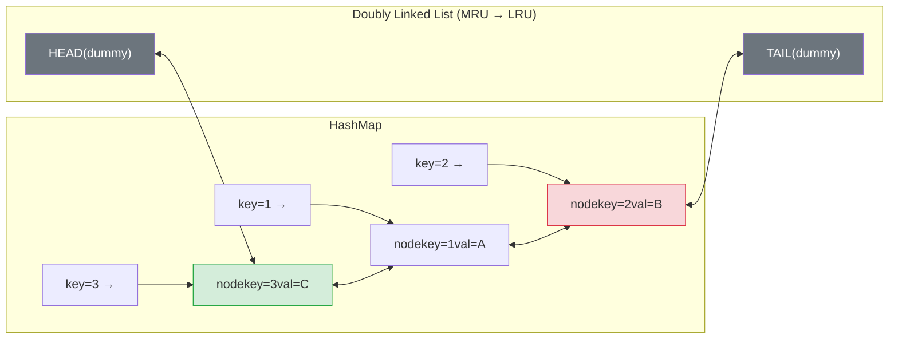

# LC 146 — LRU Cache

**Difficulty:** Medium | **Pattern:** DLL + HashMap Architecture

---

## Problem Statement

Design a data structure that follows the **Least Recently Used (LRU)** cache eviction policy.

- `LRUCache(capacity)` — initialize with positive capacity
- `get(key)` — return value if key exists, else `-1`. Mark as recently used.
- `put(key, value)` — insert/update key. If capacity exceeded, evict the LRU item.

Both operations must run in **O(1) average time**.

```
LRUCache(2)
put(1, 1)   → cache: {1:1}
put(2, 2)   → cache: {1:1, 2:2}
get(1)      → 1,  cache: {2:2, 1:1}  (1 is now most recent)
put(3, 3)   → evict 2,  cache: {1:1, 3:3}
get(2)      → -1  (evicted)
```

---

## Why Single Data Structures Fail

### HashMap alone — O(1) access, but can't find LRU

A HashMap gives O(1) lookup by key, but it has **no ordering**. To find the least recently used item, you'd need to scan all entries → O(n) eviction.

### Linked List alone — O(1) ordering, but can't find by key

A linked list maintains insertion/access order perfectly. But to find a specific key, you must traverse from the head → O(n) lookup.

### The Solution: Combine Both

```
HashMap:      key → pointer to DLL node     (O(1) access by key)
DLL:          maintains recency order        (O(1) move-to-front, O(1) remove tail)
```

Every operation becomes O(1) pointer manipulation + O(1) hash lookup.

---

## Architecture



*HEAD.next = Most Recently Used. TAIL.prev = Least Recently Used.*

---

## PROOF: Every Operation is O(1)

**GET(key):**
1. HashMap lookup: `node = map[key]` → O(1)
2. Remove node from current DLL position → O(1) (we have the pointer, just rewire 2 neighbors)
3. Insert node right after HEAD → O(1) (rewire 2 pointers)
4. Return `node.val` → O(1)

**PUT(key, value) — key exists:**
1. HashMap lookup → O(1)
2. Update `node.val` → O(1)
3. Move to front (same as GET steps 2-3) → O(1)

**PUT(key, value) — new key:**
1. Create new node → O(1)
2. Insert after HEAD → O(1)
3. `map[key] = node` → O(1)
4. If `len(map) > capacity`:
   - LRU node = `tail.prev` → O(1) (dummy tail gives direct access)
   - Remove from DLL → O(1)
   - Delete from HashMap → O(1)

**Every step is O(1). No operation requires traversal. ∎**

---

## Why Dummy HEAD and TAIL Nodes?

Without dummies, every insert/remove must check "is this the first/last node?" — adding conditional branches. Dummy nodes eliminate all edge cases:

- Insert after HEAD: always valid (HEAD always exists)
- Remove TAIL.prev: always valid (TAIL always exists, and TAIL.prev ≠ HEAD when cache non-empty)

---

## Implementation

```python
class Node:
    def __init__(self, key=0, val=0):
        self.key = key
        self.val = val
        self.prev = self.next = None

class LRUCache:
    def __init__(self, capacity: int):
        self.cap = capacity
        self.map = {}                    # key → Node
        self.head = Node()               # dummy MRU sentinel
        self.tail = Node()               # dummy LRU sentinel
        self.head.next = self.tail
        self.tail.prev = self.head

    def _remove(self, node: Node):
        node.prev.next = node.next
        node.next.prev = node.prev

    def _insert_front(self, node: Node):
        node.next = self.head.next
        node.prev = self.head
        self.head.next.prev = node
        self.head.next = node

    def get(self, key: int) -> int:
        if key not in self.map:
            return -1
        node = self.map[key]
        self._remove(node)
        self._insert_front(node)
        return node.val

    def put(self, key: int, value: int) -> None:
        if key in self.map:
            self._remove(self.map[key])
        node = Node(key, value)
        self.map[key] = node
        self._insert_front(node)
        if len(self.map) > self.cap:
            lru = self.tail.prev
            self._remove(lru)
            del self.map[lru.key]
```

---

## Python OrderedDict: Why It Works

Python's `collections.OrderedDict` is internally implemented as a **doubly linked list + hash map** — exactly our architecture. It provides:

- `move_to_end(key, last=False)` → move to front (most recent)
- `popitem(last=False)` → remove from front (LRU end)

```python
from collections import OrderedDict

class LRUCache:
    def __init__(self, capacity: int):
        self.cap = capacity
        self.cache = OrderedDict()   # DLL + HashMap under the hood

    def get(self, key: int) -> int:
        if key not in self.cache:
            return -1
        self.cache.move_to_end(key)  # mark as most recent
        return self.cache[key]

    def put(self, key: int, value: int) -> None:
        if key in self.cache:
            self.cache.move_to_end(key)
        self.cache[key] = value
        if len(self.cache) > self.cap:
            self.cache.popitem(last=False)  # evict LRU (front)
```

---

## Step-by-Step Walkthrough

```
LRUCache(2)
HEAD ↔ TAIL

put(1,1):  HEAD ↔ [1:1] ↔ TAIL,  map={1:node1}
put(2,2):  HEAD ↔ [2:2] ↔ [1:1] ↔ TAIL,  map={1,2}
get(1):    move 1 to front
           HEAD ↔ [1:1] ↔ [2:2] ↔ TAIL,  return 1
put(3,3):  add 3 to front → size=3 > cap=2
           evict tail.prev = node(2)
           HEAD ↔ [3:3] ↔ [1:1] ↔ TAIL,  map={1,3}
get(2):    2 not in map → return -1  ✓
```

---

## Complexity

| Operation | Time | Space |
|---|---|---|
| `get` | O(1) | — |
| `put` | O(1) | — |
| Overall | O(1) per op | O(capacity) |

**Space:** O(capacity) for the HashMap and DLL nodes — bounded by the cache size, not input size.
