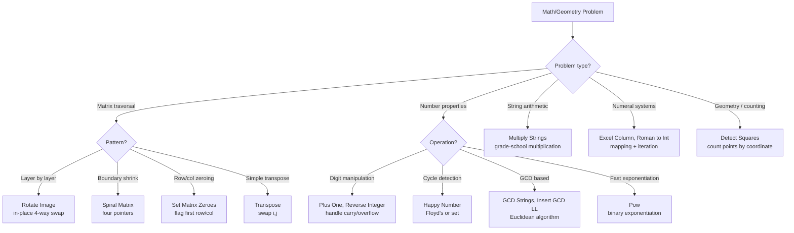

# Math & Geometry

## Core Intuition
These problems rely on mathematical properties or careful simulation. Key skills: modular arithmetic, GCD/LCM, number base conversion, matrix traversal patterns, and detecting cycles.

- **Matrix ops**: In-place rotation/transpose uses index math; spiral uses boundary pointers
- **Number theory**: GCD via Euclidean algorithm; cycle detection via Floyd's or set
- **Simulation**: Follow the rules exactly; boundary conditions are the hard part
- **Base conversion**: Repeated division/modulo

## Decision Flowchart

## Problems

### Excel Sheet Column Title — LC 168 | Easy
- **Learn**: Base-26 but 1-indexed (no zero); subtract 1 before each modulo to shift A=1 to A=0
- **Mistake**: Treating as standard base-26 (fails for Z, AZ, etc.)
- **Complexity**: O(log n) time, O(log n) space
- **Edge**: n=1 → "A"; n=26 → "Z"; n=27 → "AA"

---

### GCD of Strings — LC 1071 | Easy
- **Learn**: GCD string divides both; check s+t == t+s (necessary condition); answer is s[:gcd(len(s),len(t))]
- **Mistake**: Manually checking divisibility instead of using the concatenation trick
- **Complexity**: O(m+n) time, O(m+n) space
- **Edge**: No common divisor → ""; one string is the other → shorter string

---

### Insert Greatest Common Divisors in Linked List — LC 2807 | Medium
- **Learn**: Traverse pairs of adjacent nodes; insert new node with gcd(a.val, b.val) between them
- **Mistake**: Losing the reference to next node before inserting
- **Complexity**: O(n·log(max_val)) time, O(1) space (excluding output)
- **Edge**: Single node list → no insertions; two nodes → one insertion

---

### Transpose Matrix — LC 867 | Easy
- **Learn**: result[j][i] = matrix[i][j]; handle non-square matrices (rows/cols swap)
- **Mistake**: In-place transpose on non-square matrix (dimensions change)
- **Complexity**: O(m·n) time, O(m·n) space
- **Edge**: 1×n → n×1; already square

---

### Rotate Image — LC 48 | Medium
- **Learn**: Transpose then reverse each row (90° clockwise); or 4-way swap layer by layer
- **Mistake**: Using extra space; doing operations in wrong order (reverse then transpose = counter-clockwise)
- **Complexity**: O(n²) time, O(1) space
- **Edge**: 1×1 matrix → no change; 2×2 matrix

---

### Spiral Matrix — LC 54 | Medium
- **Learn**: Four boundary pointers (top, bottom, left, right); shrink after each direction pass
- **Mistake**: Not checking if rows/cols remain before inner passes (causes duplicates)
- **Complexity**: O(m·n) time, O(1) space (excluding output)
- **Edge**: Single row; single column; 1×1 matrix

---

### Set Matrix Zeroes — LC 73 | Medium
- **Learn**: Use first row and first column as flags; handle them separately with two boolean variables
- **Mistake**: Using O(m+n) extra space; zeroing rows/cols immediately (corrupts flags)
- **Complexity**: O(m·n) time, O(1) space
- **Edge**: First row or first column contains a zero (need separate flags)

---

### Happy Number — LC 202 | Easy
- **Learn**: Sum of squares of digits; detect cycle with Floyd's two-pointer or a set
- **Mistake**: Infinite loop without cycle detection
- **Complexity**: O(log n) time per step, O(log n) space (set) or O(1) (Floyd's)
- **Edge**: n=1 → true; n=7 → true (first non-1 happy number)

---

### Plus One — LC 66 | Easy
- **Learn**: Traverse from right; handle carry; if all 9s, prepend 1
- **Mistake**: Not handling the all-9s case (need to expand array)
- **Complexity**: O(n) time, O(n) space worst case
- **Edge**: [9] → [1,0]; [9,9,9] → [1,0,0,0]

---

### Roman to Integer — LC 13 | Easy
- **Learn**: Map each symbol; if current value < next value, subtract; else add
- **Mistake**: Processing left-to-right without lookahead for subtractive cases
- **Complexity**: O(n) time, O(1) space
- **Edge**: Single character; "IV", "IX", "XL", "XC", "CD", "CM"

---

### Pow(x, n) — LC 50 | Medium
- **Learn**: Binary exponentiation: if n is even, x^n = (x²)^(n/2); handle negative n
- **Mistake**: Linear recursion O(n); not handling n < 0 (return 1/pow(x,-n))
- **Complexity**: O(log n) time, O(log n) space (recursion) or O(1) iterative
- **Edge**: n=0 → 1; x=0 and n<0 (undefined, but LC guarantees valid); n=INT_MIN (overflow on negation)

---

### Multiply Strings — LC 43 | Medium
- **Learn**: Grade-school multiplication; result[i+j+1] += num1[i] × num2[j]; handle carry in second pass
- **Mistake**: Converting to int (defeats the purpose; overflow for large inputs)
- **Complexity**: O(m·n) time, O(m+n) space
- **Edge**: "0" × anything → "0"; single digit inputs

---

### Detect Squares — LC 2013 | Medium
- **Learn**: Store point counts in a dict; for each query point and each point sharing x-coord, find the square's other two corners
- **Mistake**: Checking all pairs of points (O(n²) per query); use the diagonal point to determine the square
- **Complexity**: O(n) add, O(n) query (n = distinct x-coord points), O(n) space
- **Edge**: Fewer than 3 points → 0 squares; duplicate points (count them); query point already in set

---

## General Edge Cases
- Integer overflow (Pow with large n, Multiply Strings)
- Negative numbers (Reverse Integer, Pow)
- Zero inputs (Multiply Strings "0", Happy Number)
- Non-square matrices (Transpose)
- Empty matrix
- Single element matrix/array
