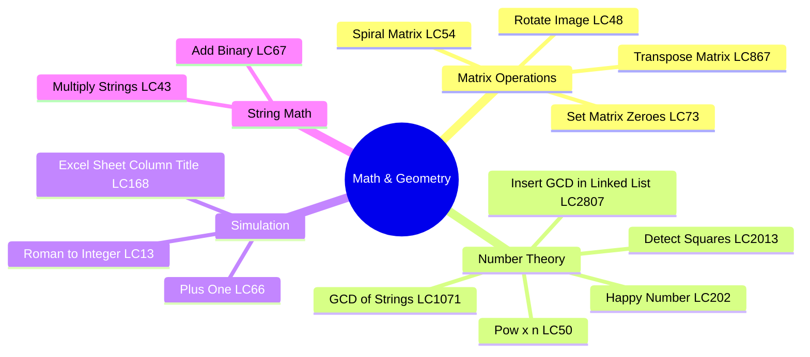
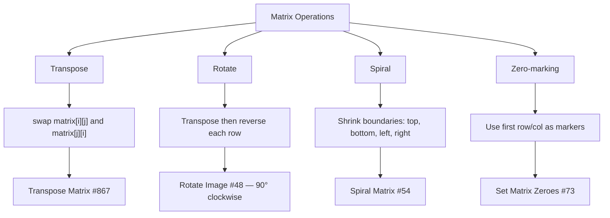
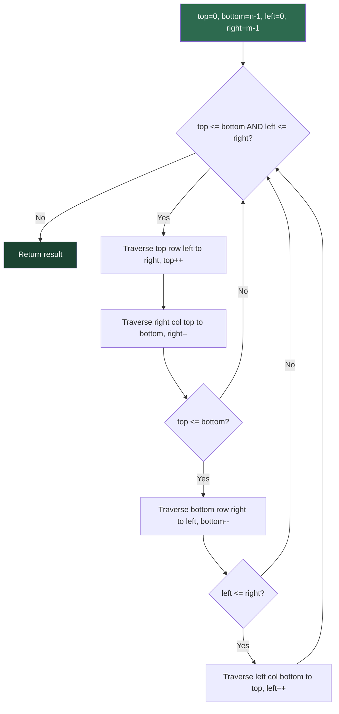
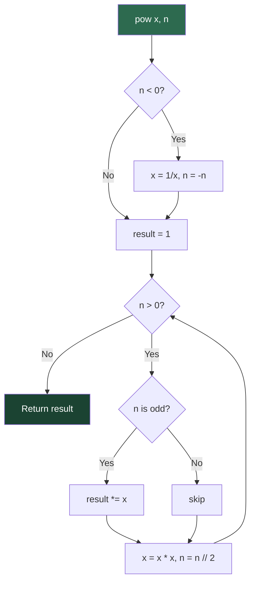
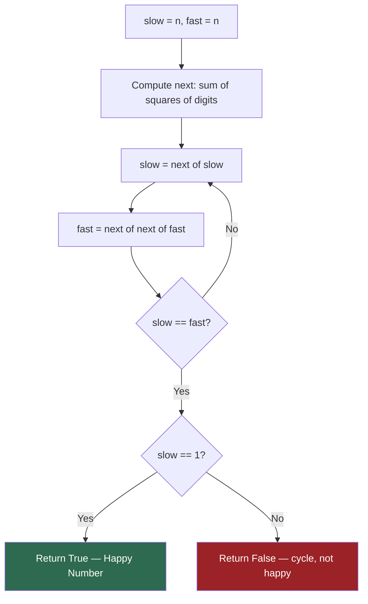
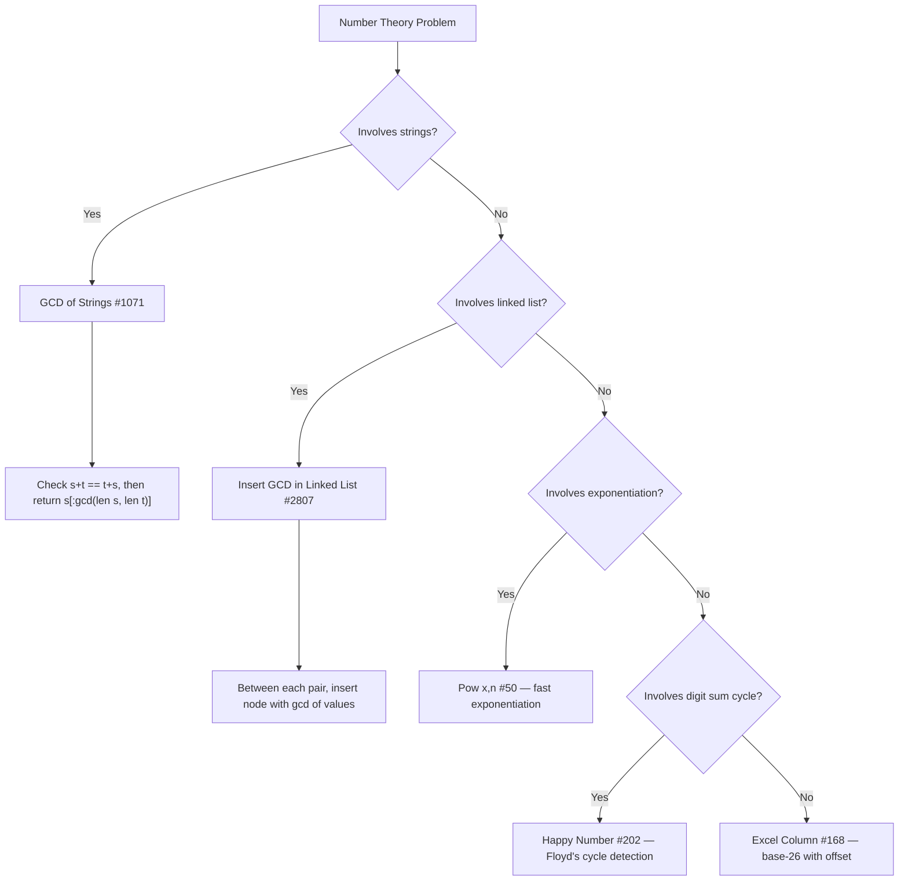

# Math & Geometry

## Problem List

| # | Problem | LC # | Difficulty | Key Technique |
|---|---------|------|------------|---------------|
| 1 | Excel Sheet Column Title | 168 | Easy | Base-26 encoding |
| 2 | GCD of Strings | 1071 | Easy | GCD + string divisibility |
| 3 | Insert GCD in Linked List | 2807 | Medium | GCD + list manipulation |
| 4 | Transpose Matrix | 867 | Easy | Index swap |
| 5 | Rotate Image | 48 | Medium | Transpose + reverse |
| 6 | Spiral Matrix | 54 | Medium | Boundary simulation |
| 7 | Set Matrix Zeroes | 73 | Medium | In-place marking |
| 8 | Happy Number | 202 | Easy | Cycle detection (Floyd's) |
| 9 | Plus One | 66 | Easy | Carry propagation |
| 10 | Roman to Integer | 13 | Easy | Symbol map + lookahead |
| 11 | Pow(x, n) | 50 | Medium | Fast exponentiation |
| 12 | Multiply Strings | 43 | Medium | Grade-school multiplication |
| 13 | Detect Squares | 2013 | Medium | Point counting + geometry |

---

## Matrix Operation Patterns

---

## Spiral Matrix Traversal Flow

---

## Fast Exponentiation Flow

*Time: O(log n) — halve the exponent each iteration*

---

## Cycle Detection — Happy Number Flow

*Alternative: use a seen set; stop when 1 or repeated*

---

## GCD / Number Theory Decision Tree

---

## Complexity Summary

| Problem | Time | Space |
|---------|------|-------|
| Excel Sheet Column Title | O(log n) | O(log n) |
| GCD of Strings | O(n + m) | O(n + m) |
| Insert GCD in Linked List | O(n log v) | O(1) |
| Transpose Matrix | O(n²) | O(1) |
| Rotate Image | O(n²) | O(1) |
| Spiral Matrix | O(n·m) | O(1) |
| Set Matrix Zeroes | O(n·m) | O(1) |
| Happy Number | O(log n) | O(1) |
| Plus One | O(n) | O(1) |
| Roman to Integer | O(n) | O(1) |
| Pow(x, n) | O(log n) | O(1) |
| Multiply Strings | O(n·m) | O(n+m) |
| Detect Squares | O(n) per query | O(n) |

---

## Study Order

1. **Plus One** — carry propagation warm-up
2. **Roman to Integer** — symbol map
3. **Excel Sheet Column Title** — base conversion
4. **Happy Number** — cycle detection
5. **GCD of Strings** — number theory + strings
6. **Transpose Matrix** — matrix basics
7. **Rotate Image** — transpose + reverse
8. **Spiral Matrix** — boundary simulation
9. **Set Matrix Zeroes** — in-place marking
10. **Pow(x, n)** — fast exponentiation
11. **Multiply Strings** — grade-school algorithm
12. **Insert GCD in Linked List** — GCD + list
13. **Detect Squares** — geometry + counting
