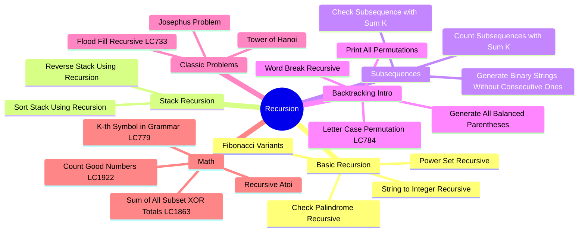
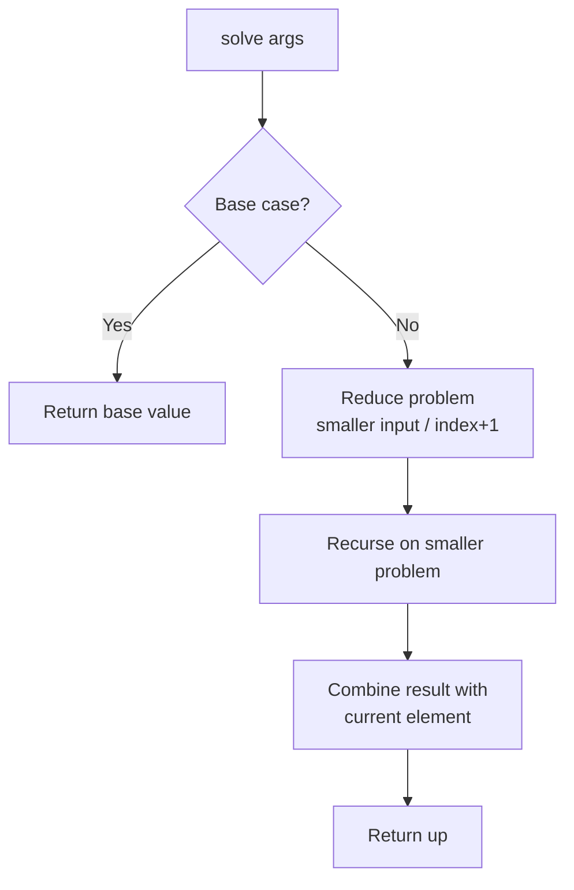
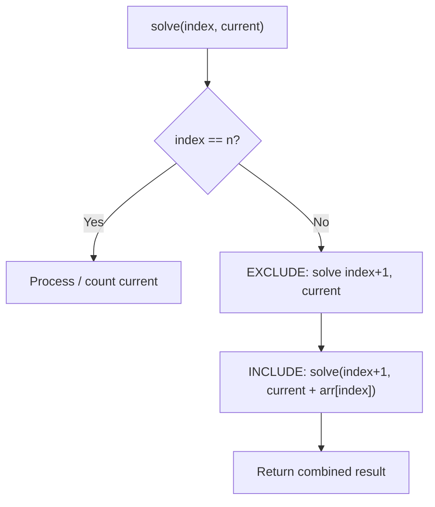
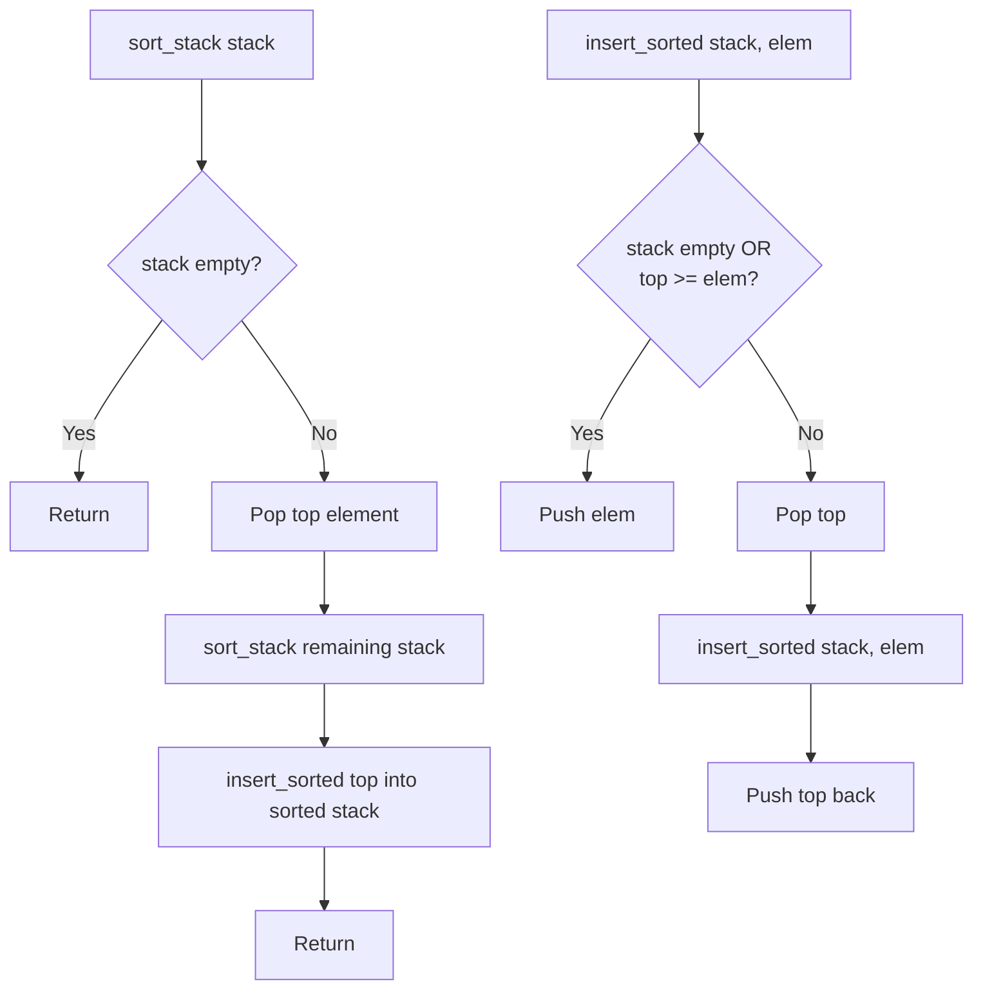

# Recursion

## Problem List

| # | Problem | LC # | Difficulty | Key Concept |
|---|---------|------|------------|-------------|
| 1 | Fibonacci Variants | — | 🟢 Easy | Base case + recurrence |
| 2 | Check Palindrome Recursive | — | 🟢 Easy | Two-pointer via recursion |
| 3 | String to Integer Recursive | — | 🟢 Easy | Digit extraction |
| 4 | Power Set Recursive | — | 🟡 Medium | Include/exclude pattern |
| 5 | Sort Stack Using Recursion | — | 🟡 Medium | Insert in sorted position |
| 6 | Reverse Stack Using Recursion | — | 🟡 Medium | Insert at bottom |
| 7 | Count Subsequences with Sum K | — | 🟡 Medium | Include/exclude + count |
| 8 | Check Subsequence with Sum K | — | 🟢 Easy | Include/exclude + early return |
| 9 | Generate Binary Strings Without Consecutive Ones | — | 🟡 Medium | Constraint-based recursion |
| 10 | Print All Permutations | — | 🟡 Medium | Swap-based / visited array |
| 11 | Generate All Balanced Parentheses | [22](https://leetcode.com/problems/generate-parentheses/) | 🟡 Medium | Open/close count tracking |
| 12 | Word Break Recursive | — | 🟡 Medium | Prefix matching + recursion |
| 13 | Letter Case Permutation | [784](https://leetcode.com/problems/letter-case-permutation/) | 🟡 Medium | Branch on letter/digit |
| 14 | Josephus Problem | — | 🟡 Medium | Circular elimination formula |
| 15 | Tower of Hanoi | — | 🟡 Medium | Classic 3-peg recursion |
| 16 | Flood Fill Recursive | [733](https://leetcode.com/problems/flood-fill/) | 🟢 Easy | Grid DFS |
| 17 | Count Good Numbers | [1922](https://leetcode.com/problems/count-good-numbers/) | 🟡 Medium | Fast exponentiation |
| 18 | Recursive Atoi | — | 🟡 Medium | Digit-by-digit recursion |
| 19 | K-th Symbol in Grammar | [779](https://leetcode.com/problems/k-th-symbol-in-grammar/) | 🟡 Medium | Parent-child relationship |
| 20 | Sum of All Subset XOR Totals | [1863](https://leetcode.com/problems/sum-of-all-subset-xor-totals/) | 🟢 Easy | Include/exclude XOR |

---

## Core Pattern

## Include / Exclude Pattern (Subsequences)

## Stack Recursion Pattern

---

## Complexity Summary

| Problem | Time | Space | Pattern |
|---------|------|-------|---------|
| k-th-symbol-in-grammar | O(n) | O(n) | Parent-child halving |
| letter-case-permutation | O(2^L·n) | O(n) | Branch on letter/digit |
| sum-of-all-subset-xor-totals | O(2ⁿ) | O(n) | Include/exclude XOR |
| recursive_atoi | O(n) | O(n) | Digit-by-digit recursion |
| count_good_numbers | O(log n) | O(log n) | Fast exponentiation |
| sort_stack_using_recursion | O(n²) | O(n) | Insertion sort via recursion |
| reverse_stack_using_recursion | O(n²) | O(n) | Insert at bottom |
| generate_binary_strings_without_consecutive_ones | O(2ⁿ) | O(n) | Constraint-based recursion |
| count_subsequences_with_sum_k | O(2ⁿ) | O(n) | Include/exclude + count |
| check_subsequence_with_sum_k | O(2ⁿ) | O(n) | Include/exclude + early return |
| josephus_problem | O(n) | O(n) | Circular elimination recurrence |
| tower_of_hanoi | O(2ⁿ) | O(n) | 3-peg recursion |
| power_set_recursive | O(n·2ⁿ) | O(n) | Include/exclude |
| print_all_permutations | O(n·n!) | O(n) | Swap-based recursion |
| string_to_integer_recursive | O(n) | O(n) | Digit extraction |
| check_palindrome_recursive | O(n) | O(n) | Two-pointer via recursion |
| fibonacci_variants | O(2ⁿ) / O(n) memo | O(n) | Base case + recurrence |
| generate_all_balanced_parentheses | O(4ⁿ/√n) | O(n) | Open/close count tracking |
| word_break_recursive | O(2ⁿ) | O(n) | Prefix matching + recursion |
| flood_fill_recursive | O(m×n) | O(m×n) | Grid DFS |

---

## Study Order

```mermaid
flowchart LR
    subgraph W1["Week 1: Basics"]
        r1["fibonacci_variants → check_palindrome_recursive"]
        r2["string_to_integer_recursive → power_set_recursive → print_all_permutations"]
    end

    subgraph W2["Week 2: Stack Recursion + Subsequences"]
        r3["sort_stack_using_recursion → reverse_stack_using_recursion"]
        r4["count_subsequences_with_sum_k → check_subsequence_with_sum_k"]
        r5["generate_binary_strings_without_consecutive_ones"]
    end

    subgraph W3["Week 3: Backtracking Intro"]
        r6["generate_all_balanced_parentheses → word_break_recursive"]
        r7["flood_fill_recursive → letter_case_permutation(784)"]
    end

    subgraph W4["Week 4: Classic + Math"]
        r8["tower_of_hanoi → josephus_problem → recursive_atoi"]
        r9["count_good_numbers(1922) → k_th_symbol_in_grammar(779) → sum_of_all_subset_xor_totals(1863)"]
    end

    W1 --> W2 --> W3 --> W4
```

**Key insight:** Every recursive function needs a base case and a way to reduce the problem. The include/exclude pattern covers ~50% of recursion problems. Master it before moving to backtracking.
