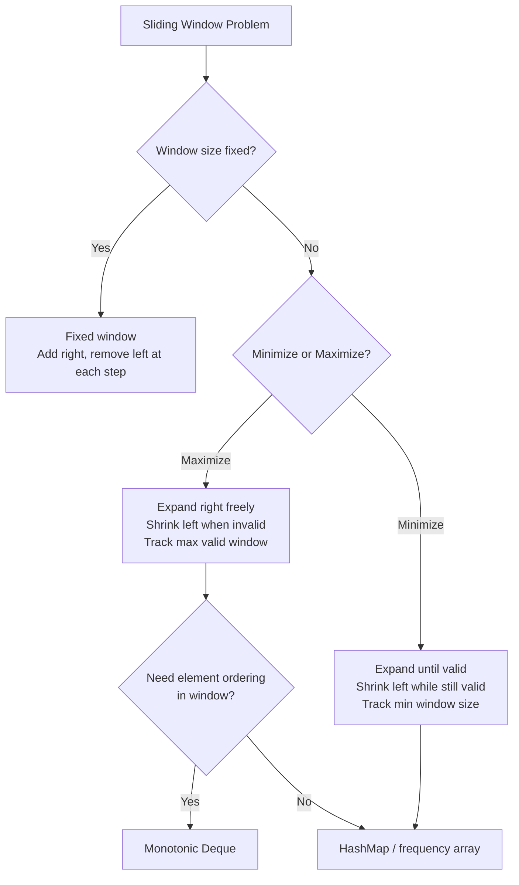

# Sliding Window — Pattern Notes

## Core Intuition

Sliding window converts O(n²) brute force (check every subarray) into O(n) by maintaining a window that expands and contracts. The key question: **when do I shrink the window?**

- **Fixed window:** Window size is given. Slide by adding right element and removing left element.
- **Variable window (find max):** Expand right freely, shrink left when constraint is violated.
- **Variable window (find min):** Expand right until constraint is met, then shrink left as much as possible.
- **Frequency tracking:** Use a hashmap/array to track character counts inside the window.
- **Monotonic deque:** For window maximum/minimum — maintain a deque of useful candidates.

---

## Decision Flowchart

---

## Per-Problem Notes

### 1. Contains Duplicate II — LC 219 | Easy
- **Key insight:** Fixed window of size k. Use a HashSet. If adding element already in set → True. Remove `nums[i-k]` when window exceeds k.
- **Tricky:** Window size is k, so remove element at `i-k` (not `i-k-1`).
- **Common mistakes:** Off-by-one in window removal. Using hashmap instead of hashset (overkill).
- **Time:** O(n) | **Space:** O(k)

### 2. Best Time to Buy/Sell Stock — LC 121 | Easy
- **Key insight:** Track running minimum (buy price). For each day, profit = price - min_so_far. Track max profit.
- **Tricky:** This is technically a sliding window where left = min price day, right = current day.
- **Common mistakes:** Updating max profit before updating min price. Allowing sell before buy.
- **Time:** O(n) | **Space:** O(1)

### 3. Longest Substring Without Repeating Characters — LC 3 | Medium
- **Key insight:** Variable window. HashMap stores last seen index of each char. When duplicate found, move left to `max(left, last_seen[char] + 1)`.
- **Tricky:** Move left to `max(left, ...)` — don't move left backward if the duplicate is outside current window.
- **Common mistakes:** Moving left to `last_seen[char] + 1` without the max → left can move backward.
- **Time:** O(n) | **Space:** O(min(n, 26))

### 4. Longest Repeating Character Replacement — LC 424 | Medium
- **Key insight:** Window is valid if `window_size - max_freq <= k`. Expand right, track max frequency of any char. Shrink left when invalid.
- **Tricky:** `max_freq` never decreases (only update when new char beats it). This is a subtle optimization — we only care about windows larger than the best seen.
- **Common mistakes:** Recalculating max_freq when shrinking (O(26) per step, still O(n) total but unnecessary). Not understanding why max_freq doesn't need to decrease.
- **Time:** O(n) | **Space:** O(26) = O(1)

### 5. Permutation in String — LC 567 | Medium
- **Key insight:** Fixed window of size `len(s1)`. Compare frequency arrays of window and s1. Slide window across s2.
- **Tricky:** Compare 26-element arrays at each step. Or track a `matches` counter (number of chars with equal frequency).
- **Common mistakes:** Sorting window at each step (O(n·k log k)). Not using fixed window size.
- **Time:** O(n) | **Space:** O(26) = O(1)

### 6. Minimum Size Subarray Sum — LC 209 | Medium
- **Key insight:** Variable window (minimize). Expand right, shrink left while `sum >= target`. Track min length.
- **Tricky:** Shrink as much as possible while constraint is still satisfied.
- **Common mistakes:** Shrinking only once per right expansion. Not handling case where no valid subarray exists (return 0).
- **Time:** O(n) | **Space:** O(1)

### 7. K Closest Elements — LC 658 | Medium
- **Key insight:** Binary search for the left boundary of the window of size k. Compare `x - arr[mid]` vs `arr[mid+k] - x` to decide which side to keep.
- **Tricky:** Binary search on the left index, not on the value. Condition: `x - arr[mid] > arr[mid+k] - x` → move left right.
- **Common mistakes:** Binary searching on value instead of index. Wrong comparison direction.
- **Time:** O(log(n-k) + k) | **Space:** O(1)

### 8. Minimum Window Substring — LC 76 | Hard
- **Key insight:** Variable window (minimize). Expand right until all chars of t are covered. Then shrink left while still valid. Track min window.
- **Tricky:** Use `have` and `need` counters. `have` increments only when a char's count in window matches its count in t.
- **Common mistakes:** Incrementing `have` for every occurrence instead of only when count matches. Not handling chars not in t.
- **Time:** O(n + m) | **Space:** O(n + m)

### 9. Sliding Window Maximum — LC 239 | Hard
- **Key insight:** Monotonic decreasing deque stores indices. Front of deque is always the max of current window. Remove indices outside window from front. Remove smaller elements from back before adding new element.
- **Tricky:** Store indices (not values) in deque to check if front is outside window. Remove from back while `nums[deque[-1]] <= nums[i]`.
- **Common mistakes:** Storing values instead of indices (can't check window boundary). Not removing out-of-window indices from front.
- **Time:** O(n) | **Space:** O(k)

---

## Edge Cases to Watch For

- **Empty string/array:** Return 0 or "" immediately.
- **Window larger than array:** k > n — return entire array or handle gracefully.
- **All same characters:** Longest repeating replacement — entire string is valid if k ≥ 0.
- **Target not achievable:** Min window substring — return "" if t chars not all in s. Min subarray sum — return 0 if no valid subarray.
- **Single character strings:** Permutation in string — trivially check if s1 char is in s2.
- **Negative numbers:** Sliding window generally doesn't work with negatives for sum problems (use prefix sum + hashmap instead).
- **Duplicate characters in t:** Min window substring — must match counts, not just presence.
- **k = 0:** Contains Dup II — only exact same index duplicates count (impossible), return False.
