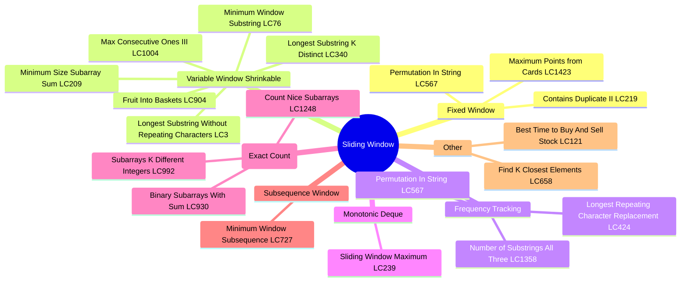
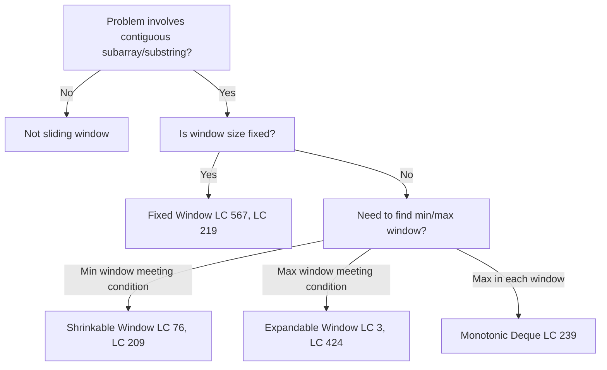
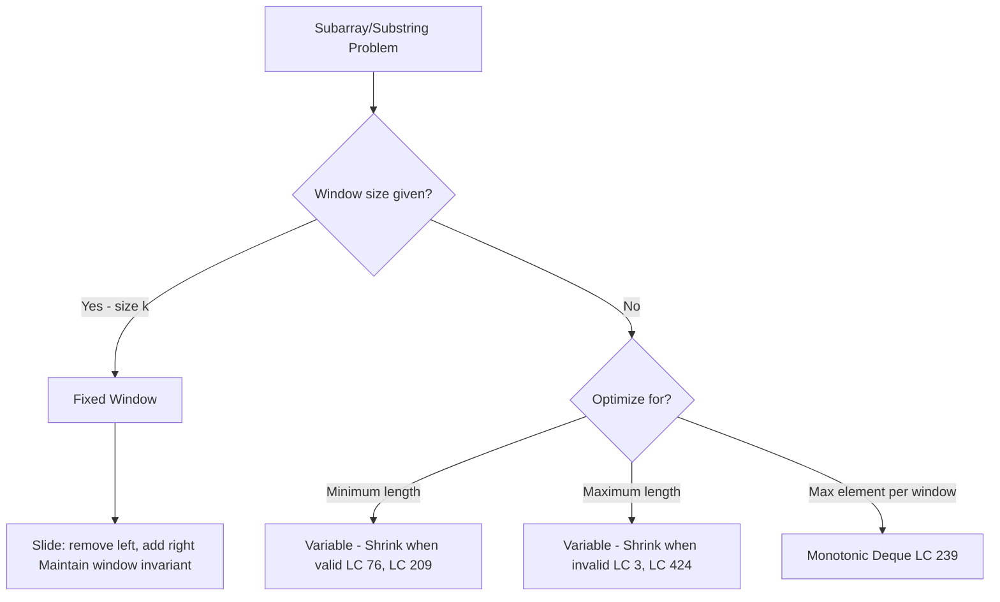
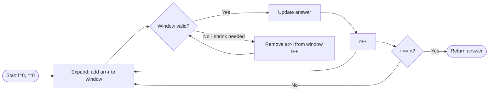
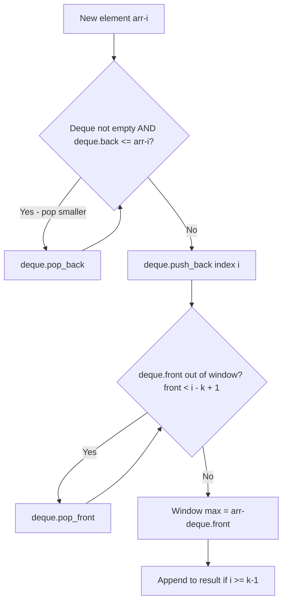

# Sliding Window

## Problem List

| # | Problem | Difficulty | Technique |
|---|---------|------------|-----------|
| 1 | [Contains Duplicate II (LC 219)](https://leetcode.com/problems/contains-duplicate-ii/) | Easy | Hash Set Window |
| 2 | [Best Time to Buy And Sell Stock (LC 121)](https://leetcode.com/problems/best-time-to-buy-and-sell-stock/) | Easy | Min Tracking |
| 3 | [Longest Substring Without Repeating Characters (LC 3)](https://leetcode.com/problems/longest-substring-without-repeating-characters/) | Medium | Hash Set/Map |
| 4 | [Longest Repeating Character Replacement (LC 424)](https://leetcode.com/problems/longest-repeating-character-replacement/) | Medium | Max Freq Tracking |
| 5 | [Permutation In String (LC 567)](https://leetcode.com/problems/permutation-in-string/) | Medium | Frequency Array |
| 6 | [Minimum Size Subarray Sum (LC 209)](https://leetcode.com/problems/minimum-size-subarray-sum/) | Medium | Shrinkable Window |
| 7 | [Find K Closest Elements (LC 658)](https://leetcode.com/problems/find-k-closest-elements/) | Medium | Binary Search + Window |
| 8 | [Minimum Window Substring (LC 76)](https://leetcode.com/problems/minimum-window-substring/) | Hard | Shrinkable Window + Counter |
| 9 | [Sliding Window Maximum (LC 239)](https://leetcode.com/problems/sliding-window-maximum/) | Hard | Monotonic Deque |
| 10 | [Max Consecutive Ones III (LC 1004)](https://leetcode.com/problems/max-consecutive-ones-iii/) | Medium | Shrinkable Window |
| 11 | [Fruit Into Baskets (LC 904)](https://leetcode.com/problems/fruit-into-baskets/) | Medium | Variable Window + HashMap |
| 12 | [Longest Substring with At Most K Distinct (LC 340)](https://leetcode.com/problems/longest-substring-with-at-most-k-distinct-characters/) | Medium | Variable Window + HashMap |
| 13 | [Maximum Points from Cards (LC 1423)](https://leetcode.com/problems/maximum-points-you-can-obtain-from-cards/) | Medium | Fixed Window (complement) |
| 14 | [Binary Subarrays with Sum (LC 930)](https://leetcode.com/problems/binary-subarrays-with-sum/) | Medium | atMost trick |
| 15 | [Count Nice Subarrays (LC 1248)](https://leetcode.com/problems/count-number-of-nice-subarrays/) | Medium | atMost trick |
| 16 | [Subarrays with K Different Integers (LC 992)](https://leetcode.com/problems/subarrays-with-k-different-integers/) | Hard | atMost trick |
| 17 | [Number of Substrings Containing All Three Characters (LC 1358)](https://leetcode.com/problems/number-of-substrings-containing-all-three-characters/) | Medium | Frequency Tracking |
| 18 | [Minimum Window Subsequence (LC 727)](https://leetcode.com/problems/minimum-window-subsequence/) | Hard | Two-pointer subsequence |

---

## Mermaid Diagrams

### 1. When to Use Sliding Window

### 2. Fixed vs Variable Window Decision Tree

### 3. Expand/Shrink Window Pattern Flow

### 4. Monotonic Deque Pattern (LC 239)

---

## Complexity Summary

| Problem | Time | Space | Pattern |
|---------|------|-------|---------|
| contains_duplicate_ii | O(n) | O(k) | Hash set fixed window |
| best_time_to_buy_and_sell_stock | O(n) | O(1) | Min tracking |
| longest_substring_without_repeating_characters | O(n) | O(min(n,m)) | Shrink on duplicate |
| longest_repeating_character_replacement | O(n) | O(1) | Max freq tracking |
| permutation_in_string | O(n) | O(1) | Fixed window freq match |
| minimum_size_subarray_sum | O(n) | O(1) | Shrink when sum ≥ target |
| find_k_closest_elements | O(log n) | O(1) | Binary search left boundary |
| minimum_window_substring | O(n) | O(m+n) | Two counters: need/have |
| sliding_window_maximum | O(n) | O(k) | Monotonic decreasing deque |
| max_consecutive_ones_iii | O(n) | O(1) | Shrinkable window (k zeros) |
| fruit_into_baskets | O(n) | O(1) | Variable window + hashmap |
| binary_subarrays_with_sum | O(n) | O(n) | atMost trick |
| count_number_of_nice_subarrays | O(n) | O(n) | atMost trick |
| number_of_substrings_containing_all_three_characters | O(n) | O(1) | Frequency tracking |
| maximum_points_you_can_obtain_from_cards | O(k) | O(1) | Fixed window (complement) |
| longest_substring_with_at_most_k_distinct_characters | O(n) | O(k) | Variable window + hashmap |
| subarrays_with_k_different_integers | O(n) | O(n) | atMost trick |
| minimum_window_subsequence | O(m·n) | O(1) | Two-pointer subsequence |

---

## Study Order

```mermaid
flowchart LR
    subgraph S1["Stage 1: Easy"]
        sw1["best_time_stock(121) → contains_duplicate_ii(219)"]
        sw2["longest_substr_no_repeat(3)"]
    end

    subgraph S2["Stage 2: Variable Window"]
        sw3["max_consecutive_ones_iii(1004) → fruit_into_baskets(904)"]
        sw4["longest_substr_k_distinct(340) → minimum_size_subarray_sum(209)"]
        sw5["longest_repeating_replacement(424)"]
    end

    subgraph S3["Stage 3: Fixed Window + atMost Trick"]
        sw6["permutation_in_string(567) → maximum_points_from_cards(1423)"]
        sw7["find_k_closest_elements(658) → binary_subarrays_with_sum(930)"]
        sw8["count_nice_subarrays(1248) → subarrays_k_different(992)"]
        sw9["number_of_substrings_all_three(1358)"]
    end

    subgraph S4["Stage 4: Hard"]
        sw10["minimum_window_substring(76) → sliding_window_maximum(239)"]
        sw11["minimum_window_subsequence(727)"]
    end

    S1 --> S2 --> S3 --> S4
```

**Recommended order:** Easy fixed → Easy variable → Medium fixed → Medium variable → Hard
