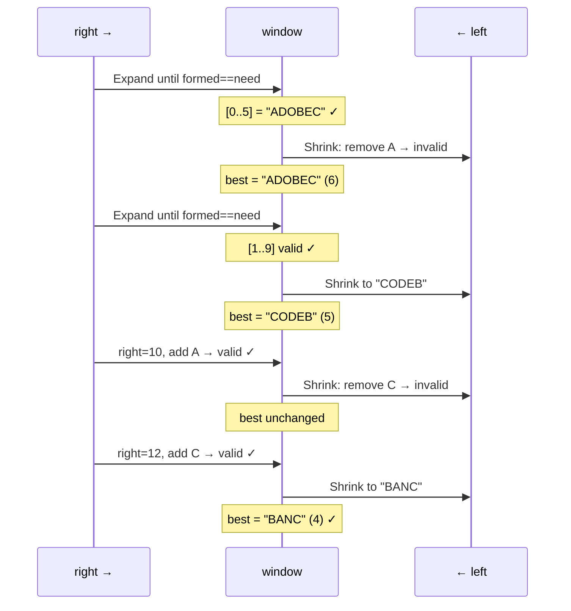

# LC 76 — Minimum Window Substring

## Problem Statement

Given strings `s` and `t`, return the minimum window substring of `s` containing all characters of `t`. Return `""` if none exists.

```
Input:  s = "ADOBECODEBANC", t = "ABC"
Output: "BANC"
```

---

## Approach 1 — Brute Force O(n² · |t|)

Try every substring, check if it contains all chars of `t`.

```python
def minWindow(s, t):
    from collections import Counter
    need = Counter(t)
    best = ""
    for i in range(len(s)):
        for j in range(i + len(t), len(s) + 1):
            w = Counter(s[i:j])
            if all(w[c] >= need[c] for c in need):
                if not best or j - i < len(best):
                    best = s[i:j]
    return best
```

---

## Approach 2 — Sliding Window with `formed` Counter (Optimal)

### The `formed` Optimization

Naively checking window validity requires comparing two frequency maps — O(|t|) per step.

Instead, track `formed` = number of distinct characters in `t` whose frequency in the window **meets** the requirement:
- `window_count[c] == required[c]` → `formed += 1`
- `window_count[c]` drops below `required[c]` after shrink → `formed -= 1`
- Window is valid when `formed == len(required)` — O(1) check.

### Algorithm

```python
def minWindow(s, t):
    from collections import Counter
    if not t or not s:
        return ""

    required = Counter(t)
    need = len(required)
    formed = 0
    window_count = {}
    left = 0
    best = (float("inf"), 0, 0)  # (length, l, r)

    for right in range(len(s)):
        c = s[right]
        window_count[c] = window_count.get(c, 0) + 1
        if c in required and window_count[c] == required[c]:
            formed += 1

        while formed == need:
            if right - left + 1 < best[0]:
                best = (right - left + 1, left, right)
            lc = s[left]
            window_count[lc] -= 1
            if lc in required and window_count[lc] < required[lc]:
                formed -= 1
            left += 1

    return "" if best[0] == float("inf") else s[best[1]:best[2] + 1]
```

---

## Correctness Proof

### INVARIANT: We never skip a valid window

**Claim:** The algorithm finds the globally minimum window.

**Proof by contradiction:**  
Suppose the optimal window is `[i*, j*]` and the algorithm misses it.

- `right` visits every index 0 to n-1, so it reaches `j*`.
- When `right = j*`: the window `[left, j*]` is valid because `[i*, j*]` is valid and `left ≤ i*` at this moment (we only advance `left` while the window is valid, so we haven't passed `i*` without recording).
- The shrink loop advances `left` while valid, recording each window. It reaches `left = i*`.
- Therefore `[i*, j*]` is recorded. **Contradiction.** ∎

### Expand guarantees finding ALL valid windows

`right` never moves backward. Every index is a potential right endpoint. For each `right`, we find the leftmost valid `left` (minimum window for that endpoint). The global minimum is the minimum over all right endpoints.

### Shrink finds the MINIMUM for each right endpoint

We shrink `left` as long as the window stays valid, stopping only when removing `s[left]` would break validity. So `left` is at the optimal (rightmost) position for this `right`. ∎

---

## Step-by-Step Walkthrough

`s = "ADOBECODEBANC"`, `t = "ABC"`, `required = {A:1, B:1, C:1}`, `need = 3`

```
Indices:  0 1 2 3 4 5 6 7 8 9 10 11 12
Chars:    A D O B E C O D E B A  N  C

right=0..2: add A,D,O → formed=1 (A met)
right=3:    add B     → formed=2 (B met)
right=5:    add C     → formed=3 ✓ VALID window [0..5]="ADOBEC"
  Shrink: remove A(0) → A unmet, formed=2. best=(6,0,5)

right=6..8: add O,D,E → formed=2
right=9:    add B     → formed=3 ✓ VALID window [1..9]
  Shrink repeatedly until invalid:
  best updated to "CODEB" (len=5) when left=5

right=10:   add A     → formed=3 ✓ VALID window [5..10]
  Shrink: remove C(5) → C unmet, formed=2. best=(5,5,9) unchanged

right=11:   add N     → formed=2
right=12:   add C     → formed=3 ✓ VALID window [6..12]="CODEBANC"
  Shrink: remove C(6)? No, C is at idx 5 which is already past.
  left=6: remove O → not in t, shrink
  left=7: remove D → not in t, shrink
  ...
  left=9: remove B → B unmet, formed=2. best=(4,9,12)="BANC" ✓

Final answer: "BANC"
```

---

## Mermaid Diagram



---

## Complexity

| Approach | Time | Space |
|---|---|---|
| Brute Force | O(n² · \|t\|) | O(\|t\|) |
| Sliding Window | O(n + \|t\|) | O(\|t\|) |

**Time:** `right` moves n steps, `left` moves at most n steps → O(n).  
**Space:** `required` and `window_count` hold at most O(|t|) entries.
