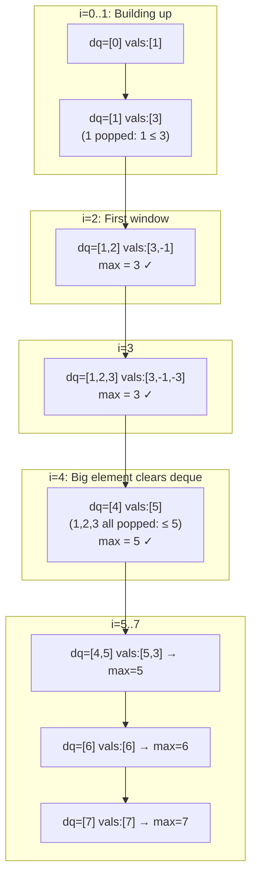

# LC 239 — Sliding Window Maximum

## Problem Statement

Given an integer array `nums` and a window size `k`, return an array of the maximum value in each sliding window of size `k`.

```
Input:  nums = [1,3,-1,-3,5,3,6,7], k = 3
Output: [3,3,5,5,6,7]
```

---

## Approach 1 — Brute Force O(n·k)

```python
def maxSlidingWindow(nums, k):
    return [max(nums[i:i+k]) for i in range(len(nums) - k + 1)]
```

---

## Approach 2 — Monotonic Deque (Optimal)

### Core Invariant

The deque stores **indices** in **decreasing order of their values** (`nums[deque[0]] >= nums[deque[1]] >= ...`).

- **Front** of deque = index of the current window's maximum.
- **Back** of deque = index of the most recently added (smallest useful) element.

### When a new element arrives at index `i`

1. **Remove expired front:** if `deque[0] <= i - k`, pop from front (outside window).
2. **Maintain invariant:** pop from back while `nums[deque[-1]] <= nums[i]` (those elements are useless).
3. Append `i` to back.
4. If `i >= k - 1`, record `nums[deque[0]]` as the window maximum.

### PROOF of Uselessness

**Claim:** If `nums[i] >= nums[j]` and `i > j`, then `j` can never be the maximum of any future window.

**Proof:**
- Any future window that contains `j` also contains `i` (since `i > j` and windows are contiguous, once `j` is in the window, `i` is too — unless `i` has already left, but `i > j` means `i` leaves the window *after* `j`).
- Since `nums[i] >= nums[j]` and `i` is always present whenever `j` is, `j` is never the maximum.
- Therefore `j` can be safely discarded. ∎

### PROOF of O(n) Amortized Time

**Claim:** Total operations on the deque are O(n).

**Proof:**
- Each index is **pushed** onto the deque exactly once.
- Each index is **popped** from the deque at most once (either from back during cleanup, or from front when expired).
- Total push + pop operations ≤ 2n → **O(n) amortized**. ∎

### Algorithm

```python
from collections import deque

def maxSlidingWindow(nums, k):
    dq = deque()   # stores indices, decreasing by value
    result = []

    for i in range(len(nums)):
        # Remove indices outside window
        if dq and dq[0] <= i - k:
            dq.popleft()

        # Remove indices whose values are <= nums[i] (useless)
        while dq and nums[dq[-1]] <= nums[i]:
            dq.pop()

        dq.append(i)

        # Window is full
        if i >= k - 1:
            result.append(nums[dq[0]])

    return result
```

---

## Step-by-Step Walkthrough

`nums = [1, 3, -1, -3, 5, 3, 6, 7]`, `k = 3`

```
i=0: num=1.  dq=[]. Append 0.       dq=[0]        (vals:[1])
i=1: num=3.  Pop 0 (1<=3). Append 1. dq=[1]        (vals:[3])
i=2: num=-1. Append 2.              dq=[1,2]       (vals:[3,-1])  → window full, max=nums[1]=3
i=3: num=-3. Append 3.              dq=[1,2,3]     (vals:[3,-1,-3]) → max=nums[1]=3
i=4: num=5.  Pop 3(-3),2(-1),1(3). Append 4. dq=[4] (vals:[5])   → max=nums[4]=5
i=5: num=3.  Append 5.              dq=[4,5]       (vals:[5,3])   → max=nums[4]=5
i=6: num=6.  Pop 5(3),4(5). Append 6. dq=[6]       (vals:[6])    → max=nums[6]=6
i=7: num=7.  Pop 6(6). Append 7.    dq=[7]         (vals:[7])    → max=nums[7]=7

Result: [3, 3, 5, 5, 6, 7] ✓
```

---

## Mermaid Diagram — Deque State Evolution



---

## Complexity

| Approach | Time | Space |
|---|---|---|
| Brute Force | O(n·k) | O(1) |
| Monotonic Deque | O(n) | O(k) |

**Time:** Each element enters and exits the deque at most once → O(n) total.  
**Space:** Deque holds at most `k` indices at any time → O(k).
