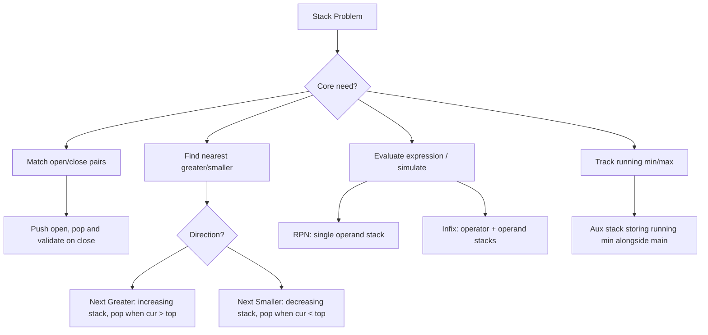

# Stack — Pattern Notes

## Core Intuition
A stack is the right tool when you need to **defer a decision** until you see a future element, or when you need to **undo/match** the most recent thing seen. LIFO naturally models nested structure and "nearest previous element" queries.

Sub-patterns:
- **Matching/Validation** — push open, pop on close, check compatibility
- **Monotonic Stack** — maintain increasing/decreasing stack; pop when invariant breaks → nearest greater/smaller in O(n)
- **Simulation** — stack as scratch space for stateful ops
- **Expression Evaluation** — operand stack + operator stack, or postfix with single stack

---

## Decision Diagram

---

## Per-Problem Notes

| # | Problem | LC | Difficulty | What to Learn | Common Mistakes | Time / Space |
|---|---------|-----|------------|---------------|-----------------|--------------|
| 1 | Baseball Game | 682 | Easy | Simulation: `C`=pop, `D`=double top, `+`=sum top two | `+` doesn't pop the two values | O(n) / O(n) |
| 2 | Valid Parentheses | 20 | Easy | Push open; on close, pop & match | Empty stack on close; stack not empty at end | O(n) / O(n) |
| 3 | Stack Using Queues | 225 | Easy | Costly-push: rotate queue after each push | Using two queues when one suffices | O(n) push, O(1) pop / O(n) |
| 4 | Queue Using Stacks | 232 | Easy | Amortized O(1): lazy transfer inbox→outbox only when outbox empty | Transferring on every pop | O(1) amortized / O(n) |
| 5 | Min Stack | 155 | Medium | Parallel min_stack storing current min at each level | Single global min fails when min is popped | O(1) all ops / O(n) |
| 6 | Eval RPN | 150 | Medium | Single operand stack; pop two on operator; `int(a/b)` for truncation toward zero | Operand order: b op a (a popped first) | O(n) / O(n) |
| 7 | Asteroid Collision | 735 | Medium | Positive→push; negative→loop destroying positives on top; equal→both explode | Forgetting the inner loop; equal-size case | O(n) / O(n) |
| 8 | Daily Temperatures | 739 | Medium | Monotonic decreasing stack of **indices**; pop when cur temp > top | Storing temps not indices | O(n) / O(n) |
| 9 | Online Stock Span | 901 | Medium | Stack of `(price, span)`; absorb span of popped elements | Not accumulating spans, just counting pops | O(1) amortized / O(n) |
| 10 | Car Fleet | 853 | Medium | Sort by position desc; compute time to target; if time ≤ stack top → merge (don't push) | Sorting ascending; forgetting merge condition | O(n log n) / O(n) |
| 11 | Simplify Path | 71 | Medium | Split on `/`; skip `.` and empty; pop on `..`; push dir names; rejoin | Multiple consecutive slashes; missing leading `/` | O(n) / O(n) |
| 12 | Decode String | 394 | Medium | Two stacks: counts + string prefixes; push state on `[`, pop & repeat on `]` | Multi-digit numbers; nested brackets | O(n·k) / O(n) |
| 13 | Max Freq Stack | 895 | Hard | `freq` map + `group` map (freq→stack); track `maxfreq`; decrement maxfreq when group empties | Not decrementing maxfreq after pop | O(1) push/pop / O(n) |
| 14 | Largest Rectangle | 84 | Hard | Monotonic increasing stack of indices; on pop compute area with popped bar as shortest; append sentinel 0 | Not processing remaining stack after loop; width off-by-one | O(n) / O(n) |

---

## Edge Cases to Watch
- Empty stack pop — guard with `if stack` before accessing top
- Single element inputs (single asteroid, single bar, single bracket)
- All same elements — monotonic stack never pops until end
- Nested structures at max depth (Decode String, Valid Parentheses)
- Negative numbers in RPN
- Equal-size asteroid collision — both destroyed
- Path with only `..` components → result must be `/`
