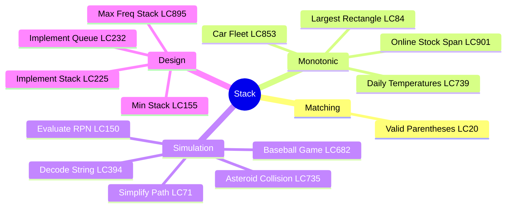
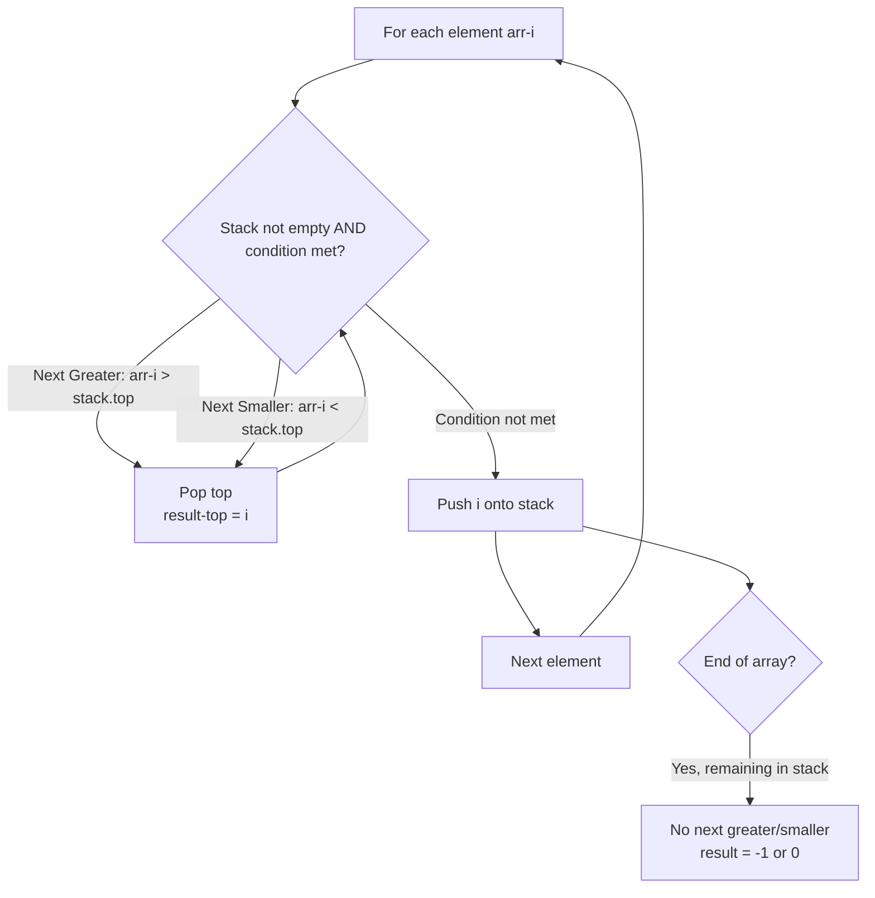
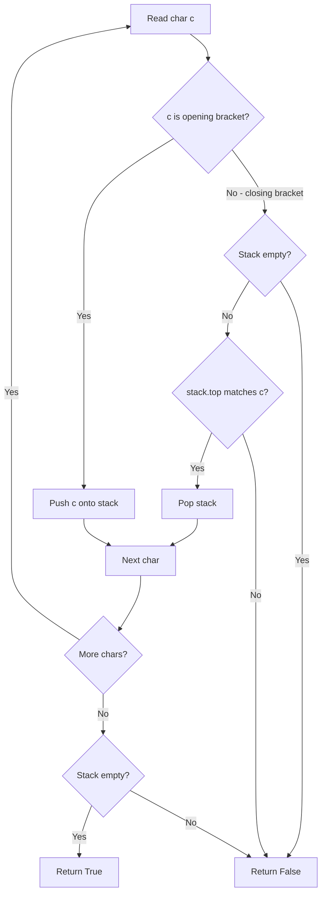
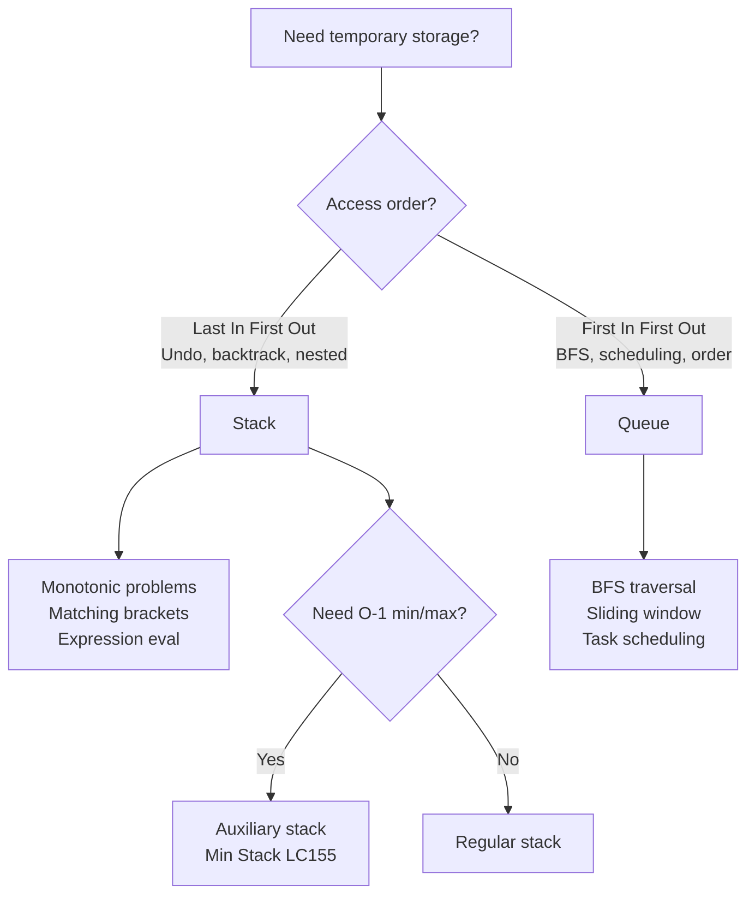
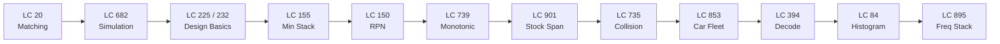

# Stack

## Problem List

| # | Problem | Difficulty | Category |
|---|---------|------------|----------|
| 1 | [Baseball Game (LC 682)](https://leetcode.com/problems/baseball-game/) | Easy | Simulation |
| 2 | [Valid Parentheses (LC 20)](https://leetcode.com/problems/valid-parentheses/) | Easy | Matching |
| 3 | [Implement Stack Using Queues (LC 225)](https://leetcode.com/problems/implement-stack-using-queues/) | Easy | Design |
| 4 | [Implement Queue using Stacks (LC 232)](https://leetcode.com/problems/implement-queue-using-stacks/) | Easy | Design |
| 5 | [Min Stack (LC 155)](https://leetcode.com/problems/min-stack/) | Medium | Design |
| 6 | [Evaluate Reverse Polish Notation (LC 150)](https://leetcode.com/problems/evaluate-reverse-polish-notation/) | Medium | Simulation |
| 7 | [Asteroid Collision (LC 735)](https://leetcode.com/problems/asteroid-collision/) | Medium | Simulation |
| 8 | [Daily Temperatures (LC 739)](https://leetcode.com/problems/daily-temperatures/) | Medium | Monotonic |
| 9 | [Online Stock Span (LC 901)](https://leetcode.com/problems/online-stock-span/) | Medium | Monotonic |
| 10 | [Car Fleet (LC 853)](https://leetcode.com/problems/car-fleet/) | Medium | Monotonic |
| 11 | [Simplify Path (LC 71)](https://leetcode.com/problems/simplify-path/) | Medium | Simulation |
| 12 | [Decode String (LC 394)](https://leetcode.com/problems/decode-string/) | Medium | Simulation |
| 13 | [Maximum Frequency Stack (LC 895)](https://leetcode.com/problems/maximum-frequency-stack/) | Hard | Design |
| 14 | [Largest Rectangle In Histogram (LC 84)](https://leetcode.com/problems/largest-rectangle-in-histogram/) | Hard | Monotonic |

---

## Mermaid Diagrams

### 1. Stack Problem Categories

### 2. Monotonic Stack Pattern (Next Greater/Smaller)

### 3. Parentheses Matching Flow (LC 20)

### 4. Stack vs Queue Decision

---

## Complexity Summary

| Problem | Time | Space | Key Insight |
|---------|------|-------|-------------|
| LC 682 | O(n) | O(n) | Simulate with stack |
| LC 20 | O(n) | O(n) | Push open, match close |
| LC 225 | O(n) push | O(n) | Rotate queue on push |
| LC 232 | O(1) amortized | O(n) | Two stacks: in/out |
| LC 155 | O(1) all | O(n) | Stack of (val, curMin) pairs |
| LC 150 | O(n) | O(n) | Push nums, pop on operator |
| LC 735 | O(n) | O(n) | Positive right, negative left |
| LC 739 | O(n) | O(n) | Monotonic decreasing stack |
| LC 901 | O(1) amortized | O(n) | Monotonic non-increasing |
| LC 853 | O(n log n) | O(n) | Sort by pos, stack arrival times |
| LC 71 | O(n) | O(n) | Split on `/`, handle `..` |
| LC 394 | O(n) | O(n) | Stack of (string, count) |
| LC 895 | O(1) all | O(n) | freq map + group stacks |
| LC 84 | O(n) | O(n) | Monotonic increasing stack |

---

## Study Order

**Recommended order:** Matching → Simulation → Design → Monotonic → Hard
