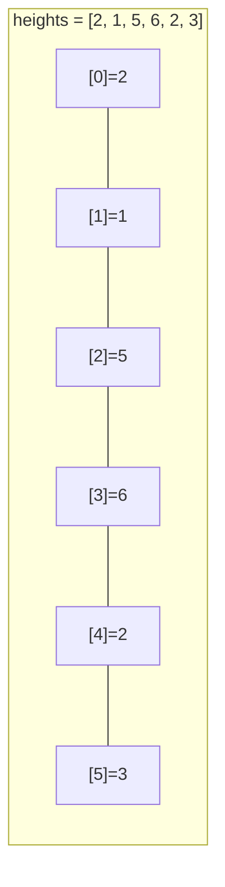
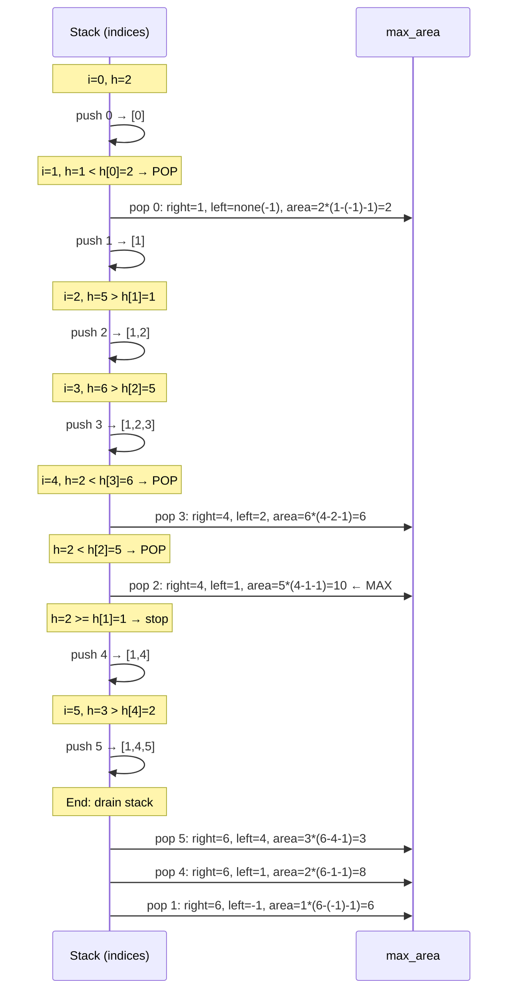

# LC 84 — Largest Rectangle in Histogram

**Difficulty:** Hard | **Pattern:** Monotonic Stack

---

## Problem Statement

Given an array `heights` representing bar widths of 1 each, find the area of the **largest rectangle** that fits entirely within the histogram.

```
heights = [2, 1, 5, 6, 2, 3]  →  10
heights = [2, 4]               →  4
```

---

## Why Brute Force Fails

**O(n²) approach:** For every pair `(i, j)`, area = `min(heights[i..j]) * (j-i+1)`. Too slow for large inputs.

**Key observation:** For each bar `i`, the maximum rectangle using bar `i` as the **shortest bar** extends:
- Left until the first bar **shorter** than `heights[i]`
- Right until the first bar **shorter** than `heights[i]`

If we can find these boundaries efficiently for all bars → O(n) solution.

---

## Core Insight: Monotonic Increasing Stack

Maintain a stack of bar indices in **strictly increasing height order**.

**INVARIANT:** At any point, `stack` contains indices `[s0, s1, ..., sk]` where `heights[s0] < heights[s1] < ... < heights[sk]`.

When we encounter bar `i` with `heights[i] < heights[stack[-1]]`:
- The top bar `j = stack[-1]` has found its **right boundary**: index `i`
- Its **left boundary**: `stack[-2]` after popping (the next smaller bar to the left)
- Area = `heights[j] * (i - stack[-2] - 1)`

This works because the stack's increasing order **guarantees** that `stack[-2]` is the first bar shorter than `j` to its left.

---

## PROOF of Correctness

**Claim:** When we pop index `j` at position `i`, the computed area is the maximum rectangle with `heights[j]` as the limiting height.

**Right boundary is correct:**  
Bar `i` triggered the pop because `heights[i] < heights[j]`. All bars between `j` and `i` were taller (they were pushed and popped before `j`, or are still on the stack above `j`). So `i` is the **first bar to the right shorter than `j`**. ✓

**Left boundary is correct:**  
After popping `j`, the new top is `stack[-1]` (call it `p`). Since the stack maintained increasing order, `heights[p] < heights[j]`. All bars between `p` and `j` were taller than `heights[j]` (they were pushed after `p` and before `j`, meaning they were ≥ `heights[j]`, but they were already popped — meaning they were popped by something even taller, so they can't be shorter than `j`). Therefore `p` is the **first bar to the left shorter than `j`**. ✓

**Width = `i - p - 1`:**  
The rectangle spans from index `p+1` to `i-1` inclusive = `i - p - 1` bars. ✓ ∎

---

## PROOF of O(n) Time

Each bar index is:
- **Pushed** onto the stack exactly **once**
- **Popped** from the stack exactly **once**

Total operations = 2n pushes/pops + n iterations = **O(n)**. ∎

---

## Stack State Diagram





---

## Algorithm

```python
def largestRectangleArea(heights: list[int]) -> int:
    stack = []   # indices, increasing heights
    max_area = 0

    for i, h in enumerate(heights):
        start = i
        while stack and heights[stack[-1]] >= h:
            j = stack.pop()
            width = i - (stack[-1] if stack else -1) - 1
            max_area = max(max_area, heights[j] * width)
            start = j          # rectangle can extend back to j's start
        stack.append(start)    # use start to handle width correctly

    # Drain remaining bars (right boundary = end of array)
    for j in stack:
        width = len(heights) - (stack[stack.index(j) - 1] if stack.index(j) > 0 else -1) - 1
        max_area = max(max_area, heights[j] * width)

    return max_area
```

Cleaner version using sentinel:

```python
def largestRectangleArea(heights: list[int]) -> int:
    heights = heights + [0]   # sentinel forces all pops at end
    stack = [-1]              # sentinel for left boundary
    max_area = 0

    for i, h in enumerate(heights):
        while stack[-1] != -1 and heights[stack[-1]] >= h:
            height = heights[stack.pop()]
            width = i - stack[-1] - 1
            max_area = max(max_area, height * width)
        stack.append(i)

    return max_area
```

---

## Step-by-Step Walkthrough

### `heights = [2, 1, 5, 6, 2, 3]`

```
Append sentinel 0: [2, 1, 5, 6, 2, 3, 0]
stack = [-1]

i=0, h=2:  push 0.  stack=[-1,0]
i=1, h=1:  1<2, pop 0: height=2, width=1-(-1)-1=1, area=2
           stack=[-1], push 1.  stack=[-1,1]
i=2, h=5:  push 2.  stack=[-1,1,2]
i=3, h=6:  push 3.  stack=[-1,1,2,3]
i=4, h=2:  2<6, pop 3: height=6, width=4-2-1=1,  area=6
           2<5, pop 2: height=5, width=4-1-1=2,  area=10  ← MAX
           2>=1, stop. push 4.  stack=[-1,1,4]
i=5, h=3:  push 5.  stack=[-1,1,4,5]
i=6, h=0:  0<3, pop 5: height=3, width=6-4-1=1,  area=3
           0<2, pop 4: height=2, width=6-1-1=4,  area=8
           0<1, pop 1: height=1, width=6-(-1)-1=6, area=6
           stack=[-1]

max_area = 10  ✓
```

---

## Complexity

| | Value | Justification |
|---|---|---|
| **Time** | O(n) | Each index pushed once, popped once → 2n total stack ops |
| **Space** | O(n) | Stack holds at most n indices (strictly increasing subsequence) |

**Can space be O(1)?** No — in the worst case (strictly increasing heights like `[1,2,3,4,5]`), all indices stay on the stack until the sentinel triggers pops. The stack must hold all n indices.
