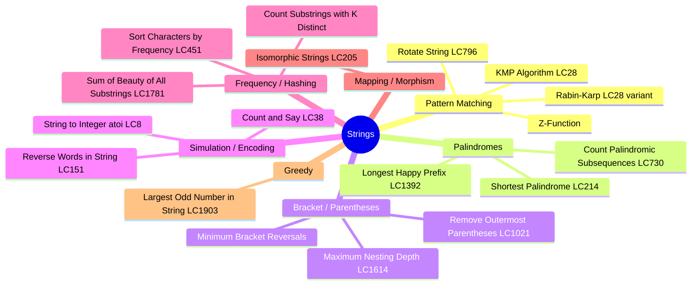

# Strings — Pattern Study

## Mindmap



---

## Decision Flowchart

```mermaid
flowchart TD
    A[String Problem] --> B{What is the goal?}

    B -->|Find a pattern / substring| C{Need exact match?}
    C -->|Yes, one pattern| D[KMP — O(n+m)]
    C -->|Yes, many patterns| E[Rabin-Karp rolling hash]
    C -->|Anagram or shift match| F[Z-Function or sliding window]

    B -->|Palindrome related| G{Build or count?}
    G -->|Shortest palindrome by prepending| H[KMP on s + '#' + rev(s)]
    G -->|Count palindromic subsequences| I[Interval DP]
    G -->|Longest prefix = suffix| J[KMP LPS array]

    B -->|Bracket balance / depth| K{Stack or greedy?}
    K -->|Remove or track depth| L[Stack simulation]
    K -->|Minimum flips to balance| M[Greedy + stack count]

    B -->|Frequency or ordering| N{Count chars?}
    N -->|Sort by frequency| O[Counter + bucket sort]
    N -->|Substrings with constraint| P[Sliding window + hash map]
    N -->|Character beauty sum| Q[Frequency array per window]

    B -->|Encoding / parsing| R[Simulation — follow the spec]

    B -->|Morphic mapping| S[Two hash maps — forward + back]
```

---

## Key Templates

### Rolling Hash — Rabin-Karp

```python
def rabin_karp(text: str, pattern: str) -> int:
    n, m = len(text), len(pattern)
    if m > n:
        return -1
    BASE, MOD = 31, 10**9 + 7
    pw = pow(BASE, m - 1, MOD)

    def char_val(c):
        return ord(c) - ord('a') + 1

    # Build initial hashes
    ph = th = 0
    for i in range(m):
        ph = (ph * BASE + char_val(pattern[i])) % MOD
        th = (th * BASE + char_val(text[i])) % MOD

    for i in range(n - m + 1):
        if th == ph and text[i:i+m] == pattern:   # verify to avoid collision
            return i
        if i + m < n:
            th = (th - char_val(text[i]) * pw) % MOD
            th = (th * BASE + char_val(text[i + m])) % MOD
    return -1
```

### KMP — LPS Array + Search

```python
def build_lps(pattern: str) -> list[int]:
    m = len(pattern)
    lps = [0] * m
    length = 0   # length of previous longest prefix-suffix
    i = 1
    while i < m:
        if pattern[i] == pattern[length]:
            length += 1
            lps[i] = length
            i += 1
        elif length:
            length = lps[length - 1]   # fall back
        else:
            lps[i] = 0
            i += 1
    return lps

def kmp_search(text: str, pattern: str) -> list[int]:
    n, m = len(text), len(pattern)
    lps = build_lps(pattern)
    matches, j = [], 0
    for i in range(n):
        while j and text[i] != pattern[j]:
            j = lps[j - 1]
        if text[i] == pattern[j]:
            j += 1
        if j == m:
            matches.append(i - m + 1)
            j = lps[j - 1]
    return matches
```

### Z-Function

```python
def z_function(s: str) -> list[int]:
    n = len(s)
    z = [0] * n
    z[0] = n
    l = r = 0
    for i in range(1, n):
        if i < r:
            z[i] = min(r - i, z[i - l])
        while i + z[i] < n and s[z[i]] == s[i + z[i]]:
            z[i] += 1
        if i + z[i] > r:
            l, r = i, i + z[i]
    return z

# Pattern search using Z-function: build "pattern#text", z[i] == len(pattern) → match
def z_search(text: str, pattern: str) -> list[int]:
    combined = pattern + '#' + text
    z = z_function(combined)
    m = len(pattern)
    return [i - m - 1 for i in range(m + 1, len(combined)) if z[i] == m]
```

---

## Problem Table

| # | Problem | LC # | Difficulty | Approach | Time | Space |
|---|---------|------|------------|----------|------|-------|
| 1 | Isomorphic Strings | 205 | Easy | Two hash maps | O(n) | O(1) |
| 2 | Largest Odd Number in String | 1903 | Easy | Greedy from end | O(n) | O(1) |
| 3 | Remove Outermost Parentheses | 1021 | Easy | Depth counter | O(n) | O(n) |
| 4 | Maximum Nesting Depth of Parentheses | 1614 | Easy | Depth counter | O(n) | O(1) |
| 5 | Reverse Words in String | 151 | Medium | Split + reverse | O(n) | O(n) |
| 6 | Rotate String | 796 | Easy | Concatenation check | O(n²) | O(n) |
| 7 | String to Integer atoi | 8 | Medium | Simulation | O(n) | O(1) |
| 8 | Count and Say | 38 | Medium | Run-length simulation | O(n·L) | O(L) |
| 9 | Sort Characters by Frequency | 451 | Medium | Counter + bucket sort | O(n) | O(n) |
| 10 | Minimum Bracket Reversals | — | Medium | Greedy + stack count | O(n) | O(1) |
| 11 | Rabin-Karp | 28 variant | Medium | Rolling hash | O(n+m) avg | O(1) |
| 12 | Z-Function | — | Medium | Z-array | O(n) | O(n) |
| 13 | KMP Algorithm | 28 | Medium | LPS array | O(n+m) | O(m) |
| 14 | Longest Happy Prefix | 1392 | Medium | KMP LPS | O(n) | O(n) |
| 15 | Sum of Beauty of All Substrings | 1781 | Medium | Freq array per window | O(n²) | O(1) |
| 16 | Count Substrings with K Distinct | — | Medium | Sliding window | O(n) | O(k) |
| 17 | Shortest Palindrome | 214 | Hard | KMP on s+'#'+rev(s) | O(n) | O(n) |
| 18 | Count Palindromic Subsequences | 730 | Hard | Interval DP | O(n²) | O(n²) |

---

## Complexity Summary

| Approach | Time | Space | Use When |
|----------|------|-------|----------|
| KMP | O(n+m) | O(m) | Single pattern match |
| Rabin-Karp | O(n+m) avg, O(nm) worst | O(1) | Multiple patterns or anti-collision needed |
| Z-Function | O(n) | O(n) | Prefix-match problems |
| Sliding Window | O(n) | O(k) | Substring constraints |
| Interval DP | O(n²)–O(n³) | O(n²) | Palindromes, subsequences |
| Simulation | O(n) | O(1)–O(n) | Encoding, parsing |
| Two Hash Maps | O(n) | O(1) | Morphic / isomorphic |
| Greedy | O(n) | O(1) | Optimal prefix/suffix trimming |

---

## Study Order


---

## Key Themes

- **KMP / LPS**: The failure function lets you skip re-matching on mismatch. Core to `longest_happy_prefix` and `shortest_palindrome`. Build it once, reuse everywhere.
- **Rolling hash**: O(1) window hash update — subtract leading char contribution, multiply, add new char. Collision risk mitigated by verification step.
- **Z-function**: `Z[i]` = length of the longest substring starting at `i` that matches a prefix of `s`. Equivalent power to KMP, different perspective.
- **Sliding window on strings**: Expand right freely, shrink left when a constraint (e.g., k distinct chars) is violated. Use a frequency map as the window state.
- **Isomorphic / morphic problems**: Two maps in both directions to enforce bijection. One map alone misses reverse collisions.
- **Bracket problems**: Depth counter handles nesting; for imbalanced reversal, count unmatched `(` and `)` after a stack pass.
- **Interval DP on strings**: `dp[i][j]` = answer for substring `s[i..j]`. Fill by increasing length. Typical for palindrome counting.
- **Simulation problems** (atoi, count-and-say): Carefully follow the spec — edge cases like leading spaces, sign, overflow are the actual test.
