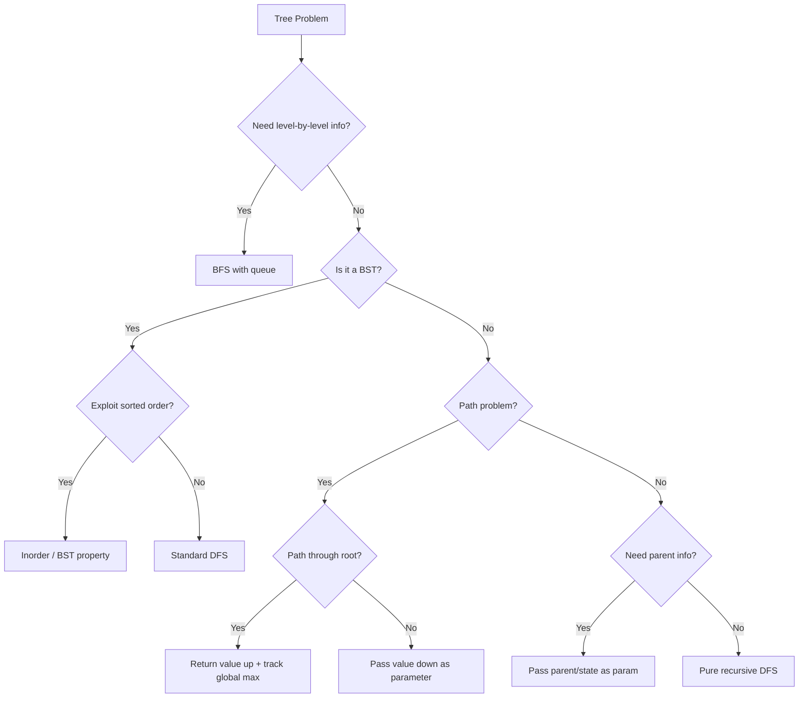

# Trees — Pattern Notes

## Core Intuition

Trees are recursive structures. Almost every tree problem reduces to: **what do I need from my children to answer the question at the current node?** Define that return value clearly, then trust recursion.

- **DFS** = process node + recurse. Choose pre/in/post based on when you need the node's value relative to children.
- **BFS** = level-by-level using a queue. Use when you need level info or shortest path.
- **BST** = left < node < right. Inorder traversal gives sorted order. Always exploit this property.

```python
# Pattern 1: DFS returning value upward
def dfs(node):
    if not node: return base_value
    left = dfs(node.left)
    right = dfs(node.right)
    return combine(left, right, node.val)   # e.g. max(left, right) + 1

# Pattern 2: BFS level order
from collections import deque
q = deque([root])
while q:
    for _ in range(len(q)):   # snapshot size — critical
        node = q.popleft()
        if node.left:  q.append(node.left)
        if node.right: q.append(node.right)

# Pattern 3: DFS passing state downward (top-down)
def dfs(node, state):
    if not node: return
    # use state at this node
    dfs(node.left,  update(state, node))
    dfs(node.right, update(state, node))
```

---

## Decision Flowchart



---

## Java Idioms

```java
// TreeNode definition (define package-private in every Solution.java file)
class TreeNode { int val; TreeNode left, right; TreeNode(int v) { val = v; } }

// BFS level order — ALWAYS snapshot size before inner loop
Queue<TreeNode> q = new ArrayDeque<>();
q.offer(root);
while (!q.isEmpty()) {
    int size = q.size();           // snapshot — critical
    for (int i = 0; i < size; i++) {
        TreeNode node = q.poll();
        if (node.left != null) q.offer(node.left);
        if (node.right != null) q.offer(node.right);
    }
}

// Inorder iterative — curr pointer + stack
Deque<TreeNode> stack = new ArrayDeque<>();
TreeNode curr = root;
while (curr != null || !stack.isEmpty()) {
    while (curr != null) { stack.push(curr); curr = curr.left; }
    curr = stack.pop();
    // process curr
    curr = curr.right;
}

// BST bounds — use Long to handle Integer.MIN/MAX_VALUE as valid node values
private boolean valid(TreeNode node, long lo, long hi) {
    if (node == null) return true;
    if (node.val <= lo || node.val >= hi) return false;
    return valid(node.left, lo, node.val) && valid(node.right, node.val, hi);
}
// Call: valid(root, Long.MIN_VALUE, Long.MAX_VALUE)

// Return pair from DFS — use int[] instead of Python tuple
private int[] dfs(TreeNode node) {
    // returns {rob_this, skip_this} or {height, diameter} etc.
    if (node == null) return new int[]{0, 0};
    int[] left = dfs(node.left), right = dfs(node.right);
    // combine left[0], left[1], right[0], right[1], node.val
    return new int[]{0, 0}; // fill in actual combination
}

// Width index — use long to prevent overflow (2i/2i+1 indexing)
// At each level: offset = first index; width = last - first + 1
// Store (node, index) in queue: Queue<long[]> for index tracking

// Parent map (tree -> graph) — build with DFS, then BFS from target
Map<TreeNode, TreeNode> parent = new HashMap<>();
// DFS to populate parent; then BFS from target node using visited set
```

---

## Per-Problem Notes

### 1. Inorder Traversal — LC 94 | Easy
- **Key insight:** Left → Node → Right. Iterative uses explicit stack; push left spine, pop, go right.
- **Tricky:** Iterative version — remember to move `curr = curr.right` after popping.
- **Common mistakes:** Forgetting the right subtree in iterative; confusing with preorder.
- **Time:** O(n) | **Space:** O(h) stack

### 2. Preorder Traversal — LC 144 | Easy
- **Key insight:** Node → Left → Right. Iterative: push right then left so left is processed first.
- **Tricky:** Iterative push order is reversed (right before left).
- **Common mistakes:** Pushing left before right in iterative.
- **Time:** O(n) | **Space:** O(h)

### 3. Postorder Traversal — LC 145 | Easy
- **Key insight:** Left → Right → Node. Iterative trick: reverse of modified preorder (Node→Right→Left).
- **Tricky:** Iterative is non-obvious; use two-stack or reverse trick.
- **Common mistakes:** Trying to directly simulate postorder iteratively without the reverse trick.
- **Time:** O(n) | **Space:** O(h)

### 4. Invert Binary Tree — LC 226 | Easy
- **Key insight:** Swap left and right children at every node. Pure recursion.
- **Tricky:** Nothing — classic recursion warm-up.
- **Common mistakes:** Forgetting to return the node after swapping.
- **Time:** O(n) | **Space:** O(h)

### 5. Maximum Depth — LC 104 | Easy
- **Key insight:** `max(depth(left), depth(right)) + 1`. Base case: null → 0.
- **Tricky:** Off-by-one — depth of a single node is 1, not 0.
- **Common mistakes:** Returning 0 for leaf instead of 1.
- **Time:** O(n) | **Space:** O(h)

### 6. Diameter of Binary Tree — LC 543 | Easy
- **Key insight:** Diameter through a node = left_height + right_height. Track global max, return height upward.
- **Tricky:** The diameter doesn't have to pass through root. Must use a nonlocal/global variable.
- **Common mistakes:** Returning diameter instead of height from the recursive function.
- **Time:** O(n) | **Space:** O(h)

### 7. Balanced Binary Tree — LC 110 | Easy
- **Key insight:** Return -1 as a sentinel for "unbalanced" up the call stack. Avoids recomputation.
- **Tricky:** Naive O(n²) solution recomputes heights. Optimal does it in one pass.
- **Common mistakes:** Computing height separately for each node (O(n²)).
- **Time:** O(n) | **Space:** O(h)

### 8. Same Tree — LC 100 | Easy
- **Key insight:** Two trees are same if roots equal AND left subtrees same AND right subtrees same.
- **Tricky:** Handle null cases: both null → true, one null → false.
- **Common mistakes:** Not handling the case where one is null and other isn't.
- **Time:** O(n) | **Space:** O(h)

### 9. Subtree of Another Tree — LC 572 | Easy
- **Key insight:** At each node of the big tree, check if `isSameTree(node, subRoot)`. Recurse if not.
- **Tricky:** O(n·m) is acceptable here. Serialization approach is O(n+m) but complex.
- **Common mistakes:** Not checking the current node itself, only children.
- **Time:** O(n·m) | **Space:** O(h)

### 10. LCA of BST — LC 235 | Medium
- **Key insight:** If both nodes < root → go left. Both > root → go right. Otherwise root is LCA.
- **Tricky:** BST property makes this O(h) instead of O(n).
- **Common mistakes:** Using the general LCA approach (LC 236) which ignores BST property.
- **Time:** O(h) | **Space:** O(h)

### 11. Insert into BST — LC 701 | Medium
- **Key insight:** Recurse left/right based on comparison. Insert at the null spot.
- **Tricky:** Return the node at each step to reattach it to parent.
- **Common mistakes:** Not returning the node — breaks the tree linkage.
- **Time:** O(h) | **Space:** O(h)

### 12. Delete Node in BST — LC 450 | Medium
- **Key insight:** Three cases: no children (delete), one child (replace), two children (replace with inorder successor = leftmost of right subtree).
- **Tricky:** Two-children case. Find inorder successor, copy its value, delete successor from right subtree.
- **Common mistakes:** Forgetting to recursively delete the successor after copying its value.
- **Time:** O(h) | **Space:** O(h)

### 13. Binary Tree Level Order — LC 102 | Medium
- **Key insight:** BFS with queue. Track level size at start of each iteration.
- **Tricky:** Snapshot `len(queue)` before the inner loop, not during.
- **Common mistakes:** Not snapshotting queue size — processes multiple levels in one pass.
- **Time:** O(n) | **Space:** O(n)

### 14. Right Side View — LC 199 | Medium
- **Key insight:** BFS level order — take the last element of each level. Or DFS passing depth, update result when depth == len(result).
- **Tricky:** DFS approach: visit right child first so rightmost is seen first at each depth.
- **Common mistakes:** BFS: taking first element instead of last.
- **Time:** O(n) | **Space:** O(n)

### 15. Construct Quad Tree — LC 427 | Medium
- **Key insight:** Check if all values in region are same → leaf. Otherwise split into 4 quadrants recursively.
- **Tricky:** Precompute 2D prefix sums to check uniformity in O(1) per region.
- **Common mistakes:** Recomputing sum naively → O(n² log n). Use prefix sums for O(n²).
- **Time:** O(n²) | **Space:** O(n²)

### 16. Count Good Nodes — LC 1448 | Medium
- **Key insight:** Pass max value seen so far down the tree. Node is "good" if its value >= max.
- **Tricky:** Pass max as parameter (top-down), not bottom-up.
- **Common mistakes:** Trying to solve bottom-up when top-down is natural here.
- **Time:** O(n) | **Space:** O(h)

### 17. Validate BST — LC 98 | Medium
- **Key insight:** Pass (min, max) bounds down. Each node must satisfy min < node.val < max.
- **Tricky:** Initial bounds are (-inf, +inf). Use `float('-inf')` and `float('inf')`.
- **Common mistakes:** Only comparing with direct parent (fails for grandparent violations). Duplicate values — BST typically requires strict inequality.
- **Time:** O(n) | **Space:** O(h)

### 18. Kth Smallest in BST — LC 230 | Medium
- **Key insight:** Inorder traversal of BST gives sorted order. Stop at kth element.
- **Tricky:** Iterative inorder with early exit is more efficient than collecting all.
- **Common mistakes:** Collecting entire inorder list then indexing — wastes memory.
- **Time:** O(h + k) | **Space:** O(h)

### 19. Construct Tree from Preorder+Inorder — LC 105 | Medium
- **Key insight:** Preorder[0] is root. Find root in inorder → splits into left/right subtrees. Recurse.
- **Tricky:** Use a hashmap for O(1) inorder index lookup. Track preorder index with nonlocal/pointer.
- **Common mistakes:** Linear search in inorder (O(n²)). Off-by-one in index slicing.
- **Time:** O(n) | **Space:** O(n)

### 20. House Robber III — LC 337 | Medium
- **Key insight:** At each node, return (rob_this, skip_this). rob_this = node.val + skip_left + skip_right. skip_this = max(rob_left, skip_left) + max(rob_right, skip_right).
- **Tricky:** Return a pair from each recursive call to avoid recomputation.
- **Common mistakes:** Using memoization with a dict — works but the pair-return approach is cleaner and O(n).
- **Time:** O(n) | **Space:** O(h)

### 21. Delete Leaves with Given Value — LC 1325 | Medium
- **Key insight:** Postorder — process children first, then check if current node became a leaf with target value.
- **Tricky:** After deleting children, the parent might now be a leaf with target value too.
- **Common mistakes:** Preorder traversal — misses nodes that become leaves after children are deleted.
- **Time:** O(n) | **Space:** O(h)

### 22. Binary Tree Maximum Path Sum — LC 124 | Hard
- **Key insight:** At each node, max gain = node.val + max(0, left_gain) + max(0, right_gain) for the global answer. But return only node.val + max(0, max(left, right)) upward (can't split).
- **Tricky:** The path through a node can't branch when returned to parent. Two different computations: one for global max, one for return value.
- **Common mistakes:** Returning the full path sum (with both children) to parent — invalid since a path can't fork.
- **Time:** O(n) | **Space:** O(h)

### 23. Serialize/Deserialize Binary Tree — LC 297 | Hard
- **Key insight:** Preorder with null markers. Serialize: "1,2,N,N,3,N,N". Deserialize: use a queue/iterator of tokens.
- **Tricky:** Deserialize needs a mutable index/iterator. Use `collections.deque` and `popleft()`.
- **Common mistakes:** Using a list index without making it mutable (nonlocal or iterator). Forgetting null markers.
- **Time:** O(n) | **Space:** O(n)

### 24. Two Sum BSTs — LC 1214 | Medium (Premium)
- **Key insight:** Inorder of each BST gives a sorted array → classic Two Sum II with two pointers (i from left of tree1's inorder, j from right of tree2's inorder).
- **Tricky:** Unlike LC 653 (single BST), you need two structures. Can't do a single-pass hash scan across both trees simultaneously.
- **Alternative:** For each node in tree1, BST-search for `target - val` in tree2. O(n·log m) but O(h) space.
- **Common mistakes:** Using LC 653's hash-set approach — works but doesn't exploit the two-BST structure optimally.
- **Time:** O(n+m) inorder approach | **Space:** O(n+m)

### 25. Zigzag Level Order Traversal — LC 103 | Medium
- **Key insight:** Standard BFS level order; alternate left-to-right vs right-to-left by reversing alternate levels (or using a deque and `appendleft`).
- **Tricky:** Whether to reverse during collection or use a `deque` with `appendleft`; both O(n).
- **Common mistakes:** Reversing every level instead of alternating; forgetting to reset the flag.
- **Time:** O(n) | **Space:** O(w) where w = max width

### 26. Boundary Traversal — LC 545 | Medium
- **Key insight:** Three separate passes: (1) left boundary top-down (skip leaves), (2) all leaves left-to-right, (3) right boundary bottom-up (skip leaves).
- **Tricky:** Defining "boundary" precisely — root is always included; don't double-count corners.
- **Common mistakes:** Including leaves in boundary pass; reversing right boundary incorrectly.
- **Time:** O(n) | **Space:** O(h)

### 27. Vertical Order Traversal — LC 987 | Hard
- **Key insight:** Carry `(col, row)` with each node in BFS. Collect all `(col, row, val)` tuples, then sort globally — first by col, then row, then val (to break ties).
- **Tricky:** Tie-breaking by value within the same `(row, col)`. BFS naturally gives row order but same-cell ties still need val sort.
- **Common mistakes:** Forgetting to sort by value within same position; using DFS without explicit row tracking.
- **Time:** O(n log n) | **Space:** O(n)

### 28. Top View of Binary Tree | Medium
- **Key insight:** BFS with `(node, col)`. For each column, record only the FIRST node seen (top wins). `TreeMap` to auto-sort columns.
- **Tricky:** First-seen in BFS = topmost; need `TreeMap` not `HashMap` for sorted output.
- **Common mistakes:** Using DFS without row tracking (gets wrong "top" node); using HashMap and needing to sort.
- **Time:** O(n log n) | **Space:** O(w)

### 29. Bottom View of Binary Tree | Medium
- **Key insight:** BFS with `(node, col)`. Overwrite column result every time — last seen wins (bottommost). `TreeMap` for sorted columns.
- **Tricky:** Overwrite unlike top view; same BFS structure but keep overwriting.
- **Common mistakes:** Confusing with top view by using first-seen instead of last-seen.
- **Time:** O(n log n) | **Space:** O(w)

### 30. Symmetric Tree — LC 101 | Easy
- **Key insight:** `isMirror(left, right)`: both null → true; one null → false; `left.val == right.val && isMirror(left.left, right.right) && isMirror(left.right, right.left)`.
- **Tricky:** Comparing mirrored children (left.left ↔ right.right), not same-side children.
- **Common mistakes:** Comparing `(left.left, right.left)` instead of `(left.left, right.right)`.
- **Time:** O(n) | **Space:** O(h)

### 31. Root to Leaf Paths — LC 257 | Easy
- **Key insight:** DFS passing current path as string/list. At every leaf (`not node.left and not node.right`), append to result.
- **Tricky:** Backtracking path correctly. Using string concatenation is simpler but O(n) per path; list + join is cleaner.
- **Common mistakes:** Forgetting to backtrack when using a mutable list; appending non-leaf nodes.
- **Time:** O(n·h) | **Space:** O(h)

### 32. LCA of Binary Tree — LC 236 | Medium
- **Key insight:** If current node is p or q, return it. Recurse left and right. If both return non-null, current is LCA. Otherwise return the non-null side.
- **Tricky:** The "return p or q immediately" part — even if the other is deeper, it'll be found as the other side.
- **Common mistakes:** Confusing with LCA of BST (can't use BST property here); forgetting the "both non-null → LCA" step.
- **Time:** O(n) | **Space:** O(h)

### 33. Maximum Width of Binary Tree — LC 662 | Medium
- **Key insight:** BFS with index. Left child = `2*i`, right child = `2*i+1`. Width = `last_index - first_index + 1`. Subtract `first_index` each level to prevent overflow.
- **Tricky:** Integer overflow with 2i indexing at depth 32. Must normalize by subtracting first index of each level.
- **Common mistakes:** Not subtracting the level's starting index → overflow; using node count instead of index span.
- **Time:** O(n) | **Space:** O(w)

### 34. All Nodes Distance K — LC 863 | Medium
- **Key insight:** Build parent map via DFS. Then BFS from `target` node treating tree as undirected graph (can go to left, right, OR parent). Stop at distance k.
- **Tricky:** Visited set is critical — without it, BFS goes back up through parent endlessly.
- **Common mistakes:** Forgetting the parent direction in BFS; not building parent map first.
- **Time:** O(n) | **Space:** O(n)

### 35. Burn Binary Tree — LC 2385 | Hard
- **Key insight:** Same as All Nodes Distance K — build parent map, BFS from `start` node. Answer = BFS levels (time to infect all = max distance from start).
- **Tricky:** Finding the `start` node during DFS parent-map construction.
- **Common mistakes:** Trying to simulate per-second propagation without BFS; missing the parent direction.
- **Time:** O(n) | **Space:** O(n)

### 36. Count Complete Tree Nodes — LC 222 | Easy
- **Key insight:** O(log²n) trick — compute left-spine height and right-spine height. If equal, subtree is perfect: return `2^h - 1`. If unequal, recurse on both halves.
- **Tricky:** Left/right heights differ by at most 1; use bit shift `(1 << h) - 1` for `2^h - 1`; Java `1 << h` may overflow for large h — use `1L << h`.
- **Common mistakes:** Naive O(n) traversal (misses the point); off-by-one in height calculation.
- **Time:** O(log²n) | **Space:** O(log n)

### 37. Construct BT from Postorder+Inorder — LC 106 | Medium
- **Key insight:** Mirror of LC 105 — postorder's LAST element is root. Find root in inorder (use hashmap). Right subtree size = `len(inorder) - 1 - root_idx`. Build right subtree FIRST (postorder processes right before left).
- **Tricky:** Must build right subtree before left since we consume postorder from the end.
- **Common mistakes:** Building left before right (index off-by-one); linear scan in inorder (use hashmap).
- **Time:** O(n) | **Space:** O(n)

### 38. Morris Traversal | Medium
- **Key insight:** Thread each node's left subtree's rightmost node's right pointer back to the current node (inorder predecessor). Visit the node when threading (preorder) or when unthreading (inorder). O(1) space.
- **Tricky:** Detecting whether you're visiting a node for the first time (thread doesn't exist yet) vs second time (thread exists — unthread and move right).
- **Common mistakes:** Forgetting to remove the thread after use; confusing inorder vs preorder timing.
- **Time:** O(n) | **Space:** O(1)

### 39. Flatten Binary Tree to Linked List — LC 114 | Medium
- **Key insight:** Reverse-postorder DFS (right → left → root) tracking `prev` pointer. At each node: `node.right = prev; node.left = null; prev = node`.
- **Alternative:** Iterative — find rightmost of left subtree, wire it to current's right, move entire left to right. Repeat for each node.
- **Tricky:** Order of operations in reverse-postorder; `prev` must be initialized to `null`.
- **Common mistakes:** Processing in wrong order (postorder instead of reverse-postorder); forgetting to null out left.
- **Time:** O(n) | **Space:** O(h) recursive / O(1) iterative

### 40. Search in BST — LC 700 | Easy
- **Key insight:** If `val < node.val` go left; if `val > node.val` go right; if equal, return node.
- **Tricky:** Return null if not found (Java: `return null;`).
- **Common mistakes:** None — warmup problem.
- **Time:** O(h) | **Space:** O(1) iterative / O(h) recursive

### 41. Floor and Ceil in BST | Medium
- **Key insight:** Single DFS pass. Update floor when `node.val <= target` (go right to find closer). Update ceil when `node.val >= target` (go left to find closer).
- **Tricky:** Both floor and ceil can be updated in the same traversal; just track best so far.
- **Common mistakes:** Separate traversals for floor and ceil (unnecessary); missing the update condition.
- **Time:** O(h) | **Space:** O(1)

### 42. Construct BST from Preorder — LC 1008 | Medium
- **Key insight:** Pass valid `(min, max)` bounds. Preorder[0] is always root. Use a pointer (Java: `int[] idx = {0}`) advancing through preorder. If `preorder[idx] < min or > max`, return null.
- **Tricky:** The idx pointer must be shared across recursive calls — use `int[]` wrapper in Java.
- **Common mistakes:** Scanning for the split index (O(n²)); not using bounds for O(n) solution.
- **Time:** O(n) | **Space:** O(h)

### 43. Inorder Successor/Predecessor in BST | Medium
- **Key insight:** Successor — go right once, then all the way left. Or: BST inorder traversal, track last-seen. Predecessor — go left once, then all the way right.
- **Tricky:** When target has no right child, successor is the last ancestor for which you went left.
- **Common mistakes:** Forgetting the "ancestor" case when there's no right subtree.
- **Time:** O(h) | **Space:** O(1)

### 44. Merge Two BSTs | Medium
- **Key insight:** Inorder both BSTs → two sorted arrays → merge (like merge sort) → build balanced BST from sorted array.
- **Alternative in-place:** Thread first BST into second using Morris-like approach.
- **Tricky:** Building balanced BST from sorted array: mid = root, recurse on halves.
- **Common mistakes:** Just combining naively without balancing; not exploiting BST sorted property.
- **Time:** O(m+n) | **Space:** O(m+n)

### 45. Recover BST — LC 99 | Medium
- **Key insight:** Inorder traversal — find two nodes out of order. First violation: `prev.val > curr.val` → `first = prev`. Second violation: `prev.val > curr.val` → `second = curr`. Swap `first.val` and `second.val`.
- **Tricky:** Adjacent-swap case (only one inversion) vs non-adjacent (two inversions). Must handle both.
- **Common mistakes:** Overwriting `first` on the second violation; missing the adjacent-swap case.
- **Time:** O(n) | **Space:** O(h) / O(1) with Morris

### 46. Largest BST in Binary Tree — LC 1373 | Hard
- **Key insight:** Postorder DFS returning a tuple `(is_bst, size, min_val, max_val)` for each subtree. Node is root of BST if: both children are BSTs AND `left.max < node.val < right.min`.
- **Tricky:** Null nodes return `(True, 0, +inf, -inf)` — min = +inf and max = -inf so any single node passes the check.
- **Common mistakes:** Returning wrong initial values for null (using 0 for both min/max breaks the comparison).
- **Time:** O(n) | **Space:** O(h)

---

## Edge Cases to Watch For

- **Null/empty tree:** Always handle `if not root: return ...` first.
- **Single node tree:** Diameter = 0, depth = 1, it's both a leaf and root.
- **Skewed trees:** Stack overflow risk in deep recursion. Height = n for a linked-list tree.
- **BST with duplicates:** Clarify if duplicates are allowed and which side they go.
- **Negative values:** Max path sum — don't assume all values are positive. Use `max(0, gain)` to ignore negative branches.
- **Path problems:** "Path" usually means no revisiting nodes. Clarify if it must go root-to-leaf or any node-to-node.
- **Integer overflow:** Max path sum with large values — use Python (no overflow) or long in Java/C++.
- **Morris on single node:** Right pointer already null — no threading needed, visits once and exits.
- **Recover BST with adjacent swap:** Only ONE inversion in inorder, not two — `second` = curr at the only violation; must not require two inversions to trigger.
- **LCA when p is ancestor of q:** The function returns p immediately (correct), since we return p or q when found — q will not be found separately.
- **Largest BST on leaf:** Every leaf is a BST of size 1; the null-node sentinel `(True, 0, +inf, -inf)` makes this work automatically.
- **Count complete tree nodes on full tree:** Both spine heights equal → returns `2^h - 1` without recursing into subtrees.
- **BFS level order on skewed tree:** Each level has exactly one node; queue never exceeds size 1 — no performance issue but worth knowing.
- **Width indexing overflow (LC 662):** At depth 32, `2^32` overflows int; subtract level's first index at each level to keep indices small.
